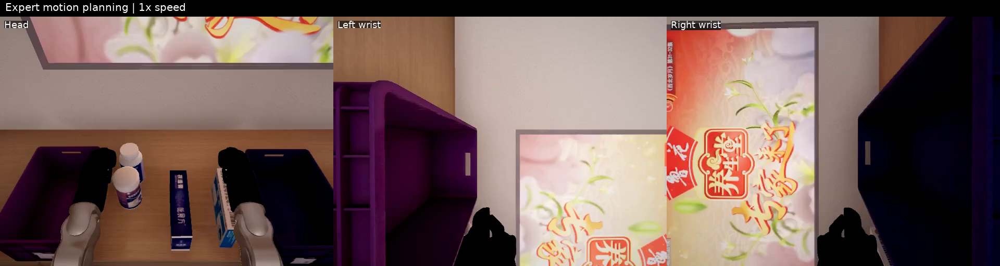

# G1 双臂药品分类：自动规划与数据采集

在 OrcaLab 26.9.1 中，左臂把两只药瓶放入左侧紫框，右臂把两只药盒放入右侧蓝框。两臂交替抓放，只要求物品进入对应框内，不要求放置后的姿态。

开发分支：[`handoff/medication-sorting`](https://github.com/JasonZhw/OrcaPlayground/tree/handoff/medication-sorting)。当前提供专家运动规划、同步数据采集和 LeRobot v2.1 导出；双臂 ACT / π0.5 训练适配与异步模型推理尚未接入。

## 演示与初始状态

本次演示使用缩小后的药盒和新版平滑运动代码，四件药品全部完成入框，原始数据检查通过。视频是专家运动规划执行结果，尚不是模型推理。

[](docs/assets/medication_sorting/preview.mp4)

[完整视频（1倍速，3分28秒）](docs/assets/medication_sorting/preview.mp4) · [原始OrcaLab布局JSON](docs/assets/medication_sorting/drag_classfication.json)

本次示范采用基准位置加轻微扰动（seed=100，XY ±5mm、朝向 ±3°），保留用户缩小后的药盒尺寸。每路相机仍是640×480；预览按原尺寸拼接为1920×512，含32像素标题栏，不裁剪、不缩放。共10,415帧/路、50Hz仿真时间，原始示范约2.47GB。同步录制执行约16分钟，预览按仿真时间恢复正常速度。

相对录制前读取的布局，两只药瓶平移约4cm，两只药盒平移约13～14cm；±5mm是相对基准位置的扰动，并非相对原布局的总位移。

该布局已成功验证；此前保存位置下的药瓶接近路径被碰撞检查拦住，不能保证任意摆放均成功。新位置先试跑，再录制。

仓库保留用户提供的完整原始布局 `drag_classfication.json`，其药品位置与视频中的基准扰动摆放不同。复现视频请使用下文的 `--layout-mode baseline --seed 100` 命令；使用布局需要对应订阅资产，文件尚未重新加载验证。

每次采集产生的 `initial_layout.json` 记录四件药品的世界坐标（米）和四元数（w,x,y,z）。它用于核对摆放，不是可直接导入OrcaLab的完整Layout；程序当前读取OrcaLab已保存布局，没有 `--layout-json` 导入参数。

## 仓库逻辑

主代码位于 [`examples/euler/medication_sorting/`](examples/euler/medication_sorting/README.md)，按实际采集流程分为五个主文件：

| 文件 | 负责的部分 | 输入 → 输出 |
|---|---|---|
| [main.py](examples/euler/medication_sorting/main.py) | 统一启动、模式选择、编号、容量与进程管理 | 启动命令 → 一条采集或试跑结果 |
| [workflow.py](examples/euler/medication_sorting/workflow.py) | 场景读取、目标计算、任务编排 | 场景位姿和几何 → 抓取位置/姿态、抓放阶段 |
| [planning.py](examples/euler/medication_sorting/planning.py) | IK关节求解与路径规划 | 夹爪目标、当前关节状态 → 避碰关节路径和限速采样 |
| [execution.py](examples/euler/medication_sorting/execution.py) | 固定底盘、驱动手臂和夹爪、检查执行状态 | 动作目标 → 仿真运动与实测状态 |
| [recording.py](examples/euler/medication_sorting/recording.py) | 同步录制、英文任务与数据协议 | 三路画面、状态和动作 → 原始示范及完整性报告 |

```text
main启动 → workflow读取场景并计算目标 → planning求解关节角与路径
                                         ↓
                               execution逐步执行
                                         ↕
                               recording逐帧同步记录
                                         ↓
                         检查入框与数据完整性 → 保存结果
```

`workflow.py` 合并原来的run、scene、task和targets逻辑。一次抓放为：接近 → 下探 → 闭合并保持 → 抬升 → 搬到框上方 → 下放 → 张开 → 撤回。每阶段重新规划，夹爪保持上一条闭合指令直到明确释放。

抓取顺序不固定绑定药品名称。每轮张开夹爪后，先按手到剩余目标的水平距离排序，检查接近和下探路径，选择第一个规划通过的目标；如果一个目标被挡住，就检查同一只手负责的另一个。左右臂仍交替执行，只有完成放置才从待办目标中移除。控制台的 `SELECT_TARGET` 和运行目录的 `selection.json` 会记录选择及排除原因。这个检查只确认抓取前路径可行，抬升、搬运和最终入框仍需通过实际执行检查。

路径采样使用五次平滑曲线，常规关节速度上限0.4rad/s、加速度上限0.8rad/s²；下放与撤回分别降到0.2rad/s、0.4rad/s²。相邻阶段从上一条关节指令继续，避免把跟踪误差直接变成指令跳变。不录制试跑最高按50Hz墙钟步进，慢渲染后不追赶补步；规划计算仍可能产生等待。碰撞路径的中间路点仍会减速到零，保留到位与抓持停顿，不是整条轨迹无停顿运行。

入框点根据框底与物品实际几何计算：药瓶底部距框底约8cm，药盒约5cm；XY落点按物体轮廓留出8mm边距。到框上方后保持夹紧并慢速下放，到位后仍夹紧停留，再在1.2秒内逐渐松爪，等待0.5秒后撤回。药瓶保留较高的释放位置，是因为侧抓手腕在更低位置会碰到框沿。

如果下放路径无法规划，但物品实际完整投影已处于框口内、底部位于框沿上方12cm以内，则允许保持手臂位置直接逐渐松爪，不强求下降到固定高度。触发记录保存在 `release_fallbacks.json`。落下后仍检查是否入框，抓持丢失等执行异常不会触发这个替代动作。

为减少药瓶搬运时瓶底擦框沿，药瓶抓稳后先竖直抬升15cm（原12cm），框上方进入点也提高3cm。药盒仍抬升12cm，释放目标高度及最终入框检查不变。新记录的 `expert_trajectory` 保存这组路径参数，便于区分旧示范；提高目标点不代表整条路径必然成功，仍经过碰撞规划和实测抓持检查。

专家通过仿真读取目标真值，不是用摄像头检测药品。当前规划器为多初值IK＋RRT-Connect，未使用CuRobo。改变已有药品的XY和朝向后会重新规划，但新资产、明显的尺寸变化、不可达或碰撞布局仍需校准和验证。

辅助工具：`preview.py` 生成预览视频；`lerobot_export.py` 导出训练格式；`batch.py` 做小批量随机试验；`collect_dataset.py` 支持预设计划、容量管理与续采。日常手动微调布局只需启动 `main.py`。

## 环境准备

需要 OrcaLab 26.9.1、Python 3.12，以及带夹爪G1的 `nursinghome / drag_classfication` 场景。机器人名称为 `unitree_g1_1`；三路相机为 `head_cam`、`camera_left`、`camera_right`。项目与订阅资产需要另外准备，不包含在本仓库中。

```bash
# 已有本机可用环境时直接激活。
conda activate orcalab_9_1
cd /path/to/OrcaPlayground

# 新环境安装本模块依赖，需官方包源能提供匹配版本。
python -m pip install -r examples/euler/medication_sorting/requirements-collection.txt

# 检查必要接口。
python -c "from orca_gym.environment.euler.orca_gym_euler_env import OrcaGymEulerEnv; from orca_gym.core.euler.orca_studio_bridge import OrcaStudioBridge; import av; print('imports OK')"
```

本机当前开发目录是 `/home/jason77/SY/OrcaPlayground-medication-sorting`。新服务器的完整建环境步骤见 [部署与手动工作流](examples/euler/medication_sorting/MANUAL_WORKFLOW.md)。数采需要OrcaLab画面渲染，建议采集程序与OrcaLab同机；只做模型训练时无需运行仿真画面。

## 启动与采集

先打开场景，将四件药品放回桌面、保存Layout、保持OrcaLab显示。同一仿真只运行一个控制程序。

**1. 检查场景。** 不驱动机器人，查看输出的 `scene_report.json`。

```bash
python -m examples.euler.medication_sorting.main --mode inspect \
  --output "$HOME/med_runs/inspect_$(date +%Y%m%d_%H%M%S)"
```

**2. 试跑动作。** 使用当前布局，不录制；`--object herbbox` 可只测试草本饮品药盒。其他对象为 `calcium`、`melatonin`、`pharyngitis`，默认 `all`。

```bash
python -u -m examples.euler.medication_sorting.main --mode run --execute \
  --layout-mode current \
  --output "$HOME/med_runs/test_$(date +%Y%m%d_%H%M%S)"
```

控制台会输出 `GRASP_TARGET`，并在运行目录写入 `grasp_targets.json`，记录每件物品实际抓取前的物体位置、夹爪抓取位置、接近点和旋转矩阵。后面的 `plans.json` 则记录各阶段关节路径。

**3. 复位并保存布局，再采集一条。** 这一条命令包含规划、执行、录制和校验，不需要另外启动录像程序。

```bash
python -u -m examples.euler.medication_sorting.main \
  --dataset-root "$HOME/datasets/g1_med_sort_v2" \
  --execute
```

成功后检查视频，复位、微调药品位置或朝向并保存Layout，再执行同一命令。程序自动创建新编号，不覆盖已有条目。验证布局增加 `--split val`，按整条布局留出验证集。

默认数据目录上限25GB、磁盘空闲预留4GB、下一条预算2.5GB。失败记录保留并占用容量，不能作为成功训练示范。主入口每次只采一条，结束后提示你调整布局。

`current` 保留当前保存的位置；试跑模式中的 `baseline` 使用脚本基准摆放。初期建议用当前布局逐条验证。需要自动扰动时在 `--mode run` 下指定 `--xy-jitter 0.005 --yaw-jitter-deg 3 --seed 100`，单位分别是米和度；随机化不保证所有摆放都可抓取。

复现README这条演示的摆放与录制参数（需要相同场景资产、药盒尺寸和框位置）：

```bash
python -u -m examples.euler.medication_sorting.main --mode run --execute --record \
  --layout-mode baseline --seed 100 --xy-jitter 0.005 --yaw-jitter-deg 3 \
  --task-index 0 --output "$HOME/med_runs/demo_$(date +%Y%m%d_%H%M%S)"
```

此命令把四件药品设置到基准扰动位置；按你手动调整的布局采集时使用上面的默认采集命令。

## 结果、视频和数据

```text
g1_med_sort_v2/raw/train/episode_0000/
├── result.json             执行成功与失败原因
├── initial_layout.json     初始物体位姿与种子
├── grasp_targets.json      实际计算的抓取目标
├── placement_targets.json  框上方、释放位置与底部净空
├── scene_report.json       场景绑定和物理参数
├── scene.xml               本次物理模型
├── plans.json              各阶段规划路径
├── trace.json              实际执行诊断
└── episode/
    ├── metadata.json       任务、状态/动作协议、相机和完整性结果
    ├── episode.npz         数值数据
    └── videos/             三路视频与逐帧索引
```

`result.json` 的 `success=true` 且 `episode/metadata.json` 的 `raw_valid=true` 才是成功候选。还需观看视频确认实际入框。失败时先看 `reason` 和最后一个阶段，不要绕过检查继续导出。

把编号换成你实际采集成功的编号：

```bash
EP="$HOME/datasets/g1_med_sort_v2/raw/train/episode_0000"
python -m examples.euler.medication_sorting.preview \
  --episode "$EP/episode" --output "$EP/preview.mp4"
```

预览需要系统ffmpeg，默认1倍速。三路640×480画面按原尺寸横向拼接，加32像素标题栏后为1920×512；不裁剪、不缩放。三路训练原片仍各自保持640×480完整构图。

| 数据 | 当前协议 |
|---|---|
| 状态 | 30维：左臂7＋左夹爪实测关节8＋右臂7＋右夹爪实测关节8 |
| 动作 | 原生16维：左臂7＋左夹爪1＋右臂7＋右夹爪1 |
| 夹爪 | 0～1的标定指令进度；0张开、1完整夹持，不是实测宽度 |
| 视频 | 头部、左腕、右腕三路，当前640×480，不裁剪、不缩放 |
| 时间 | 50Hz仿真时间，执行前状态与动作、相同索引画面对齐 |
| 文本 | 自动保存英文任务，默认轮换三种同义表达 |

录制会等待三路画面对齐，因此实际墙钟录制时间可能更长。固定底盘、指尖 `condim=6`、全局 `impratio=2` 和现有闭链接触修正在每次运行时应用，无需逐个Layout修改XML或修改虚拟环境包。

## 导出LeRobot

先按 [转换环境安装说明](examples/euler/medication_sorting/MANUAL_WORKFLOW.md#5-安装独立转换环境) 准备 `med_lerobot`。采集环境与转换环境分开，转换不需要运行OrcaLab。

```bash
conda activate med_lerobot
python -u -m examples.euler.medication_sorting.lerobot_export \
  --source-root "$HOME/datasets/g1_med_sort_v2" \
  --output "$HOME/datasets/lerobot/local/g1_med_sort_v2" \
  --repo-id local/g1_med_sort_v2 --split train
```

输出目录必须不存在；增加示范后重新导出请换新目录。转换只整理LeRobot v2.1文件、视频编码及元信息，不转换动作维度；旧18维原始记录会被拒绝。验证集单独使用 `--split val` 并指定不同输出目录。

## 自动微调布局并连续采集 15 次

在服务器使用已验证成功的 `episode_0000` 作为中心布局：

```bash
conda activate orca
cd /root/gpufree-data/OrcaPlayground
python -u -m examples.euler.medication_sorting.collect_dataset \
  --dataset-root /root/gpufree-data/datasets/g1_med_sort_v2 \
  --reference-episode /root/gpufree-data/datasets/g1_med_sort_v2/raw/train/episode_0000 \
  --episodes 15 --xy-jitter 0.003 --yaw-jitter-deg 1 \
  --max-gb 100 --execute
```

每次都从同一份成功布局的快照重新开始，四件药品各自随机移动 X/Y ±3mm、绕竖直轴旋转 ±1°，高度不变。规划器根据新位置重新计算抓放轨迹；相机仍录制原生分辨率，状态30维、动作16维，三种英文任务表述轮换。自动采集期间请保持当前场景打开，不要手动移动机器人、物体或框，也不要停止仿真。

`--episodes 15` 表示15次尝试，并不保证15条成功示范。已有数据不会覆盖，新编号接着已有记录和已保存计划分配。已识别的 IK/抓放失败会删除录像和轨迹，只保留原因、布局及元数据，然后进入下一次复位；相机、连接、数据完整性、磁盘或超时问题会停止整批，等待排查。只有 `success=true` 且 `raw_valid=true` 的记录可以进入后续转换。

程序启动时打印 `PLAN` 路径，保存固定布局、种子和15条编号。进度在数据目录的 `collection_status.json`，当前采集状态在 `live.json`，逐条日志在 `logs/episode_NNNN.log`。成功后生成完整原始数据，仍需统一转换 LeRobot。

若批次中断，修复原因后用 `--plan <启动时打印的JSON路径> --max-gb 100 --execute` 继续同一计划，不要重复运行上面的新批次命令。恢复会跳过成功记录和已确认的运动失败；没有完整结果的记录会停止并要求检查，不会覆盖重录。

## 当前验证与后续

当前在重构基础上修改了路径时间采样、阶段指令衔接、入框高度及松爪过程；原生16维动作、30维状态、摩擦参数和图像分辨率保持不变。当前已完成一条完整录制，其他布局仍需逐条验证。目前不能把结构测试通过理解为任意布局都能成功。

新版平滑下放和渐进松爪已完成一条完整录制。接下来补充不同布局的成功数据，再做双臂ACT/π0.5训练适配和异步推理。当前双臂30维状态/16维动作不能直接套用此前单臂训练配置。

原仓库使用说明保留在 [README.upstream.md](README.upstream.md)。
