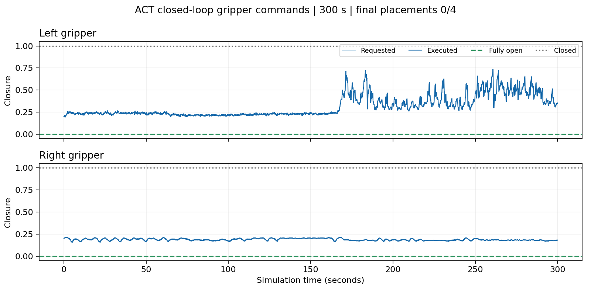

# 药品分类：ACT 基线训练和 Hugging Face 上传

这次继续使用已经验证的 20 条双臂药品示范，增加一个 ACT 基线。先看一个结构更简单的模仿学习模型能学到什么，再和 π0.5 比较。训练 loss 下降、模型能加载，都不等于四个药品已经能成功归类；最终仍要回到同条件仿真检查抓取和放置。

## 1. 这次具体训练什么

| 项目 | 本次配置 |
|---|---|
| 数据 | 20 条，219594 帧，50 Hz；三路完整 640×480 图像 |
| 输入 | 头部、左右腕相机 + 30 维机器人状态 |
| 输出 | 50 步 × 16 维绝对动作；没有动作差分或时间移位 |
| 夹爪 | closure：0 开、1 闭；不是测量宽度 |
| 图像编码器 | 官方 ImageNet 预训练 ResNet-18；其余 ACT 参数重新初始化 |
| 模型参数量 | 实测 51,606,558；可学习参数 51,606,416 |
| batch / seed | 8 / 1000 |
| 优化器 | 官方 ACT 预设 AdamW，学习率 1e-5，weight decay 1e-4；梯度裁剪 10 |
| 精度 | FP32，未开启 AMP |
| 首轮训练 | 20000 步，每 5000 步保存；实验 act20k_v1 |
| 图像处理 | 保持完整 640×480，不裁剪缩放；ImageNet 均值/标准差归一化，未启用图像增强 |
| 数值处理 | 官方 ACT 的 mean/std，来自当前数据集统计；不复用 π0.5 的分位数归一化 |
| 运行环境 | 只读复用已安装的 Python 3.11 训练环境，不修改原有依赖 |

官方 LeRobot 训练默认预算是 100000 步，本次先跑 20000 步作为基线，不把这个预算称作“保证收敛”。20k×8=160000 个采样窗口，约相当于全数据 0.73 倍的起始帧采样量；窗口彼此重叠，不能据此宣称独立样本量或泛化能力。

预测 50 步对应 1 秒动作。它和执行多少步后重新看图不是同一个参数。训练先固定预测长度，部署时再实测推理延迟、动作交接和队列余量。时间集成也不能不测速度就直接设为 50 Hz。

## 2. ACT 的 loss 怎么理解

官方实现先把专家动作按当前数据集的均值和标准差归一化，再比较模型预测的动作和专家动作，计算 L1 误差；episode 末尾补齐的动作通过 padding mask 排除贡献。训练还带一个 CVAE 潜变量，加入 KL 正则项：

`总 loss = 动作 L1 loss + 10 × KL loss`

因此日志里的总 loss 不是直接以弧度表示的关节误差，也不能与 π0.5 的 flow-matching loss 数值直接横比。我们单独记录 L1、KL、总 loss 和梯度范数。推理时潜变量使用官方默认的零值。

没有独立验证集，当前 loss 都是训练指标。第 19 条是固定布局的重新录制，也不能充当独立验证样本。

## 3. Smoke test 检查了什么

已完成 10 次真实梯度更新，loss/梯度有限，成功保存第 10 步 checkpoint。离线重新加载后，从三路真实图像和 30 维状态输出了 `[50,16]` 动作，所有数值有限，权重与归一化缓冲区有限。

这是训练与加载链路检查，没有运行机器人，不是任务成功率测试。原始输出的夹爪值可能稍微超出 0–1，部署时仍需使用经过检查的动作边界与控制接口。

## 4. 文件在哪里，怎样复现

### 本轮已经完成：20000 步与最终加载验证

云端记录显示，本轮于 2026-11-05 00:03:33 UTC（北京时间 08:03:33）完成收尾。实际完成 20000 次更新，训练计时约 72 分钟；训练、最终离线加载和整个串联流程退出码均为 0，父子进程均已退出。SSH 后来断开影响了结果读取，没有影响这份已完成的训练记录。

每 10 步记录一次该步指标。前 30 个记录点与最后 30 个记录点的平均值如下；这是训练采样点的均值，不是独立验证集成绩：

| 指标 | 前 30 个记录点 | 最后 30 个记录点 |
|---|---:|---:|
| 总 loss | 7.57118 | 0.06179 |
| 动作 L1 | 0.54776 | 0.05371 |
| KL | 0.70234 | 0.000807 |

最后一步总 loss 为 0.05550。全部已记录的 loss、分项和梯度范数均为有限值。最终模型重新加载后输出 `[50,16]`，数值全部有限；首次动作块耗时约 0.472 秒，包含首次运行开销，不能当成稳定推理延迟。后续 ACT 仿真试跑结果见第 5 节。

最终模型目录：`/root/gpufree-data/training/med20_act_20261104/act20k_v1/checkpoints/020000/pretrained_model`。其中 `model.safetensors` 为 206,636,224 字节。证据为本轮根目录的 `status.json`、`act20k_v1_metrics.jsonl`、`training.exitcode`、`final_reload.json`、`final_reload.exitcode`、`pipeline.exitcode`。收尾核实时磁盘剩余约 42.1 GB。

云端仓库：`/root/gpufree-data/OrcaPlayground`

本轮根目录：`/root/gpufree-data/training/med20_act_20261104`

数据：`/root/gpufree-data/datasets/lerobot/local/g1_med_sort_v2`

运行 Python：`/root/gpufree-data/envs/med_pi05/bin/python`。目录名保留了历史名称，但本次执行的是 PyTorch ACT，没有加载 π0.5/JAX 模型。

LeRobot 固定提交：`0cf864870cf29f4738d3ade893e6fd13fbd7cdb5`。训练入口核对提交、数据维度、通过的转换报告，并记录全部 parquet 和元数据 SHA256。环境与数据不重新安装或转换。

代码入口是 `examples/euler/medication_sorting/act/run.py`，直接调用该固定版本的官方训练器；`pipeline.py` 在 smoke 加载报告通过后串行执行正式训练和最终离线加载。没有上传或操作仿真的步骤。非有限 loss/梯度会停止本次运行，不自动盲重试。

复现新实验时使用一个**新的输出目录**，不要覆盖正在运行的实验：

```bash
cd /root/gpufree-data/OrcaPlayground
export TORCH_HOME=/root/gpufree-data/training/med20_act_20261104/torch_cache
export OMP_NUM_THREADS=4 MKL_NUM_THREADS=4 HF_HUB_OFFLINE=1
/root/gpufree-data/envs/med_pi05/bin/python -m examples.euler.medication_sorting.act.run train \
  --dataset /root/gpufree-data/datasets/lerobot/local/g1_med_sort_v2 \
  --output /root/gpufree-data/training/med20_act_reproduction/smoke10_v1 \
  --steps 10
```

先创建新的实验根目录。`train` 输出目录本身不能提前创建；官方训练器会拒绝覆盖已有目录。随后用 `run reload --checkpoint .../checkpoints/000010/pretrained_model --report .../smoke_reload.json` 检查加载，传入同样的 `--dataset` 与 `--output`。通过后再用 `pipeline --root 新实验根目录 --dataset 数据路径 --verified-smoke 新报告路径` 启动正式串联任务。

本轮状态看 `status.json`；真实计步和 loss 看 `act20k_v1_metrics.jsonl`、`training.log`。最终预计保存到 `act20k_v1/checkpoints/020000/pretrained_model`。只有训练退出 0、最终加载报告通过且 `pipeline.exitcode` 为 0，才称训练完成。初次下载、数据加载、推理预热不算梯度训练速度。

## 5. ACT 接入仿真后，实际表现怎样

### 跑通了控制，但这轮没有完成分类

2026-11-05 使用最终 `020000` 模型做了一轮 15000 步闭环测试：仿真时间 300 秒，实际耗时 302.28 秒，程序退出码为 0。四个物体的最终归位检查均未通过，结果是 **0/4**。两个框固定且保留碰撞，最终位置没有变化。没有新增示范、训练或上传。

ACT 每次看头部和左右腕相机，结合 30 维状态预测 50 步动作。控制仍按 50 Hz 执行，队列剩余 30 步时请求下一块；过时动作被丢弃，块间衔接 10 步。整轮推理耗时中位数 77.8 ms、95 分位 87.0 ms；控制间隔中位数 20.13 ms、95 分位 21.91 ms。队列最少仍有 10 步，没有耗尽。这些记录说明速度能支撑本轮运行，但不代表动作决策正确。

### 首次起步为什么停了，后来怎么处理

第一次尝试在动作 0 被保护拦下：ACT 给出的左腕目标与当前姿态相差 0.12245 弧度，超过单步 0.08 弧度限制；整块内部的最大相邻跳变只有 0.01821 弧度。

因此第二次增加了仅在起步使用的 10 步（0.2 秒）过渡。初始目标差异上限为 0.25 弧度，原始关节范围与块内连续性仍要检查，过渡后每一步和后续控制仍执行 0.08 弧度检查。真实失败预测的回归检查通过，NaN、关节越界、过大的初始差异和块内突跳仍会被拒绝。没有放开后续保护。

### 为什么看起来没有学会张开夹爪

这轮确实没有正确触发完全张开。`closure=0` 才是完全张开、`1` 是闭合；实际下发范围左手约 0.191–0.734，右手约 0.157–0.215，两侧都没有出现低于 0.05 的动作。请求值与执行值之差的 95 分位都是 0，说明平滑器没有把大量张开命令挡住。

但不能据此说模型完全不认识“张开”：从原始示范中抽查 4 个张开时刻，预测值都接近 0；另抽查的 4 个闭合时刻预测约 1.06–1.14。这只是选取的 8 个训练帧检查，不是验证集成绩。部分闭合值超过当前 1.1 容差，说明输出边界还需要处理。

数据里并不缺张开动作：219594 帧中，左手约 75.2%、右手约 57.4% 的 closure 小于 0.05。当前证据更支持“在示范画面上能输出开合，自己闭环运行后没有正确进入相应阶段”。视觉和状态偏移、动作阶段衔接需要继续定位，不能仅归因于频率，也不能保证单纯延长训练就能解决。

执行侧仍有待查项：左侧连杆关节相对目标的绝对误差 95 分位约 0.832 rad，右侧约 0.059 rad；左侧需结合物体接触继续排查。当前不能宣称整个夹爪执行链已经完全正常。



### 证据、录像与复现入口

云端实验目录为 `/root/gpufree-data/training/med20_act_20261104/simulation_20261105`。`full15000_v1` 保留首次拦截记录，`full15000_v2` 保存完整试跑。结果看 `result.json`，控制看 `control_metrics.json`、`trace.json`，夹爪看 `gripper_diagnostics.json`；原始示范抽查见 `teacher_observation_closure_check.json`。

`inference_observations.mp4` 保存 750 次推理时的三路画面，按仿真时间排列，时长约 299.66 秒。它是稀疏观测录像，不是每个控制步都有画面的 50 fps 连续录像。`final_cameras.png` 是终态画面。

实验目录的 `README.md` 记录复现命令，`serve_act.py` 提供 ACT 本地服务，`run_trial.py` 复用已有仿真控制入口。`transport_check.json` 证明同一真实数据帧通过 HTTP 服务与官方直接推理的输出差为 0；完整权重严格加载，没有重新训练。结束后已停止本次 ACT 服务，场景保持暂停，原始 GUI 布局备份为 `layout_before.json`。

## 6. 上传 HF：你需要做的事

目标已经确定：**公开数据集 `Bigluck77/g1_med_sort`**。

上传准备目录：`/root/gpufree-data/training/med20_act_20261104/hf_upload/g1_med_sort`

共 149 个文件、5,354,013,256 字节（约 5.35 GB / 4.99 GiB）。包含 `data/`、`videos/`、`meta/`、`provenance/`、验证报告和数据卡；不包含原始失败录制、服务器日志或训练权重。成功原始数据仍单独保留。除单独生成的数据卡外，准备目录用硬链接共享已验证的数据，不额外复制 5 GB，也不要手动改其中的数据文件。

本地已完成逐文件 SHA256 校验和常见凭据文本模式检查。清单保存在相邻的 `upload_manifest.json`。用户已自行执行上传，公开仓库 [Bigluck77/g1_med_sort](https://huggingface.co/datasets/Bigluck77/g1_med_sort) 已提交成功，提交为 `3d8eb0ad9a8b8c14f92f44dd86d74bafbb4e4b8b`，标签为 `v2.1`。已核实远端包含 60 个视频、20 个 parquet 及元数据等全部 149 个上传文件，另有仓库的 `.gitattributes`。`hf_upload/upload_result.json` 记录成功结果。以下命令保留作复现参考，本轮无需再次上传。

### 第一步：你自己登录

在 HF 账号中创建有目标数据集写入权限的访问令牌，然后在**云服务器终端**运行：

```bash
HF_HUB_OFFLINE=0 /root/gpufree-data/envs/med_pi05/bin/huggingface-cli login
```

在终端隐藏输入提示中粘贴令牌。不要把令牌发到聊天里，也不要放到命令参数里。这里用现有环境支持的旧版 CLI 名称；新版工具的对应命令是 `hf auth login`，本次不需要为了改命令而升级训练环境。

### 如果登录报 Connection reset by peer

本次在云端复现了登录 HTTPS 握手被重置，也观察到 DNS 超时；此时还没有收到 HF 的账号验证结果，不能据此判断 Token 错误。本机能访问官方 HF，已通过现有 SSH 连接提供临时、仅监听回环地址的 CONNECT 通道，云端端口为 18977。

在云端同一个终端先设置，然后重新执行上面的登录命令：

```bash
export HTTPS_PROXY=http://127.0.0.1:18977
export HTTP_PROXY=http://127.0.0.1:18977
export HF_ENDPOINT=https://huggingface.co
export HF_HUB_OFFLINE=0
```

未带 Token 的验证请求通过通道返回官方 HTTP 401，说明 Python requests 的 HTTPS 连接已经建立；这不代表登录已通过。通道保持客户端到 HF 的 TLS 验证，不解密或记录登录凭据。只允许 HF 及其 AWS 文件传输域名；不会将 Token 发到下载镜像。

这是当前会话的临时通道，依赖本机网络、代理进程和现有 SSH 连接。上传结束前保持本机在线；连接断开后需要重新建立通道，不能把端口号当作永久代理地址。上传脚本继承这些环境变量。此设置不会改变已经运行的 ACT 训练进程。

### 第二步：检查一次准备包

```bash
cd /root/gpufree-data/OrcaPlayground
/root/gpufree-data/envs/med_pi05/bin/python -m examples.euler.medication_sorting.act.upload_dataset \
  --folder /root/gpufree-data/training/med20_act_20261104/hf_upload/g1_med_sort
```

不加 `--execute` 只检查文件，不访问 HF 写入接口。

### 第三步：你执行公开上传

```bash
cd /root/gpufree-data/OrcaPlayground
/root/gpufree-data/envs/med_pi05/bin/python -m examples.euler.medication_sorting.act.upload_dataset \
  --folder /root/gpufree-data/training/med20_act_20261104/hf_upload/g1_med_sort \
  --execute
```

脚本核对登录账号是 Bigluck77，创建公开 dataset 仓库并上传，最后创建 LeRobot v2.1 读取用的 `v2.1` 标签，记录提交号。若已有同名文件，上传会更新它；脚本不会删除远端其他文件。若已有 `v2.1` 标签，不会悄悄移动它，而是停止让你检查。这种情况下数据提交可能已成功，不能简单判作全量上传失败。

上传在服务器直接进行，无需先下载到你的电脑；ACT 训练读取本地数据，不需要等待上传。

### 上传长期显示 0%，怎样尝试绕开 SSH 的带宽限制

本次确实观察到 Xet 上传流量持续经过代理，但多路大文件共享同一条跨境 SSH 连接，进度条没有及时显示进展。云端无代理探测已收到 HF 文件网关 `cas-bridge.xethub.hf.co` 和 AWS S3 的 HTTPS 响应；这仅验证连通，不代表已测得大文件上传速度。

本地已准备 `examples/euler/medication_sorting/act/upload_direct_storage.sh`，但本次 SSH 拥堵导致部署超时，尚未确认云端脚本完整落盘。可以直接使用下列等价命令。它设置官方支持的 `HF_HUB_DISABLE_XET=1`，使用当前客户端的普通 LFS 上传路径；认证和提交仍走官方 HF 代理连接，已列出的存储域名直连。没有关闭 TLS 验证，没有更改训练依赖。

由用户先在旧上传终端按 Ctrl+C，等旧进程退出、命令提示符回来，再执行：

```bash
export HTTPS_PROXY=http://127.0.0.1:18977 HTTP_PROXY=http://127.0.0.1:18977
export HF_ENDPOINT=https://huggingface.co HF_HUB_OFFLINE=0 HF_HUB_DISABLE_XET=1
export NO_PROXY=localhost,127.0.0.1,.amazonaws.com,cas-bridge.xethub.hf.co,cdn-lfs.hf.co,cdn-lfs-us-1.hf.co
export no_proxy="$NO_PROXY"
cd /root/gpufree-data/OrcaPlayground
/root/gpufree-data/envs/med_pi05/bin/python -u -m examples.euler.medication_sorting.act.upload_dataset \
  --folder /root/gpufree-data/training/med20_act_20261104/hf_upload/g1_med_sort --execute
```

这会再次检查原始清单并上传，不会重新采集或转换。切换传输方式后，不能保证旧方式尚未完成的分块全部复用；也不能保证云端直连存储一定更快。若出现连接错误，应保留错误信息排查，不要同时启动多个上传进程。代理仍承担认证请求，本机和 SSH 通道仍需在线。

配置依据：[HF 官方环境变量说明](https://huggingface.co/docs/huggingface_hub/package_reference/environment_variables#hfhubdisablexet)。本机已检查安装版本的 `is_xet_available()` 确实遵循该开关。

## 7. 官方依据

- [LeRobot ACT 文档](https://huggingface.co/docs/lerobot/act)：结构、训练流程和输入输出。
- [本次固定版本 ACT 配置](https://github.com/huggingface/lerobot/blob/0cf864870cf29f4738d3ade893e6fd13fbd7cdb5/lerobot/common/policies/act/configuration_act.py)：优化器、chunk、CVAE 和时间集成参数。
- [本次固定版本 ACT 实现](https://github.com/huggingface/lerobot/blob/0cf864870cf29f4738d3ade893e6fd13fbd7cdb5/lerobot/common/policies/act/modeling_act.py)：L1/KL loss、padding mask、动作反归一化。
- [HF 官方上传说明](https://huggingface.co/docs/huggingface_hub/guides/upload)：账号认证、dataset 仓库和文件夹上传。

当前实验与后续仿真结果必须分别记录：训练完成只能说明得到了 checkpoint；成功抓住并分类四个物体，才是任务层面的结果。


## 8. 2026-11-05 ACT 续训：20,000 → 40,000 更新

用户要求“继续 训练act”。本轮从原 `act20k_v1/checkpoints/020000` 恢复，新增20,000次更新；不从头初始化、不改变数据或控制器。独立运行目录：`/root/gpufree-data/training/med20_act_continue_20261105`。

- 入口：`examples/euler/medication_sorting/act/continue_train.py`；仍调用固定版本 LeRobot 官方训练。完整恢复权重、归一化缓冲区、AdamW、随机数状态和20,000计步；数据加载器重新建立，因此不声称与不中断40,000步逐位等价。
- 保留原batch8、chunk50、三路640×480、FP32、学习率1e-5、weight decay1e-4、grad clip10、KL权重10；原20条示范不变。
- 连续训练至40,000，仅30,000和40,000保存完整checkpoint，分别在新目录 `act40k_v1/checkpoints/030000`、`040000`。每份约620MB，总新增约1.24GB；保留所有原checkpoint。
- 开始时剩余约3.19GiB；要求预留全部两次保存加1.5GiB。运行时低于1.5GiB停止，保存前再次核对单份checkpoint加预留空间。失败保留日志，不自动重试，不删数据腾空间。
- 训练前评测原20k，训练结束后分别离线加载30k、40k。使用之前π0.5评测的45个固定训练观测索引，但ACT采用确定性推理（不重复噪声种子）。每个观测独立reset后输出50×16动作，保存原始预测与标签，分别比较手臂/夹爪首步及50步MAE；按目标动作分组记录左/右手打开、闭合、正在打开、正在闭合误差。
- 这是训练观测上的离线检查，没有独立验证集；不能由loss、MAE或加载成功推断闭环抓取成功。本轮不自动启动仿真或上传。
- `resume_verified.json`检查优化器计数；`policy_restore_verified.json`逐tensor验证原权重与归一化恢复；`first_update.json`只有完成20,001更新后产生；`metrics.jsonl`每10步记录该步指标，不是10步均值。
- 完成条件：实际新增20,000更新、两份checkpoint步数正确、三个离线评测各45个有限预测、源checkpoint哈希不变、训练及pipeline退出码0、status complete。`process.json`和各阶段process/exitcode/log文件供监测。

实现验证：新增3项回归测试通过，作用域ruff检查通过，云端真实训练配置预检查通过，源优化器153组计数均为20,000。全量pytest被既有 `examples/embodied/g1/utils/test_xbox.py` 在收集时 `SystemExit` 阻断，未声称全库测试通过。监督进程初始PID666784；是否进入实际更新以新运行目录的first_update和metrics为准。


续训启动核实：`first_update.json`已记录20,001次实际更新（新增1次），loss=0.0728063、L1=0.0649760、KL=0.0007830，所有数值有限。权重和归一化246个tensor完全匹配源checkpoint；AdamW153组计数均由20,000恢复。原20k的45个固定观测评测通过，首步/50步手臂MAE=0.0290992/0.0264527，夹爪MAE=0.0470795/0.0465608。左右正在张开阶段各4个观测，首步MAE分别0.2691/0.2765，明显高于稳定张开阶段0.01439/0.00934；这是同一批训练观测的基线，不是成功率。ACT监测已恢复，旧π0.5监测保持暂停。


## 9. ACT 40,000 步续训完成（2026-11-05）

实际新增20,000次更新，总计40,000。训练用时 **71分49.7秒**；连同基线评测、两份模型加载检查和源文件哈希核验，流程共 **73分11.6秒**。训练、三次离线评测及pipeline退出码均0，status complete；监督和全部阶段进程已退出。30k/40k完整checkpoint的训练计数分别为30,000/40,000。原20k完整checkpoint逐文件SHA256未变，收尾时再次独立核验通过。

同一批45个训练观测，每个输出50×16动作，三个版本均有限；以下为未裁剪、物理动作空间MAE（手臂为弧度，夹爪为0开1闭的closure标量），越低越好。不是独立验证集，也不是闭环成功率。

| 总更新数 | 手臂首步MAE | 手臂50步MAE | 夹爪首步MAE | 夹爪50步MAE |
|---|---:|---:|---:|---:|
| 20000 | 0.029099 | 0.026453 | 0.047080 | 0.046561 |
| 30000 | 0.019371 | 0.019012 | 0.040134 | 0.038638 |
| 40000 | 0.017517 | 0.017313 | 0.034815 | 0.033986 |

40k相对20k，手臂首步/50步误差下降39.80%/34.55%，夹爪首步/50步下降26.05%/27.01%。

| 阶段（每手样本数） | 20k首步夹爪MAE | 30k | 40k |
|---|---:|---:|---:|
| left_opening（4） | 0.269115 | 0.264835 | 0.197213 |
| right_opening（4） | 0.276543 | 0.272046 | 0.235843 |
| left_closing（2） | 0.117841 | 0.085356 | 0.084352 |
| right_closing（2） | 0.050560 | 0.034601 | 0.117223 |
| left_open（32） | 0.014394 | 0.004210 | 0.003996 |
| right_open（21） | 0.009343 | 0.011849 | 0.004101 |
| left_closed（6） | 0.059438 | 0.047450 | 0.052059 |
| right_closed（6） | 0.097096 | 0.075638 | 0.068570 |

释放过渡有改善，但仍是明显薄弱项：左右正在张开阶段各仅4个观测，40k首步MAE仍0.1972/0.2358。右手开始闭合只有2个观测，首步MAE从0.05056升至0.11722，不能称全面改善；右手闭合50步MAE则从0.06162降至0.05931。左手张开50步MAE在30k→40k略升（0.22434→0.22610），也需保留两份模型作后续对比。

训练指标取20,010–21,000和39,010–40,000两个区间中每10步记录一次的100个单步样本，再求均值（不是全部1000步平均）：总loss 0.060985→0.043756，L1 0.054036→0.041921，KL 0.00069494→0.00018350，grad norm 6.4608→3.8373。总loss=L1+10KL。全部记录有限。

最终策略：`/root/gpufree-data/training/med20_act_continue_20261105/act40k_v1/checkpoints/040000/pretrained_model`。30k同级路径为`030000/pretrained_model`。两者均保留完整training_state，原20k不变。完整对比保存在新运行目录`completion_review.json`，逐样本预测在`eval_20000`、`eval_30000`、`eval_40000`。

本轮未运行仿真；不能据此断言已经学会完整抓取/释放。下一项有意义的验证是相同初始场景下20k/30k/40k的闭环对比，重点记录夹爪何时闭合、何时释放。ACT训练监测收尾后暂停，π0.5和旧15监测继续暂停。


## 10. 第一瓶短任务诊断：40k + 单片段2k（2026-11-05）

用户授权继续排查后，先验证episode0前2500帧（50秒）的原始action物理回放：第一瓶成功落框，机器人状态与示范最大差异0。随后从40k完整恢复，在独立目录 `/root/gpufree-data/training/act_short_grasp_20261105` 对该片段增加2,000次更新。只采样0–2450观测，每个50步标签均限定在0–2499帧；全局归一化、原数据、依赖、控制增益均不变。

实际40001–42000更新，训练耗时437.75秒；训练、两次离线评测和流程退出码均0。原40k完整checkpoint逐文件SHA256再次核对未变。诊断模型保存在 `short_fit_v1/checkpoints/042000/pretrained_model`，不是完整四物体模型的替代版本。

相同65个训练观测的手臂首步MAE从0.016207降到0.009403rad，双夹爪首步MAE从0.022758降到0.016481。左手正在闭合首步MAE（6观测）从0.103835降到0.044301；正在张开50步MAE（4观测）从0.246679降到0.137221。没有独立验证集。

同原始初始场景、同控制器的同步闭环测试每20步重规划，等待推理时冻结仿真时间，保留既有启动过渡、chunk混合和限速。两次均完整运行2500步且退出码0：

| 测试 | 第一瓶落框 | 左closure现象 | 药瓶最高上升量 |
|---|---|---|---:|
| 原40k | 否 | 最高约0.21，未充分闭合 | 4.55mm |
| 单片段增训2k | 否 | 能到1，但长时间约0.6–0.8，闭合延迟 | 4.17mm |

另用原始动作先运行750帧到准确的抓取前状态（完整qpos误差0），交给单片段模型再执行1500步；正常结束但仍未抓取，药瓶最高上升3.54mm。初始路径偏离不能单独解释失败。所有相机恢复无错误，GUI恢复qpos误差0，临时模型服务和训练/评测/仿真进程均退出。

当前证据说明短片段拟合改善了输出，但没有解决抓取阶段衔接；不能归因于示范提前张开夹爪，也不能把离线改善当作任务成功。下一项应核对原始50步动作块与实际前20步执行，检查重规划和混合是否反复覆盖闭合/抬起过渡，再决定阶段采样；本次未继续增训、修改执行参数或重采。

详细证据：该运行目录的 `report.md`、`diagnostic_summary.json`、`handoff_summary.json`、`closure_comparison.png` 和三个闭环子目录中的 `trace.json/result.json/inference_observations.mp4`。视频是每20步一次的推理观测，按仿真时间标记，非50fps连续录屏。训练首/末50条每10步单步采样均值：总loss0.034187→0.027166，L1 0.032474→0.025577，KL0.00017129→0.00015894；全201条日志数值有限。


## 11. ACT checkpoint 已上传 Hugging Face（2026-11-05）

用户明确授权上传，并选择私有仓库：[Bigluck77/g1_med_sort_act](https://huggingface.co/Bigluck77/g1_med_sort_act)。

包含5k、10k、15k、20k、30k、40k共六份全数据checkpoint，路径为`checkpoints/<六位步数>/`；42k单片段诊断模型单独放在`diagnostics/episode0_first2500/042000/`。每份保留完整`pretrained_model`和`training_state`，共52个上传文件、4,336,888,103字节（另有HF自动管理的.gitattributes）。Smoke测试模型未上传，数据集仓库未修改。

提交：`2a30313862de40dd2724061a7b0cc5a27ae67d67`。全部上传文件大小与SHA256核对通过：大文件对比HF提交中的LFS SHA256，小文件重新下载计算SHA256；再次验证原始checkpoint哈希不变。第一次传输中断后降低并发续传，最终退出码0，上传进程已退出。凭据沿用服务器已有登录，未复制或保存到上传包。

上传工作目录：`/root/gpufree-data/training/act_hf_export_20261105`；保留`upload_manifest.json`、`verification.json`、`final_verification.json`及首次失败记录。模型卡说明归一化、动作语义、固定LeRobot版本、训练范围和已知闭环抓取失败，不将42k诊断版本标成通用升级。下载需使用有访问权限的HF账号登录。
