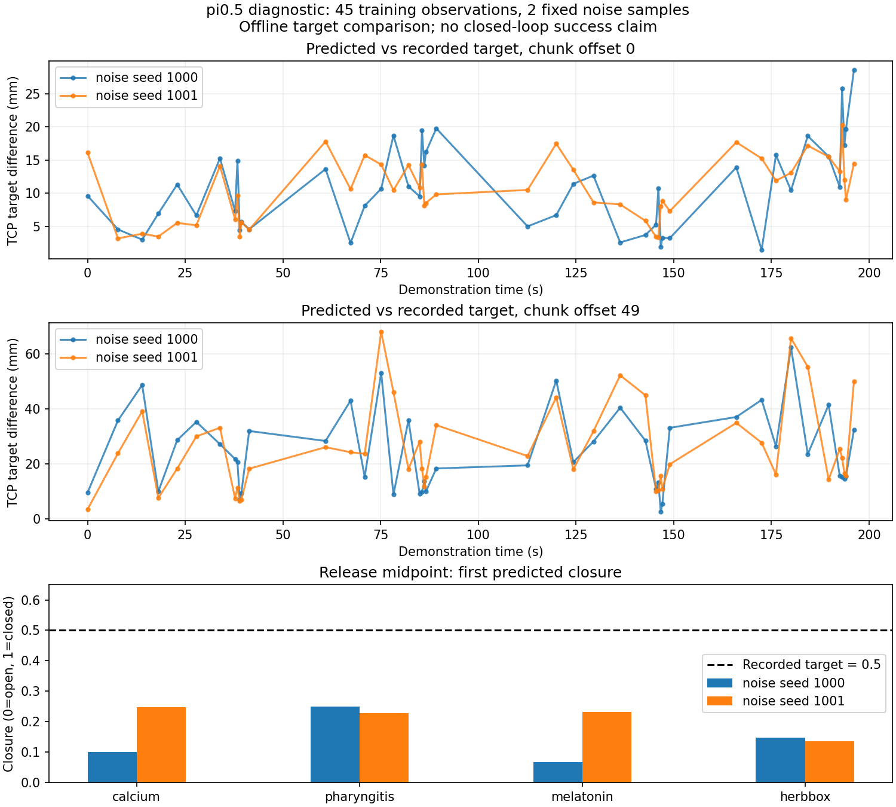
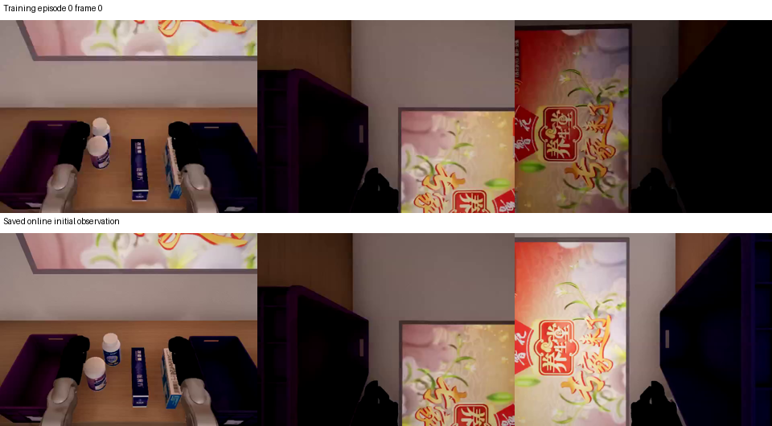
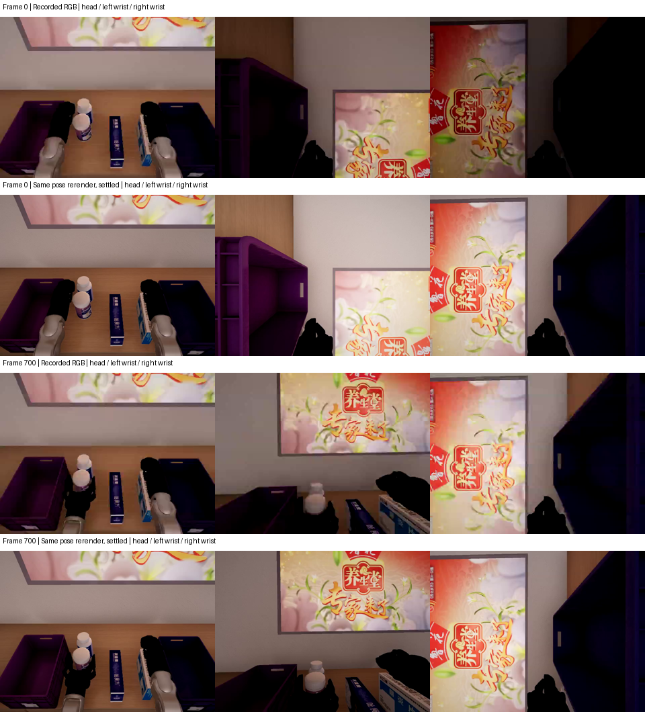
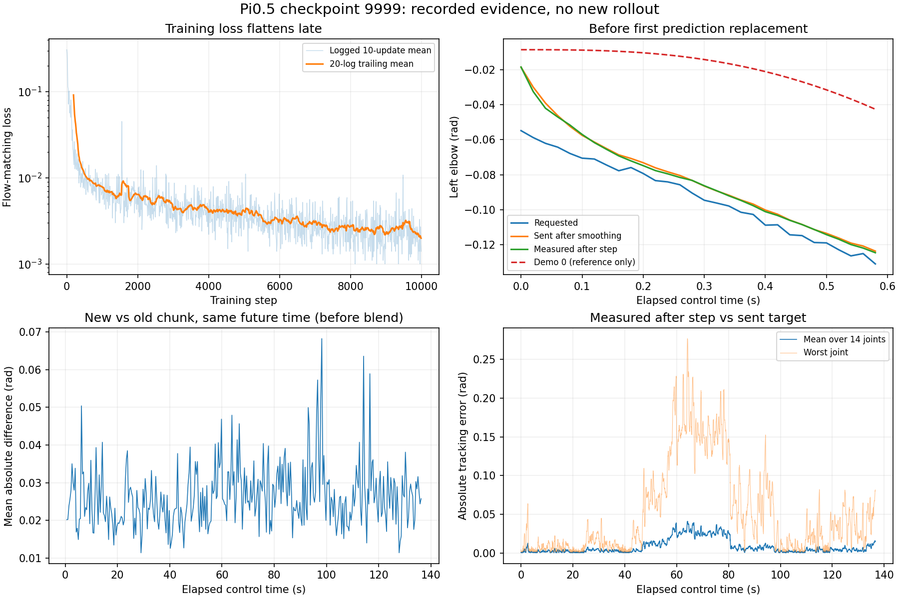

# 用记录的 action 检查控制器

## 数据里到底有什么

每帧包含 30 维 observation.state 和 16 维 action。state 是两臂各 7 个关节及两套夹爪各 8 个关节的实测角度。action 是两臂各 7 个目标角度及每只夹爪 1 个 closure（0 开，1 闭）。action 不是力矩；控制器将目标角度转为控制输出，位置伺服再产生力矩。

第 0 条示范第 4213 帧的 Parquet 数据：左肘 state 为 -0.4335010648 rad，action 为 -0.4335007370 rad，左右 closure 分别为 0 和 1。两条曲线很接近，因此 HF 预览里的蓝色 state 会遮住橙色 action。该条示范左肘目标与同帧实测值的最大差仍有约 0.0116434 rad，两列并非复制。

## 这次测试与 state play 的区别

action_replay 读取原始 scene.xml 和 initial_layout.json，只在开始恢复一次原始场景。先通过原控制器重放采集前的静置、对齐指令，恢复录制起点及运动状态，再以 50 Hz 发送原始 action，内部每 2 ms 积分一次物理。

进入回放后不再写入参考关节状态或药品位置，也不根据示范轨迹修正误差。默认 direct 模式没有模型预测、动作平滑、额外限速或强制吸附；下文 inference 模式会加入推理端的动作处理。机器人关节和药品的位置由控制器及物理引擎算出。参考 state 只用于比较。

复用现有 SortingEnv.step 的位置反馈倍率 12、偏置补偿和原夹爪映射，未修改执行器增益、阻尼或力矩限制。测量子类仅观察每次公共 do_simulation 调用后的实际执行器力矩和限幅状态。

## 怎么播放并观察

先停止其他回放和推理控制脚本，打开同结构药品场景。无需启动模型服务。

```bash
cd /root/gpufree-data/OrcaPlayground
EP=/root/gpufree-data/datasets/g1_med_sort_v2/raw/train/episode_0000
OUT="/root/gpufree-data/training/action_replay_$(date +%Y%m%d_%H%M%S)_$$"

/opt/conda/envs/orca/bin/python -m examples.euler.medication_sorting.action_replay \
  --episode "$EP" \
  --output "$OUT" \
  --render
```

--render 把新计算出的仿真位置显示到 OrcaLab，按原速播放；不加此参数则只进行本地物理计算，不改变 GUI 场景，可更快完成数值测试。增加 --frames 250 可先运行 5 秒短测。结果目录不能复用。

## 看哪些指标

- 每个手臂关节的控制步末实际角度与该步目标角度的 RMSE、绝对误差 P95、最大误差。
- 新仿真的步前 state 与采集时同帧 state 的差，反映执行是否复现。
- 每 2 ms 测得的执行器力矩峰值、控制输入触及范围边界的比例。输入限幅不等同于力矩限幅。
- 新仿真结束后四件药品是否满足原放置判定。
- 夹爪是有闭环连杆约束和接触的机构，不能把各连杆对独立伺服目标的误差直接解释成控制失效。

tracking.npz 保存每步 action、执行前后 state、参考 state、执行器力矩及控制输入；result.json 保存汇总和源文件指纹。没有独立验证集，一条示范复现成功不证明模型泛化，也不代表真机控制性能。

## 2026-11-05 基线结果

第 0 条成功示范完整重放 10659 个 action，代表 213.18 秒物理过程。未连接渲染的数值测试耗时 104.56 秒，进程退出码 0。四件药品全部通过原 placement 判定。新仿真步前的 30 维关节状态与原始记录逐帧一致，最大差及 RMSE 均为 0；这是同模型同初始条件下的确定性复现结果，不是测量精度无限高的结论。

双臂 14 个关节的控制步末目标跟踪指标：各关节 RMSE 约 0.000324～0.003007 rad（0.019～0.172 度），最坏单点误差 0.012502 rad（约 0.716 度，右肩 pitch）。双臂控制输入触限比例均为 0；最大测得执行器力矩约 9.342 N·m（右肩 pitch）。这些数值是本仿真模型的结果，不代表真机额定力矩或安全限值。

本次没有调整力矩、增益或阻尼。证据表明原始目标动作能够通过当前采集执行器完成这一条任务。接下来更适合比较模型预测目标、初始观测以及推理动作平滑等处理；不能把这一条基线扩大为所有轨迹、初始条件或真机均无控制问题。

完整报告：云端 `/root/gpufree-data/training/control_audit_20261105/baseline_v2/result.json`，逐步数组为同目录 `tracking.npz`。

## 第二步：正确动作经过推理端处理，还能成功吗

这次把模型暂时替换成“按时间索引取出的示范动作”，保留 π0.5 推理端实际使用的 ActionQueue 和 ActionConditioner，再交给同一个控制器执行。这样可以单独检查：正确动作是否会被队列衔接、平滑或夹爪限速处理坏。

初始场景、示范和控制参数与 direct 基线一致。每次提供 50 帧动作，剩余 30 帧时请求下一段；模拟固定 11 帧（220 ms）返回延迟，丢弃过期动作，用 10 帧重叠融合。手臂平滑时间常数为 0.06 秒，夹爪闭合速度为 0.625/秒、张开速度为 1.6/秒，控制周期仍为 20 ms。11 帧是参考近期真实推理记录选择的固定值，不是对全部网络延迟的模拟。

| 对照项 | 直接执行示范 action | 经过推理端动作处理 |
| --- | --- | --- |
| 完整动作数 | 10659 | 10659 |
| 仿真时长 | 213.18 秒 | 213.18 秒 |
| 四件药品放置判定 | 4/4 通过 | 4/4 通过 |
| 手臂最大步末目标跟踪误差 | 0.012502 rad（0.716°） | 0.012430 rad（0.712°） |
| 双臂控制输入触限比例 | 0 | 0 |
| 无渲染实际运行耗时 | 104.56 秒 | 105.16 秒 |

队列融合后的目标与同帧原始 action 最大差约 4.44e-16，仅为浮点舍入量级。平滑后，手臂目标相对原始 action 最大偏差约 0.020204 rad（1.158°）；夹爪 closure 最大偏差约 0.171，主要表现为张开瞬间被延缓。这些改变没有阻止本条示范完成任务。表中的“目标跟踪误差”比较的是实际关节角度和最终下发目标，不是和未经平滑的原始目标比较。

### 如何复现这个对照

```bash
cd /root/gpufree-data/OrcaPlayground
EP=/root/gpufree-data/datasets/g1_med_sort_v2/raw/train/episode_0000
OUT="/root/gpufree-data/training/action_pipeline_$(date +%Y%m%d_%H%M%S)_$$"
/opt/conda/envs/orca/bin/python -m examples.euler.medication_sorting.action_replay \
  --episode "$EP" --output "$OUT" \
  --processing inference --latency-steps 11
```

需要在 OrcaLab 观察时增加 `--render`。输出包含原始 action、队列输出 requested_action、最终下发 executed_action 和实测 state，可以逐层比较。实验报告保存在云端 `/root/gpufree-data/training/control_audit_20261105/inference_processing_v1/result.json`。

### 现在能判断什么，还不能判断什么

目前没有证据支持先调整力矩、增益或阻尼：相同初始条件下，正确目标经过当前控制器以及这套 π0.5 动作处理，可以完成本条四物体任务。下一步应该沿着“输入观测 → 模型预测 → 最终下发 → 实际动作”寻找最早出现偏差的位置。

这仍然不是模型闭环测试：没有相机输入、模型预测、真实网络或变化的返回延迟；示范动作提前已知，不会根据当前画面重新决策。它也没有覆盖不同初始布局、固定箱体设置或全部 20 条示范。因此不能据此断言只有训练有问题，也不能直接代替 ACT 推理链路的验证。

另一个已经核实的线索：真实 π0.5 运行 `simulation_manual_20261105_164208_4002889` 在已执行 6831 步后，因 `Gripper extrapolation exceeds 0.1 tolerance` 停止。该运行的 `prediction_9820.npy` 中夹爪最小预测值为 -0.115026，越过了现有保护范围。这解释了那次停止，但尚不能解释此前全部抓取失败；本次没有放宽保护或修改模型输出。

## 第三步：直接给模型正确观测，检查它预测得准不准

### 怎么测

2026-11-05，使用正式 π0.5 checkpoint 9999，对第 0 条成功示范做离线预测。每次都输入这条示范原本的三路图像和实测 state，不让前一次模型误差影响下一次输入。取四件药品接近、下降、闭合、抬起、搬运、降低、释放、撤回各阶段中点，并增加释放起点、终点、终点后 20 帧及初始帧，共 45 个时刻；每个时刻用种子 1000、1001 生成两组固定噪声，共 90 次预测。

这不是独立验证集，也没有运行物理或操作机器人。它回答的是：“给模型训练中见过的正确观测，它给出的目标动作和示范有多大差别？”

检查确认：本条 Parquet 的 state/action 与原始记录转成 float32 后逐元素一致；45 个输入的 state 和未来 50 帧 action 的索引均一致；三路相机映射沿用采集顺序；checkpoint 的归一化文件与训练 assets 字节一致。官方 reader、训练适配和正式模型加载流程均复用现有实现。

### 预测本身已经有偏差

| 指标 | 本次样本结果 |
| --- | --- |
| 第一帧动作的 14 个手臂关节平均绝对误差 | 0.013513 rad，约 0.774° |
| 第一帧动作最坏单关节误差 | 0.132597 rad，约 7.60° |
| 整段 50 帧手臂动作平均绝对误差 | 0.018422 rad，约 1.055° |
| 第一帧目标的末端位置差 | 平均 10.59 mm，P95 19.58 mm，最大 28.54 mm |
| 第 50 帧目标的末端位置差 | 平均 25.10 mm，P95 52.71 mm，最大 67.97 mm |
| 90 次预测触发夹爪 ±0.1 越界保护的次数 | 0 |

末端位置差的计算方式是：其他关节保持该观测时刻的状态，分别代入预测手臂目标和示范手臂目标，做正向运动学后比较 `ee_center_site`。每个物体取负责它的手臂，初始帧取右臂。这是两组**目标姿态**的差异，不是执行后的抓取误差或成功率。第 50 帧误差也不意味着在线系统一定会执行到该帧，因为途中会重新预测。

作为参考，“未来 50 帧都保持当前实测手臂角度”的简单基线，平均绝对误差为 0.016426 rad，第一帧为 0.001213 rad。这条示范运动慢、释放阶段会停顿，所以这个基线天然有利；它不能完成任务，但提醒我们：当前样本中的预测误差并不小，低训练 loss 不能直接等同于动作精度足够。



### 夹爪并非完全不会打开，但释放时机有偏差

四个释放中点的示范 closure 都是 0.5，模型第一帧预测如下。数值越小，代表越张开。

| 物体 | 种子 1000 | 种子 1001 | 示范目标 |
| --- | --- | --- | --- |
| calcium | 0.101 | 0.248 | 0.5 |
| pharyngitis | 0.250 | 0.228 | 0.5 |
| melatonin | 0.067 | 0.233 | 0.5 |
| herbbox | 0.147 | 0.137 | 0.5 |

释放终点则能预测接近 0 的全开动作。因此这里看到的是释放中段偏早张开，而不是 π0.5 无法表达“打开”。这项结论仅针对本次 π0.5 样本，不能替代 ACT 夹爪问题的单独检查。

### 视觉输入还有一条未排除的线索

下图上排是训练第 0 条的初始帧，下排是历史在线运行保存的初始观测，列顺序为头部、左腕、右腕。右腕构图明显不同。检查全部 20 条训练示范的初始帧后，训练侧右腕构图基本一致。



第 0 条原始 FFV1 与导出 MP4 的首帧 RGB 平均绝对差约为 1.14～1.48/255；目视未见左右相机互换或大幅视角改变。当前只读查询得到的分辨率、视场角、裁剪距离、gamma 与采集记录一致，但这些是**当前**参数，不能代替历史运行时的相机外参。历史两次初始机器人关节角最大差约 0.008929 rad，也并非完全相同姿态。

因此，已确认“保存的画面不同”，还没有确认是相机位置/朝向、渲染设置或场景状态导致。不能把这张对照图直接作为相机标定错误的定论。后续应固定相同完整 qpos、场景和相机设置，比较重新渲染帧与录制帧，再决定是否需要修复视觉输入。

### 历史在线记录说明了什么

在那次 6831 步运行中，队列最少仍有 16 帧，返回延迟为 10～14 个控制周期，三路相机时间戳在每次记录内一致。右夹爪最终下发 closure 最大仅 0.220，左夹爪最大 0.870。在线手臂步末目标跟踪误差最大约 0.277 rad，出现在第 3208 帧；这种模型生成轨迹上的较大偏差，可能涉及接触或姿态条件，当前日志不足以确认原因。不能用成功示范的跟踪结果替代它，也不能据此直接加大增益。

这一阶段的结论是：控制器能执行正确示范；模型在正确观测下的目标预测已有可测误差；在线视觉一致性还有待同姿态验证。同姿态验证现已完成，结果见下一节；暂未调整增益、改变动作保护或重新训练。

### 证据和复现

云端诊断目录：`/root/gpufree-data/training/control_audit_20261105/policy_observation_v1`，包含 `rows.json`、`predictions.npz`、`summary.json`、`kinematic_errors.json`、图像对照和相机参数。旁边 `online_trace_audit.json` 是历史在线执行汇总。

离线预测脚本：`/root/gpufree-data/training/control_audit_20261105/offline_probe.py`。使用已有隔离模型环境运行；不修改依赖、不启动模型服务、不控制仿真。选择新输出目录：

```bash
OUT="/root/gpufree-data/training/control_audit_20261105/policy_observation_$(date +%Y%m%d_%H%M%S)_$$"
/root/gpufree-data/envs/med_pi05/bin/python \
  /root/gpufree-data/training/control_audit_20261105/offline_probe.py "$OUT"
```

该命令重现输入核对、90 次预测及基础误差统计。末端运动学和历史在线执行汇总是随后对这些预测、原始 trace 和在线 trace 的独立分析；不属于训练 loss。

## 第四步：完全相同姿态下，训练图像与重新渲染图像是否一致

### 固定所有位置，再看相机

对第 0 条示范的第 0、700、1888、3546、9624 帧，恢复录制时完整场景 qpos，包括机器人、药品和箱子。只发送显示状态，不执行物理步进、不运行策略。每个姿态重复请求 26 次独立 IDR 图像，保留第 0、5、25 次，检查画面稳定后的结果。

15 组保留的完整场景状态，经服务器回读，与请求值的最大差均为 0；每组的三路相机时间戳一致。当前模型中与录制模型不同的 body 初始位姿仅涉及 4 件带自由关节的药品，已由录制的完整 qpos 覆盖。静态物体与机器人没有发现对应的 body 位姿差异。测试完成后原显示姿态恢复误差为 0，相机推流设置恢复无报错，场景保持暂停。

### 结果：没有发现明显视角错位，初始差异主要是明暗

对每个时刻的第 25 次重渲染与原视频比较，在 ±8 像素平移搜索中，15 个图像对的梯度相关最佳偏移全部为 `(0, 0)`。未做翻转或图像几何变换。梯度方向余弦相似度约为 0.864～0.982；结合边缘和物体位置目视对照，没有发现左右相机互换、图像翻转或明显的相机视角错位。这是有限样本的图像对齐证据，不等同于重新测量过完整相机外参。

初始帧左右腕的 RGB 平均绝对差约为 53.82、58.28/255，而后面四个时刻稳定后的三路图像平均绝对差仅约 2.08～4.77/255。差异最大的初始腕部画面，边缘位置仍基本对应，主要变化在亮度和阴影。



原始视频开头也记录了这个变化：右腕图像平均亮度从第 0 帧的 40.49，上升到第 10 帧的 71.81、第 25 帧的 90.33、第 50 帧的 97.23、第 100 帧的 98.27。同姿态重渲染约为 98.2。另一个例子是跳到第 700 帧后，固定姿态不动，左腕 RGB 平均绝对差从第一次的 46.64 降到第 25 次的 4.77。

这些结果符合曝光或渲染历史随时间调整的表现。当前接口没有提供实际曝光历史状态，因此不能进一步断言具体是哪一个引擎参数造成的。也不能简单把它说成摄像头朝向变了。上一节只凭初始截图怀疑“构图差异”，现在应按本节更强的同姿态证据理解。

### 这种明暗差异，对模型动作有多大影响

进一步使用同一个正式 π0.5 checkpoint，在上述 5 个时刻各用两组固定噪声，对比两种输入：原训练图像，以及第 25 次稳定重渲染图像。每一对仅替换 RGB，state、任务文本、随机噪声完全相同，共 10 对、20 次预测，不执行动作。

第一步 14 个手臂关节预测的平均变化约为 **0.00083 rad（0.047°）**，最坏单关节变化约为 **0.00282 rad（0.162°）**。相同样本下，模型相对示范的第一步手臂平均绝对误差仍约为 **0.0124 rad（0.71°）**，换图后没有消除这个误差。初始帧整段 50 步预测仍会受到一定影响，平均动作变化约 0.00442～0.00547 rad，因此不能说图像差异毫无影响，也没有测量它在长闭环中的累计影响。

这轮结论是：**相机明显错位没有得到证据支持；在抽查的同姿态样本中，图像差异对第一步输出的影响明显小于模型原有预测误差。** 排查优先级可以转向模型动作预测、随机采样波动及闭环偏离后的误差积累，而不是先重调相机位置、控制增益或力矩参数。本轮未修改训练数据、模型权重或生产推理逻辑。

### 本轮证据与复现脚本

云端 `/root/gpufree-data/training/control_audit_20261105/matched_camera_v1` 保存完整状态、逐次 RGB、原始视频参考帧、相机属性、恢复结果、图像对齐统计和开头亮度统计；`matched_camera_policy_v1` 保存仅替换图像的成对预测结果。

同目录上一层的 `matched_camera_probe.py` 可在新的输出目录重现 5 个固定姿态的渲染检查。运行前应停止其他仿真控制脚本并打开同结构场景；脚本持有共享控制锁，结束时恢复显示姿态和推流设置。分析脚本 `analyze_matched_camera.py` 和 `camera_policy_effect.py` 的输入实验路径固定为本轮目录，复用到新实验时要先修改对应路径，不能把不同轮次结果混在一起。

```bash
OUT="/root/gpufree-data/training/control_audit_20261105/matched_camera_$(date +%Y%m%d_%H%M%S)_$$"
/opt/conda/envs/orca/bin/python \
  /root/gpufree-data/training/control_audit_20261105/matched_camera_probe.py "$OUT"
```

## 第五步：偏差从哪里开始，还要不要继续训练

### 第一段动作里，模型目标已经和示范不同

继续分析历史闭环 `simulation_manual_20261105_164208_4002889` 的 6831 条执行记录、341 段已接收预测，以及正式训练日志。本轮没有重新启动训练，也没有执行新的仿真动作。

第一段预测在第 0 步到达，下一段在第 30 步才替换。所以先看前 30 步（0.6 秒），可以避开新旧预测段切换的影响。在这段内，14 个手臂关节的“步末实测角度减去平滑后下发目标”平均绝对误差为 **0.000655 rad（0.038°）**，最大为 **0.004233 rad（0.243°）**。机械臂基本跟上了实际下发的目标。

但第一帧模型给出的左肘目标是 **−0.05482 rad**，20 条成功示范第一帧的左肘目标范围是 **−0.00863～−0.00496 rad**。在线起始左肘实测值为 −0.00544 rad。也就是说，还没到第一次预测段切换，模型就给出了与示范开头不同的动作目标，控制器随后基本按这个目标移动。

这里不能直接把“与示范同一时刻不同”全部判成错误：在线初始观测、物体布局和示范不完全相同，策略也未必必须以完全相同速度运动。这个比较用于定位最早出现差异的环节。结合第三步在**真实示范观测**上仍测得的预测误差，它支持优先检查模型输出；还不足以单独证明整次失败只有一个原因。



图中左肘的绿色实测曲线与橙色下发曲线基本贴合，蓝色是平滑前模型请求；红色示范只用于参照。右下图也保留了后段较大的跟踪误差，不能把“开头跟得好”推广到整条失败轨迹。

### 重新预测时，新旧目标并不一致

把相邻预测段按它们指向的**同一个未来控制时刻**对齐，比较新段到达后仍有重叠的部分，共得到 340 组。每组先对重叠帧与 14 个手臂关节取平均绝对差，再对 340 组平均，结果为 **0.02632 rad（1.51°）**。这是平滑、拼接前的模型目标差异，不是机械臂每次直接跳这么多。

第一组替换发生在第 30 步，新旧段重叠目标平均差为 0.02016 rad，最坏单关节差为 0.10601 rad。原执行流程有 10 帧拼接和平滑，因此不能把原始预测差异直接当作执行跳变。新旧段的观测和随机噪声都不同，这项统计也不能单独区分二者的影响。

已有 45 个固定示范观测、每个两组噪声的离线预测还显示：只更换噪声，第一步手臂预测平均变化约 **0.01206 rad（0.69°）**。说明随机采样确实是需要单独测量的因素；不能直接归咎于控制频率。

### 固定观测、换 16 组噪声后，偏差还在不在

对第 0 条示范的起始、下降接近、闭爪中段、释放中段这 4 个时刻，各固定图像、state 和任务文本，只更换 16 组噪声（种子 2000～2015），共 64 次离线预测。使用同一个最终 checkpoint，没有执行这些动作。

| 时刻 | 单次预测的第一步手臂 MAE 均值 | 16 次预测取均值后的第一步手臂 MAE |
| --- | ---: | ---: |
| 起始，第 0 帧 | 0.01167 rad | 0.00913 rad |
| 下降接近，第 699 帧 | 0.01184 rad | 0.00893 rad |
| 闭爪中段，第 906 帧 | 0.00970 rad | 0.00574 rad |
| 释放中段，第 1918 帧 | 0.01412 rad | 0.01230 rad |

这 4 个样本平均从 0.01183 降到 0.00903 rad。取平均确实减少了一部分波动，但不能消除相对示范的偏差。这里的“取平均”仅用于诊断，没有接入在线控制，也不代表平均动作一定可行。

释放中段尤其明显：示范左夹爪 closure 是 **0.5**，16 次预测范围是 **0.126～0.365**，均值 **0.204**，全部比示范更张开。闭爪中段示范是 0.676，预测均值 0.626、范围 0.489～0.774，波动更明显。因此，这批样本同时存在随机波动和平均预测偏差；仅固定随机种子不能消除已经测到的释放偏差。

该检查仅覆盖一条训练示范的 4 个时刻，不能推广为所有药品或所有布局的结论，更不能据此断言模型训练不够久。证据目录为云端 `/root/gpufree-data/training/control_audit_20261105/noise_audit_v1`，包含结果和全部预测；只读脚本 `noise_audit.py` 使用已有 `med_pi05` Python，接收一个新输出目录。无需启动仿真。

### 训练 loss 还有明显下降空间吗

复核官方 `scripts/train.py` 后确认：除 Step 0 外，日志通常每 10 次更新汇总一次均值，打印值保留四位小数。下表再对对应步号范围内的日志值取均值；它不是独立验证误差，也没有包括未打印的末尾 9991～9999 步。

| 日志步号范围 | 日志 loss 均值 |
| --- | ---: |
| 1000～1990 | 0.006767 |
| 4000～5990 | 0.0037645 |
| 6000～7990 | 0.002878 |
| 8000～8990 | 0.002460 |
| 9000～9990 | 0.002549 |

整体学习确实发生了，但最后两段各 1000 步没有继续明显下降。这个结果不能证明模型已经最优，也不能证明过拟合；我们没有独立验证集，也没有保留多个训练阶段的 checkpoint 来比较真实动作质量。当前仅保留最终 `9999`。

### 当前判断与下一轮实验怎么做

当前更有依据的判断是：**需要改善模型动作预测及其闭环稳定性；尚不能把解决办法等同于“原设置再多跑几千步”。** 正确示范经过现有控制器和推理执行处理能完成任务，模型在示范观测下却仍有位置与夹爪时序误差。继续训练值得作为受控实验，但不应只看 loss 更低就认定成功。

下一轮应固定现有 checkpoint、观测样本、噪声种子、起始场景和控制参数作为基线。本轮固定观测对照已经发现随机波动和平均预测偏差同时存在。因此值得安排针对抓取、释放阶段的续训对照，并独立评估采样稳定性；每轮只改一个因素，保留中间 checkpoint。续训要看同一批接近、抓取、释放样本的手臂误差、夹爪时序以及同条件闭环表现；训练样本上的改善仅代表拟合改善，不能当作新布局泛化能力。

本轮证据位于云端 `/root/gpufree-data/training/control_audit_20261105/trace_training_v1/`，含 `result.json`、逐段 `overlap.json` 和 `curves.npz`。只读复现脚本是同级 `trace_training_audit.py`，使用 orca Python，参数为一个尚不存在的输出目录。不修改权重、数据或控制器。

## 第六步：已授权的增训对照（2026-11-05）

用户确认开始增训。本轮从原 `med20_lora_10k_v1/9999` 恢复参数、优化器状态和更新计数，新增 10000 次更新，总计 20000 次。batch 仍为 2，预测长度仍为 50，使用同一份数据与归一化，学习率沿用原计划在 10000 步后的 **5e-6**；没有重新初始化或改动控制器。

实验目录：`/root/gpufree-data/training/med20_pi05_continue_20261105`。监督脚本 `pipeline.py` 串行执行以下步骤：

1. 核对原 checkpoint 文件哈希、数据归一化、固定上游代码和学习率。
2. 用原一万步模型重新评估 45 个固定训练观测，每个用种子 1000/1001，共 90 次预测。
3. 分别续训到 12500、15000、17500、20000 次更新；每段完成后保存完整 checkpoint、退出训练进程，再以相同观测和种子离线加载评估，检查通过后自动进入下一段。
4. 全部完成后重新核对原一万步 checkpoint 的完整哈希。

保存版本位于 `versions/12500`、`versions/15000`、`versions/17500`、`versions/20000`；各自包含 `params`、`train_state` 和 `assets`。官方工作目录的 checkpoint 编号为总更新数减 1。工作目录与保留目录对已写完的 checkpoint 采用硬链接，避免重复复制；原模型不覆盖。四个新版本预计占用约 38 GB，磁盘不足时停止并保留记录。

各段之间会重新构建数据加载器，因此虽然恢复了优化器及计步，也不能声称与不间断的两万步训练逐位等价。此设计让训练和离线评估串行使用 GPU，并在每 2500 步留下可比较版本。

运行状态看 `status.json`，每段日志为 `train_<总更新数>.log`，首次恢复计步应为 `Step 10000`。评估在 `eval_<总更新数>/result.json` 中记录第一步/整段手臂误差、第一步夹爪误差与超容差次数。评估样本仍来自训练集；没有自动操作仿真，也没有上传。本节记录实验设置，最终结果须以 `pipeline.exitcode=0`、状态 complete、全部保存和离线加载检查为准。

续训采样补充：官方恢复未保存数据遍历位置。首段保持原 seed=42；后续三段使用固定 seed=2542、5042、7542，避免每段都重复同一排列的开头。该配置同时决定数据打乱及训练随机数；离线评估的噪声种子仍固定为 1000/1001。首段已运行，不重启。此差异纳入复现记录，不能将分段训练称为只改总步数且逐位等价的连续运行。

### 增训完成结果（2026-11-05）

本轮已完成新增 10000 次、总计 20000 次更新。监督流程从 10:03:57 UTC 到 12:10:16 UTC，共 **2 小时 6 分 19 秒**，包含预检、恢复、编译、保存、五次离线评估及原模型最终哈希校验；四段训练子进程合计约 **1 小时 59 分 47 秒**，包含各段恢复和保存，不是纯 GPU 更新耗时。没有重新下载或安装环境。

四段首次更新分别为 10000、12500、15000、17500，训练和评估退出码全部为 0。监督状态为 `complete`，`pipeline.exitcode=0`，所有父子进程均已退出；原一万步 checkpoint 的完整文件哈希复核未变。四个版本均保留完整参数、优化器状态和相同归一化，每个版本独立加载后的 90 次预测均为有限的 `[50,16]`，夹爪超容差次数均为 0。最终剩余磁盘约 3.57 GiB。

下表的 MAE 是与示范动作的平均绝对误差，越小越好。手臂单位为 rad，夹爪为 closure 数值（0 开、1 闭）。所有版本使用同一批 45 个训练观测与两组固定噪声；这是配对的训练样本诊断，没有独立验证集。

| 总更新数 | 第一步手臂 MAE | 整段 50 步手臂 MAE | 第一步夹爪 MAE | 相对一万步变化：手臂第一步 / 整段 / 夹爪 |
| --- | ---: | ---: | ---: | --- |
| 10000（基线） | 0.013507 | 0.018436 | 0.025573 | — |
| 12500 | 0.013055 | 0.017525 | 0.027307 | −3.35% / −4.94% / +6.78% |
| 15000 | 0.011779 | 0.016071 | 0.027067 | −12.80% / −12.83% / +5.84% |
| 17500 | 0.010877 | 0.015114 | 0.028506 | −19.47% / −18.02% / +11.47% |
| 20000 | 0.011207 | 0.014387 | 0.028683 | −17.03% / −21.96% / +12.16% |

**增训改善了这批观测上的手臂预测，但没有改善夹爪。** 17500 版的第一步手臂误差最低，20000 版的整段手臂误差最低；夹爪误差则是原一万步模型最低。因此不能把最新版本称为全面最优，也不能从这些数字推导四物体抓取成功率或新布局泛化能力。

释放中段的第 1918 帧是一个具体例子：示范左夹爪 closure 为 0.5；一万步模型在两个固定种子下预测约 0.102、0.249，两万步模型约 0.081、0.214，仍比示范更张开。它说明该时刻的释放偏差仍在，不能据此计算整段释放提前多少秒，也不能概括为所有情况下“不会张开”。

训练日志各段的打印 loss 均值依次为 **0.0022396、0.0022504、0.0021572、0.0019892**，总体小幅下降。统计口径是每段 250 个打印值的算术平均：首个恢复更新为单次值，其余通常是十次更新的均值，打印值保留四位小数，段末未打印的更新不计入。它不是验证误差；loss 下降与夹爪误差上升同时发生，说明不能只凭 loss 判断任务质量。

最终完整 checkpoint：

```text
/root/gpufree-data/training/med20_pi05_continue_20261105/versions/20000
```

对应官方工作目录为 `checkpoints/pi05_g1_med20_lora/med20_lora_20k_v1/19999`（相对于本轮实验目录）。四版本的详细预测位于各自 `eval_<总更新数>/rows.json`、`predictions.npz` 和 `result.json`。

下一步应在相同初始场景、控制参数和推理配置下比较一万、17500、两万步模型，分别记录抓取、搬运和释放结果，重点检查夹爪时序及闭环误差积累，再决定是否调整训练样本权重或目标。本轮只完成训练与离线检查，未执行这些仿真评测，也没有上传；正常训练监测在收尾后暂停。

## 第七步：两万步在线试验与夹爪分层检查

增训完成后，用户要求启动两万步模型，并继续排查夹爪。在线实验目录为 `/root/gpufree-data/training/med20_pi05_continue_20261105/online_20k_20261105_121721`。首次预热遇到 OrcaLab 50051 端口短暂断连；确认旧执行进程退出、同一个 OrcaLab 进程恢复监听后重试一次。`simulation_retry1` 实际执行 4550 步（91 秒仿真时间），随后因动作队列耗尽停止：待返回请求总耗时 1.73 秒，其中模型推理仅约 0.18 秒。未完成全程任务，不能报告成功。

### 归一化没有发现数值或开闭方向错误

两侧夹爪训练统计的 q01 均为 0，q99 均为 0.9998。使用该 checkpoint 的实际 OpenPI Normalize/Unnormalize 函数，对 closure 0、0.2、0.5、0.8、1 做归一化、补齐 32 维、反归一化，最大往返误差为 2.22e-16；统计文件哈希与训练资产一致。当前 π0.5 配置启用 quantile normalization，推理输出先反归一化，再截回 16 维，没有额外做一次 0～1 转换。这个检查排除了已检查路径上的缩放和开闭方向错误，不等于证明所有数据设计都最优。

### 这次在线运行没有预测出充分闭合指令

检查重试运行保存的 227 个完整预测段（包含末尾未执行请求）：反归一化后左夹爪最大值 0.413，右夹爪最大值 0.216，没有任何预测超过 0.9。实际执行的最大值为左 0.337、右 0.216。队列拼接后请求值与最终下发值的平均绝对差，左侧约 0.000452，右侧接近 0。因此不能把缺少闭合归咎于平滑把高闭合指令全部消掉。

同一两万步 checkpoint 的固定示范观测评估中，目标 closure 大于等于 0.9 的样本，两侧各有 16 次预测：左侧预测均值 0.99881、MAE 0.00906，右侧均值 0.99366、MAE 0.00647。模型在这些真实训练观测上能输出闭合；这不证明它在闭合开始前能正确触发阶段切换，也不证明在线泛化。

20 条数据中，左侧 closure 小于 0.1 的帧占 75.31%，大于 0.9 占 19.43%；右侧分别为 57.51%、12.80%。其余包含中性值和过渡值，不能全部称为开闭过渡。阶段分布不均是值得后续检查的因素，本轮没有证明它是唯一根因，也没有调整采样权重。

### 原控制器可以把夹爪收拢后再次张开

使用成功示范的初始姿态，在独立 CPU 物理场景中运行原 `SortingEnv`、原夹爪映射和原速度限制，保持手臂目标不变，依次下发 closure 0、0.5、1、0，每档 5 秒。没有渲染或改动用户窗口中的场景，也没有修改控制器或模型。此处“保持”是固定手臂目标，不是强行锁死关节；张开档末尾手臂最大漂移约 0.0133 rad。

| closure 档位 | 左夹指参考点距离 | 右夹指参考点距离 |
| --- | ---: | ---: |
| 初次 0 | 83.98 mm | 86.96 mm |
| 0.5 | 39.14 mm | 39.25 mm |
| 1 | 38.59 mm | 38.70 mm |
| 再次 0 | 83.96 mm | 87.15 mm |

这里测量的是 inner/outer link4 **坐标原点间距**，不是指尖净开口宽度。结果显示两个夹爪都能收拢并重新张开，且该机构响应不是 closure 的线性函数。连杆约束及接触会使驱动关节实测角度不等于伺服目标，不能仅据关节差值断定控制故障。本测试不证明带载抓取力或每个在线姿态均正常。

证据为 `/root/gpufree-data/training/control_audit_20261105/gripper_physical_v1/{result,rows}.json`，脚本为同级 `gripper_physical_probe.py`。

### 动作顺畅不等于到达抓取姿态

在线 4550 步与第 0 条示范的抓取中段姿态比较，左手最接近时位置仍差约 9.90 cm、对应姿态差 25.38°；右手约 6.88 cm、127.57°。这只是与一条示范的对照，不能当作唯一正确抓取姿态误差：在线四个物体初始位置相对该示范存在约 1.17～3.71 cm 差异。

另外按物体初始位姿迁移示范中的手—物体相对抓取姿态，最近位置距离仍约为左 11.19 cm、右 8.14 cm。该计算假设物体保持在线初始位姿，而在线日志没有保存中途物体姿态，所以只能作为诊断参照，不能证明物体始终没有移动。详细证据在 `simulation_retry1/grasp_pose_distance_audit.json`、`initial_layout_comparison.json`、`object_relative_grasp_audit.json`。

本轮把优先级收敛到了**在线观测偏离示范后，接近—闭合阶段没有正确衔接**。归一化错误和夹爪完全无法开闭均未得到支持，但触发失败具体由位置偏差、视觉条件、状态分布或阶段采样中的哪些因素造成，尚未完全隔离。下一项应固定成功示范的初始布局做短程闭环对照，记录到达抓取区域前后的完整图像、夹爪输出和物体相对位姿，再决定改模型训练还是执行逻辑；不要直接对所有帧强制闭爪。

## 第八步：相同起点闭环与闭合过渡观测对照

用户确认继续后，固定第 0 条成功示范，使用其原始场景、初始物体布局及原始控制器，执行 156 步原始起步/对齐流程，恢复进入数据第 0 帧的物理状态，再交给同一个两万步模型。初始完整 121 维 qpos（包含机器人及自由物体）与示范最大差为 **0**。本诊断使用示范原本的自由箱体物理；此前线上固定箱体设置没有被修改。因而这里是严格复现示范物理起点的诊断，不能与前次固定箱体运行直接视为只改变布局的配对试验。RGB 来自当前实时渲染，并非原视频逐像素复制。

第一轮 `matched_closed_loop_v1` 在相机启动时缺失首个索引 IDR，执行模型动作 0 步。增加启动预热后，`matched_closed_loop_v2` 保留正式异步 ActionQueue、10 帧融合、原 ActionConditioner 和控制器，实际执行 **910 步 / 18.2 秒**，因 `head_cam` 缺失索引 3880 导致待返回请求失败、队列耗尽停止。日志和全部已有证据保留，未绕过队列耗尽保护。相同起点没有消除闭环偏离：第 900 步示范左 closure 0.6484，实际下发约 0.0130，但该轮未到示范充分闭合时间，不用于声称完成了全段对照。

### 去掉等待延迟后的诊断

为隔离图像/网络等待，另用 `matched_synchronous_v1`：每执行 20 个物理控制步重新预测一次，采图与推理期间冻结物理时间，动作段不按网络延迟裁剪；保留原控制器、动作融合和速度限制。它改变了重规划和延迟处理方式，不是正式实时推理的等价替代，也不是修复部署。该轮完整执行 **1500 步 / 30 秒仿真**，循环墙钟约 50.95 秒，进程退出 0。

- 示范左 closure 在第 984 步（19.68 秒）首次超过 0.9；模型执行全程未超过 0.9。
- 所有保存的预测段（含预热）的左 closure 最大约 **0.3694**；实际执行最大约 **0.2711**。第 1000 步示范为 0.9720，实际为 0.0145。
- 请求与执行左 closure 平均绝对差约 0.000922，右侧近 0；缺少充分闭合并非高闭合指令被执行端全部抹掉。
- 逐步完整 qpos 支持用实际物体位姿计算相对姿态。与示范第 906 帧的左手—钙片瓶抓取变换相比，在线最近位置距离约 **7.81 cm**，对应旋转差 28.30°。这只是对一个示范抓取变换的距离，不是唯一正确抓取位置或指尖间隙。
- 钙片瓶最大位置位移约 1.65 cm、最大高度上升仅约 4.28 mm；末帧图像中它仍在桌面。没有完成该次抓取。该 30 秒诊断只覆盖第一次左手抓取，不能评价后续右手或四物体任务成功率。

两次实际渲染诊断结束后，显示 qpos 恢复最大差均为 0，相机参数恢复无报错。没有改训练数据、checkpoint、归一化、控制增益或正式推理代码。

### 模型是否只能“维持闭合”，不会开始闭合

新增 `closure_transition_v1` 离线检查，输入第 0 条示范在初始、接近和第一次闭合阶段的 **13 个真实录制 RGB/state**；每个时刻连续调用当前两万步服务 3 次，共 39 次，全部输出有限的 `[50,16]`。服务随机数连续推进，未使用成对固定种子；这是少量训练样本诊断，不能计算泛化成功率。

| 示范帧 | 示范当前左 closure | 模型第一步均值（三次） | 模型第 50 步均值 | 示范第 50 步 closure |
| --- | ---: | ---: | ---: | ---: |
| 775 | 0.0000 | 0.0071 | 0.2737 | 0.2844 |
| 800 | 0.0286 | 0.0427 | 0.3788 | 0.4000 |
| 825 | 0.2954 | 0.3578 | 0.4367 | 0.4690 |
| 900 | 0.6484 | 0.6439 | 0.7246 | 0.7311 |
| 1000 | 0.9720 | 0.9826 | 1.0022 | 1.0000 |

模型在这些正确观测下能够预测闭合开始及后续增加，并非只有已经完全闭合时才输出闭合。但过渡仍有明显误差和随机波动：例如第 875 帧当前目标 0.4753，三次第一步预测约 0.3068～0.4871。因此不能称夹爪时序已经学准。

**本轮进一步支持的判断：主要排查方向是模型闭环接近轨迹偏离及偏离后的阶段衔接，而不是先改归一化或加力矩。** 相机索引帧丢失是另一个独立的运行缺陷；冻结等待后仍出现抓取失败，说明等待延迟不能单独解释这轮失败。尚未单独隔离视觉变化、模型随机采样、状态依赖和训练覆盖各自的影响，不能声称找到了唯一根因。

下一项有区分力的实验是：用已验证的示范 action 经原控制器执行到抓取前，再让模型接管短段，比较从初始全程闭环与抓取前接管的差异。这样不需要强制闭爪、改数据或再加训练步数，就能进一步检验前段位置漂移是否导致闭合阶段失败。本轮没有自动执行新的增训。

云端证据根目录为 `/root/gpufree-data/training/control_audit_20261105`，本节目录为 `matched_closed_loop_v1`、`matched_closed_loop_v2`、`matched_synchronous_v1`、`closure_transition_v1`；保留完整 qpos trace、逐次图像/state、原始预测、退出报告、姿态分析及对照图片。诊断脚本同级保存，不属于生产推理模块。

## 第九步：抓取前接管与推理参数优化尝试

用户要求继续优化。本轮限定为使用原两万步权重的短程仿真对照，没有增加训练步数、改数据或控制增益。共执行 7 轮、8000 个模型控制步（合计 160 秒仿真时间），全部正常结束；每轮起点/接管完整 qpos 与示范的最大差均为 0，结束后显示姿态恢复差为 0，相机参数恢复无报错。

### 接管方式与两项候选改动

接管测试先通过原控制器执行示范前 750 个 action（15 秒示范时长），此时夹爪尚未开始闭合。随后完全由模型控制 1000 步（20 秒仿真），期间不再写入示范状态或动作。另有两轮从第 0 帧开始，完全由模型执行 1500 步。

沿用上一节同步诊断模式：采图/推理期间冻结物理时间。第一项候选将重新预测间隔从 **20 步增至 40 步**，仍使用 50 步预测段及 10 帧重叠融合，其余设置一致。第二项候选使用**固定扩散初始噪声 seed=1000**，每次调用同一个 `[50,32]` 噪声数组，仍每 20 步重规划。通过独立端口 8766 的诊断服务测试，原 8765 服务未替换。两次完全相同的输入在固定噪声服务上的输出最大差为 0，输出均有限 `[50,16]`。

本轮随机服务的 RNG 随请求推进，各次试验不是成对固定噪声实验；固定噪声候选只测试了一个预先选定的种子，没有搜索“最幸运种子”。相机仍使用当前重渲染 RGB。因此下面是小样本筛选结果，不是因果效应或成功率估计。

| 起点 / 设置 | 左 closure > 0.9 的步数 | 钙片瓶最大升高 | 结束时升高 | 观察 |
| --- | ---: | ---: | ---: | --- |
| 抓取前接管，20 步，第 1 次 | 57 | 2.02 cm | 约 0 | 未稳定提起 |
| 抓取前接管，20 步，第 2 次 | 335 | 2.11 cm | 约 0 | 有充分闭合，仍未稳定提起 |
| 抓取前接管，40 步，第 1 次 | 754 | 25.50 cm | 22.23 cm | 短窗内提起并保持在空中 |
| 抓取前接管，40 步，第 2 次 | 85 | 2.53 cm | 约 0 | 改善未重复 |
| 抓取前接管，固定噪声、20 步 | 262 | 1.42 cm | 1.31 cm | 未稳定提起 |
| 从起点开始，随机噪声、40 步 | 0 | 0.30 cm | 约 0 | 未充分闭合 |
| 从起点开始，固定噪声、20 步 | 0 | 2.67 cm | 2.65 cm | 未充分闭合，不能据小幅升高称为抓取成功 |

高度是物体坐标原点相对该轮接管/初始时刻的变化，可能包含移动、倾斜或接触推挤。3 cm 门槛仅用于筛选明显提起，不是完整抓取成功判据。唯一明显提起的 40 步试验中，物体超过该高度门槛共 538 步（10.76 秒），但没有测试完整搬运/释放/四物体任务。所有试验均不能外推真机表现。

五轮抓取前接管试验，双臂实际关节对最终下发目标的平均绝对跟踪误差约 **0.00161～0.00212 rad**，最大单点误差约 **0.0151～0.0198 rad**。这支持继续关注预测目标与动作衔接；不能把“能跟上模型目标”解释成模型目标处于正确抓取位置，也不排除带载接触细节。

### 保留与放弃的决定

- **不采用 40 步作为正式默认值**：一次短窗提起未在复测中重复，从起点测试也未成功。
- **不采用固定噪声作为修复**：同观测重复性得到验证，但本种子在闭环中没有带来稳定抓取；随机性不是足以单独解释失败的因素。
- **保留接管/重规划诊断工具和全部证据**，没有把示范前段辅助包装成模型从头完成任务。原正式服务、模型、归一化和控制参数保持原配置；临时固定噪声服务在实验后停止释放资源。

目前已观察到“抓取前到位后能开始闭合，但闭合和抬升配合仍不稳定”及“从起点运行时更容易偏离”。因此本轮没有可宣称稳定改善的参数版本。后续更值得验证的是针对接近、闭合、带载抬升之间的偏离状态进行纠偏监督，并用本节固定场景对照检验；单纯再加原数据训练步数、强制夹爪闭合或提高力矩，均没有从本轮获得充分依据。新增采集或训练并未在本轮执行。

云端总表为 `/root/gpufree-data/training/control_audit_20261105/optimization_review_v1.json`。各目录含 `summary.json`、`summary_arrays.npz`、完整 `trace.json`、逐次输入/预测及运行脚本副本：

- `handoff_750_v1`、`handoff_750_chunk20_v2`
- `handoff_750_chunk40_v1`、`handoff_750_chunk40_v2`
- `handoff_750_fixed1000_v1`
- `from_start_chunk40_v1`、`from_start_fixed1000_v1`

复现工具 `chunk_probe.py` 的 `--handoff-frame 750` 表示先执行示范到抓取前；设为 0 才是从起点完全由模型控制。`--replan-steps` 可取 10/20/40，已测试的是 20/40。输出目录必须新建，脚本持有全局仿真互斥锁，退出时恢复显示状态；它是诊断脚本，不是生产实时推理服务。
