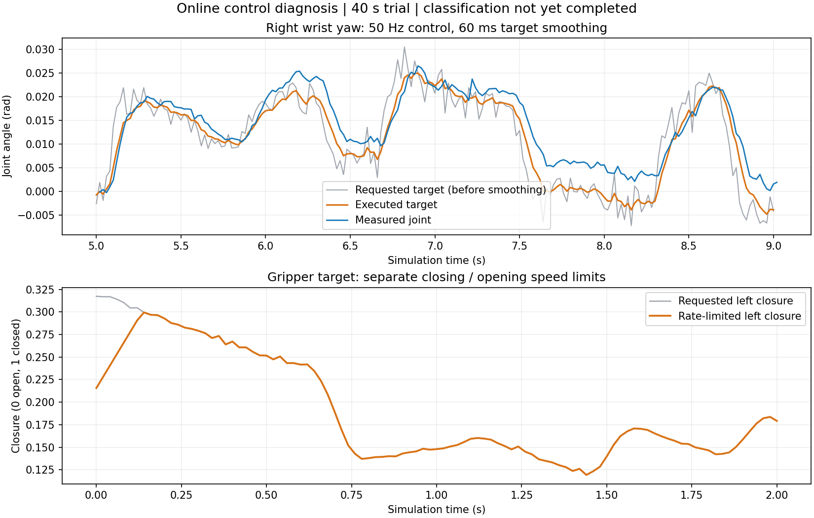
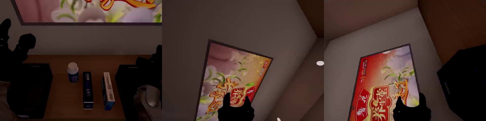

# 从药品示范到 π0.5 LoRA：训练与推理怎么接起来

核查日期：2026-11-04。面向第一次接触机器人学习的同事，也作为后续开发的验收依据。

后续对照实验见 [ACT 基线训练与 HF 上传](medication_act_training_upload.md)：复用同一批 20 条示范，记录 ACT 配置、smoke 检查、复现命令，以及用户自行上传到公开数据集 `Bigluck77/g1_med_sort` 的步骤。

**转换完成后可以进入训练准备，但还不能把数据目录交给任意训练命令就直接开跑。** 我们还需要把双臂的数据接口接对，计算本数据的统计量，再用短训练检查模型确实能学习、保存和加载。上传 Hugging Face 只是数据分发方式；训练程序正确读取服务器上的本地数据后，不必等上传才能训练。

本文将“项目已完成”“官方实现的行为”和“下一步要验证的方案”分开说明。所引用的训练源码固定在 OpenPI 提交 `215abfb217dbac7d5f1273282331b9b1866c0479`；不能把最新版 LeRobot 的命令直接套到这个版本。

## 1. 目前做到哪里了

截至 **2026-11-04 20:09 UTC** 的云端核查；完整阶段总结见 [11月4日续篇](medication_progress_20261104.md)：

| 工作 | 已有证据与状态 |
|---|---|
| 完整示范 | 20 条成功，四件药品均入框；共 219,594 帧，按 50Hz 约 73.2 分钟 |
| 清理与编号 | 本次删除 18 个确认失败目录，先保留失败诊断；成功编号已连续为 0000～0019，前后总帧数一致 |
| 原始数据 | 三路 640×480；30 维状态、16 维动作；成功原始录像和轨迹保留 |
| LeRobot 转换 | 已完成，20 条/219,594 帧全量读回校验通过，退出码 0；正式目录、README 和完成摘要齐全，父子进程已退出 |
| 双臂 π0.5 训练 | 适配、统计量、10步短训练及离线重新加载通过；正式10,000步训练日志已记录第610步，模型闭环尚未评测 |
| 上传 | 尚未上传；用户自行上传 HF |

证据入口位于云端：

```text
原始数据：/root/gpufree-data/datasets/g1_med_sort_v2
收尾记录：/root/gpufree-data/datasets/g1_med_sort_v2_history/postprocess_swap15_20261104
正式输出：/root/gpufree-data/datasets/lerobot/local/g1_med_sort_v2
```

收尾记录中的 `cleanup_journal.json`、`status.json`、`conversion.log` 和最终 `completion_summary.json` 分别回答“删了什么、现在在哪一步、执行了什么、最终是否成功”。运行时输出带 `.partial` 后缀，不能当正式完成的数据使用。

本次正式输出为 5,354,013,168 字节，约 5.35GB（4.99GiB）；`.partial` 已发布为正式目录。转换监测已暂停，正式训练已按用户后续授权启动，尚未上传。交换布局批次为 2 成功、13 失败；后续补采为 5 成功、3 失败，加上此前 13 条成功，共 20 条。此次清理 18 个失败目录还包括更早的两个失败诊断目录。

用户自行上传时，可在云端登录自己的 HF 账号后使用以下模板；这里仅提供命令，未执行上传。将 `你的账号` 替换为实际账号或组织。`--private` 只控制新建仓库，已有仓库的可见性需在 HF 上确认。

```bash
/root/gpufree-data/envs/med_lerobot/bin/huggingface-cli upload \
  你的账号/g1_med_sort_v2 \
  /root/gpufree-data/datasets/lerobot/local/g1_med_sort_v2 . \
  --repo-type dataset --private
```

此模板已对照服务器已安装 CLI 的 `upload --help` 核对，不包含 token。

这 20 条是**专家程序执行的示范**，并非 π0.5 的测试成绩。采集专家能读取仿真物体真值；后续模型需要依靠图像、机器人状态和任务文本行动。最后一条是同布局重新实际录制的成功示范，不是复制文件，也不增加布局多样性。目前没有独立验证集。

## 2. 整体工作流：每一步解决什么问题

```text
专家完成抓放，记录三路图像、状态和动作
                    ↓
LeRobot 转换与读回校验 —— 确认资料没有丢帧、错位或串任务
                    ↓
双臂适配器 —— 告诉模型哪路是左腕，哪一维控制哪个关节
                    ↓
本数据归一化统计量 —— 把不同数值范围变成模型方便学习的尺度
                    ↓
短训练 + 保存/加载检查 —— 确认训练链路能跑通
                    ↓
π0.5 LoRA 正式微调 —— 用示范调整预训练模型
                    ↓
离线预测检查 → OrcaLab 闭环测试 → 统计成功率与卡顿
```

官方 OpenPI 同样要求自定义数据适配、统计量计算和训练配置。我们的额外工作是接入 G1 双臂的真实接口，不是另造一套学习算法。参考：[固定版本 OpenPI 微调说明](https://github.com/Physical-Intelligence/openpi/blob/215abfb217dbac7d5f1273282331b9b1866c0479/README.md)。

### 为什么转换要校验

机器人学的是“看到这个场景时，应该做这个动作”。画面晚一帧、左右腕写反、夹爪开闭含义相反，都可能让文件正常读取，却教出错误行为。

本项目转换器检查每行状态、动作、时间和任务对应关系；检查三路视频帧数与时间戳；校验原始图像，并在关键帧比较编码后的画面；最后用官方 reader 读取连续动作段。H264 是有损编码，**不要求导出像素与原图逐点完全相同**。这里的“全量校验”也不代表把所有压缩帧都做逐像素一致性比较。

通过这些检查只能证明数据转换符合约定，不能证明机器人已经学会抓药。实现依据：[本项目转换器](../examples/euler/medication_sorting/lerobot_export.py)、[对应回归测试](../tests/test_medication_lerobot.py)。

## 3. 图像为什么保留 640×480，模型却读 224×224

这分成三个环节，不能混在一起说：

| 环节 | 做什么 | 是否改变保存的原始数据 |
|---|---|---|
| 数据转换 | 保留完整 640×480 画面，换成训练工具能读取的视频和表格 | 保留原始备份；导出视频有编码损失，不裁剪、不缩放 |
| 模型入口 | 按所选预训练模型要求缩放、补边、调整数值范围 | 只处理当前读入的样本 |
| 训练增强 | 训练时随机改变部分画面，帮助模型适应变化 | 不改数据集文件；推理时不随机增强 |

所选 OpenPI 的模型入口为 224×224。640×480 图像按比例缩到 224×168，再补上下边至 224×224。药瓶不会因为宽高被强行拉伸而变形，但细节会减少，因此要实际看模型输入图，确认瓶口、夹爪、框沿还看得清。[官方 ResizeImages 实现](https://github.com/Physical-Intelligence/openpi/blob/215abfb217dbac7d5f1273282331b9b1866c0479/src/openpi/transforms.py)

```text
原始画面 640×480          等比例缩小 224×168        模型画面 224×224
┌────────────────┐      ┌────────────┐          ┌────────────┐
│ 药品、夹爪和框沿 │  →   │ 完整场景缩小 │    →     │   上方补边  │
│ 都在完整画面内   │      └────────────┘          │ 完整场景缩小 │
└────────────────┘                              │   下方补边  │
                                                └────────────┘
```

需要纠正一个容易误解的说法：**“转换不裁剪”不等于“训练全程没有裁剪”。** 固定版本的 JAX 预处理在训练模式下，对非腕部图像做 95% 随机裁剪、缩放回原尺寸及 ±5° 旋转；各视角还做颜色增强。推理模式不执行这套随机增强。开训前应保存一组增强前后对照图，检查边缘目标是否被遮掉；如需修改增强策略，要明确记录与上游的差异。[官方 preprocess_observation 源码](https://github.com/Physical-Intelligence/openpi/blob/215abfb217dbac7d5f1273282331b9b1866c0479/src/openpi/models/model.py#L132-L191)

因此，训练与推理应保持一致的是相机身份、颜色通道、基础缩放补边和数值含义；不需要在推理时重复随机裁剪。224 是这里采用的实现要求，不能推广为“所有机器人模型都只能用 224”。

## 4. 双臂适配：最怕格式正确、含义错误

我们的接口可以理解为两张表：“机器人现在是什么状态”和“下一步要发什么指令”。它们的长度不同是正常的。

| 向量 | 顺序与含义 |
|---|---|
| 状态 30 维 | 左臂实测 7 + 左夹爪实测关节 8 + 右臂实测 7 + 右夹爪实测关节 8 |
| 动作 16 维 | 左臂目标 7 + 左夹爪闭合指令 1 + 右臂目标 7 + 右夹爪闭合指令 1 |

关节目标是绝对角度，单位 rad。夹爪指令 0 表示张开，1 表示标定的完整夹持指令，并非“夹爪宽度 1 米”或实测夹持力。推理必须沿用 `medication_closure_v1` 映射。具体定义见[采集与数据协议](../examples/euler/medication_sorting/recording.py)。

适配器需要把头部、左腕、右腕映射到三个正确的模型槽位，并保留英文任务的原始配对。使用默认 32 维模型宽度时，30 维状态、16 维动作分别补齐；补出来的维度是内部占位，推理时必须去掉，不能发送给机器人。[官方模型形状与配置](https://github.com/Physical-Intelligence/openpi/blob/215abfb217dbac7d5f1273282331b9b1866c0479/src/openpi/models/pi0_config.py)

**本轮拟先保留绝对关节动作语义。** 不能直接用 `action - state[:16]` 生成相对动作：状态里的左夹爪占 8 维，动作只占 1 维，后面的右臂位置已经错开。若以后测试相对关节动作，必须显式匹配左右臂索引，夹爪单独处理，并验证推理还原结果。

仓库中已有的[旧药品适配器](../projects/medication_sorting/tools/medication_sorting/pi05_adapter.py)声明的是单右臂 8 维、两路相机和 5Hz，不能直接用于当前双臂数据。旧单臂托盘训练包也是另一套接口。可以参考其流程，不能复用其数据统计量、动作截取或旧任务检查点作为本任务已验证配置。

### 归一化不是改动作，而是换一把尺子

例如关节角与夹爪 0～1 指令数值范围不同。归一化让模型更容易处理它们，推理后再按同一份统计量还原。拟使用本训练集自己的分位数统计量；后续增加独立验证集时，统计量只由训练集计算，避免提前“看过考题”。统计量、适配代码和模型权重要一起保存。[官方归一化与数据配置](https://github.com/Physical-Intelligence/openpi/blob/215abfb217dbac7d5f1273282331b9b1866c0479/src/openpi/training/config.py)

## 5. π0.5 LoRA 学什么，何时可以正式开训

π0.5 属于视觉—语言—动作模型：结合图像、任务和机器人状态，预测接下来一段动作。所选开源实现使用 flow matching 动作头，可以直观理解为逐步把一段带噪声的动作草稿修正成符合当前任务的动作序列。[官方模型说明](https://github.com/Physical-Intelligence/openpi/blob/215abfb217dbac7d5f1273282331b9b1866c0479/README.md)

LoRA 的目的，是保留预训练能力，通过较小的可训练参数增量适应当前机器人和任务。实际哪些参数冻结，必须检查配置和可训练参数清单，不能仅凭任务名称含有“LoRA”判断。沿用旧工作流的方向是 JAX、π0.5 基座、语言模块与动作专家的 LoRA 配置；固定版本的 PyTorch 路径不支持 LoRA，转换环境装有 CUDA PyTorch 也不等于 JAX 训练环境已经就绪。[官方后端说明](https://github.com/Physical-Intelligence/openpi/blob/215abfb217dbac7d5f1273282331b9b1866c0479/README.md)、[冻结参数实现](https://github.com/Physical-Intelligence/openpi/blob/215abfb217dbac7d5f1273282331b9b1866c0479/src/openpi/models/pi0_config.py#L78-L107)

以下是验收顺序。第一项正式转换验收已通过，其余训练适配与评测项目仍待执行：

| 步骤 | 用通俗的话解释 | 留下什么证据 |
|---|---|---|
| 正式转换验收 | 确认整理好的材料可靠 | 正式目录、退出码 0、`validation.json` 通过，20 条/219,594 帧一致 |
| 数据小检查 | 让训练程序真正读几组样本 | 三视角预览、关节名字与顺序、任务文本、动作段边界正确 |
| 统计量与还原检查 | 确认换尺子后能换回来 | 本数据统计量；归一化/反归一化后的数值误差报告 |
| 约 10 步短训练 | 检查 GPU、梯度和保存流程 | loss 有限、可训练参数符合预期、显存记录、检查点保存并重新加载 |
| 离线预测 | 先看模型输出是否能送入接口 | 输出去填充后为 16 维，顺序正确，无 NaN/Inf，夹爪映射正确 |
| 正式微调与仿真评测 | 检查机器人是否真的完成任务 | 完整轨迹、四物体成功率、分阶段失败原因、耗时与卡顿记录 |

短训练不是在十几步内“教会抓药”，loss 下降也不是成功率上升的保证。首轮 20 条适合验证整个流程；不能从同一示范里随机抽相邻帧当独立验证集。模型泛化能力需要另采独立布局、按完整任务评测。

## 6. 推理怎么接，怎样避免动作一顿一顿

目标流程如下，**当前双臂链路仍需实现和实测**：

```text
OrcaLab 三路相机 + 实测状态 + 任务
           ↓ 对齐时间，避免积压旧画面
推理客户端 → 同训练的基础预处理 → π0.5
                                          ↓
                                  一段未来动作 chunk
                                          ↓
                            反归一化 → 恢复 16 维动作
                                          ↓
                              动作队列 → 50Hz 控制器
                                          ↓
                                   新画面与新状态
```

相机端口只负责提供画面；客户端还要组织状态、任务和时间信息。不能把摄像头异步发送理解为“模型自然就能连续控制”。采集中的 50Hz 是仿真时间步长；录制时等待相机可能使墙钟运行更慢，不能据此宣称在线控制已经达到实时 50Hz。

### chunk 大一点，会不会更流畅

先区分三个参数：模型一次预测多少步、这一轮实际执行多少步、什么时候发起下一次推理。按 50Hz，25 步是 0.5 秒，50 步是 1 秒。预测长一点能提供更多可用动作，但执行太长才重新看画面，也会降低对滑脱、碰撞的反应能力。不能只把客户端数字调大，就当模型支持了更长的预测范围。

同步执行是“做完这一段，再等模型想下一段”，等待会造成停顿。异步执行是“执行旧动作的同时计算新动作”，但两段直接拼接仍可能跳变。PI 的 RTC 工作专门研究这种衔接：利用旧动作约束重叠时间段，再生成后续动作。原版 RTC 是可用于 π0.5 的推理时方法；后来另有训练时版本。普通异步队列不等于已经实现 RTC，其论文结果也不是本项目的实测结果。[官方 RTC 方法与实验](https://www.pi.website/research/real_time_chunking)

### 已实现的仿真接入入口

用户在训练结束后授权接入仿真。本轮使用最终 `med20_lora_10k_v1/9999`，保留 H=50；在队列剩余 30 步时发起下一次预测。比如第 20 步拍下画面，到第 30 步预测才回来，就丢弃新预测的前 10 步，从对应当前仿真时刻的动作开始。这里按仿真步数对齐，不能直接把不同机器的墙钟时间相减。新旧队列还有重叠时，用 10 步五次平滑权重过渡；这会改变实际执行目标，因此原始预测与最终执行动作分别保存，并保留范围和跳变检查。它是客户端过渡策略，不是 RTC。

代码入口是 `examples/euler/medication_sorting/pi05/serve.py` 和 `simulate.py`。前者在独立 JAX 环境加载模型与同一份归一化参数，后者在 `orca` 环境连接 Euler 仿真。两个进程通过仅监听本机的 HTTP/NPZ 接口通信，NPZ 禁止 pickle；没有额外给采集环境安装训练依赖。模型内部仍走官方 `create_trained_policy` 和本次训练使用的药品适配器。

三路相机使用同一个 `simulate_index` 的原生 IDR 帧，与发出渲染请求前的 state30 配对。图像解码和推理在工作线程里进行，主线程继续执行队列中的动作。渲染 RPC 确认返回并不等于 GPU 图像已经读回，因此三路帧没到齐前不能用后续显示刷新覆盖它；物理步进不必等待图像。渲染 RPC 本身仍然同步，所以必须实测控制间隔，不能保证任意负载下的实时 50Hz，也不能称为 RTC。

模型给出的绝对关节目标通过原采集控制器执行，关节越界直接停止。夹爪仍经 `Grippers.set` 转换：模型小幅外推到 `[-0.1,1.1]` 时，只把两路 closure 限制到 `[0,1]` 并记录修改数量；超过这一容差就停止。原始预测保留，不修改训练数据，也不裁剪关节角。最终动作的单步变化超过 0.08 rad（夹爪为无量纲 0.08）仍停止。该阈值是本次仿真接入的保护参数，不是实体机器人的安全认证。

首次 JAX 编译及两次真实画面预热在暂停的仿真时间上进行。预热后才统计模型执行步数。默认只运行 250 步，即 5 秒仿真时间；不采集新的训练示范。每次输出到新目录，保留初始三路画面、每段预测、实际动作、相机时间戳、延迟和停止原因。

复现命令（在云端仓库根目录执行；先确认没有其他仿真控制进程）：

```bash
R=/root/gpufree-data/training/med20_20261104
CKPT="$R/checkpoints/pi05_g1_med20_lora/med20_lora_10k_v1/9999"
# 终端一：模型服务，保持运行。
/root/gpufree-data/envs/med_pi05/bin/python -m examples.euler.medication_sorting.pi05.serve \
  --run-root "$R" --checkpoint "$CKPT"
# 终端二：等模型服务输出 checkpoint 信息后，运行有步数上限的仿真。
# output 必须是尚不存在的新目录。
/opt/conda/envs/orca/bin/python -m examples.euler.medication_sorting.pi05.simulate \
  --checkpoint "$CKPT" --output "$R/simulation_manual_trial" --steps 250
```

结束时仿真保持暂停，原相机开关与端口设置恢复。模型服务可以留待下一次试验，但它本身不会驱动机器人。短时接通不代表四物体任务成功，后续仍需完整任务和不同布局评测。

### 首次在线验收结果（2026-11-04 UTC）

最终 `smoke250_bounded_v5` 完成 250 个模型控制步：5 秒仿真时间，5.023 秒墙钟时间。初始姿态准备与 JAX 预热不计入这 250 步。首次编译约 32 秒，之后在真实相机输入上，推理中位数 166 ms，95% 分位 173 ms；控制间隔中位数 20.06 ms，95% 分位 21.18 ms，最大 22.04 ms。此次未出现队列耗尽，已执行动作最大相邻变化 0.0274（关节 rad / 夹爪无量纲）。这些是单次 5 秒测试的测量值，不是长时性能保证。

调试过程中确实遇到过三类边界：新旧动作段直接切换时右肩目标跳变 0.1165 rad；渲染请求覆盖未到齐的索引帧；夹爪预测 −0.0009 超出接口范围。分别以短重叠过渡、相机到齐屏障、显式夹爪限幅处理，旧失败日志保留。最终测试的预测动作段中共有 23 个 closure 数值被限制到端点，包含后来可能没有执行的未来动作，不能把这个数量当作实际夹爪开合次数。

本轮只验证连接、映射、延迟和短时连续控制。四个物体尚未完成入框，不能报告任务成功率。最终目录：`/root/gpufree-data/training/med20_20261104/simulation_integration_20261104/smoke250_bounded_v5`，包括 `result.json`、`timing_summary.json`、`trace.json`、`predictions.json`、原始预测数组和初始三路图像。相关 44 项测试通过，新增代码 ruff 检查通过；全仓库 pytest 在收集阶段被既有 `examples/embodied/g1/utils/test_xbox.py` 的 `sys.exit()` 阻断，未声称全仓库通过。

### 第一次完整任务试跑：保护中止，尚未完成

用户继续授权一次全程推理，运行 `full15000_v1`，上限 15000 步、300 秒，沿用短测配置。实际执行到 **1535 步、30.7 秒**时退出码为 1。拒绝执行的第 1535 步中，左夹爪 closure 从 0.5460 变为 0.6418，变化 0.09576，触发统一的 0.08 单步变化阈值。该动作没有执行。四个物体在最终几何检查中都未进入对应框，不能把本次报告为完成四物体任务，也不能从这次保护中止直接推算模型成功率。

本次推理延迟中位数 163 ms、95% 分位 174 ms；控制间隔中位数 20.09 ms、95% 分位 21.81 ms，最大 26.46 ms。停止原因是夹爪变化检查，没有观察到队列耗尽。为定位问题，离线重放了保存的所有动作段与队列过渡，并逐步核对已经执行的动作，确认触发维度为 action[7]，不是右臂关节或相机槽位串错。

夹爪 closure 与关节角不是同一种量，统一使用 0.08 阈值不能代替各自的变化速度标定。对 20 条示范数值列的检查显示，初始化后的张开阶段存在约 0.203 的单步 closure 变化；这只说明现有保护阈值并未覆盖示范中的全部夹爪操作，不证明本次较快的闭合一定合适。后续应分别设计夹爪开合限速和关节过渡，保留原始预测、执行后动作及夹持效果对照，而不是简单提高统一阈值。本次没有放宽保护或自动重跑。

日志、预测数组、执行轨迹、最终三路画面与 `diagnostic.json` 保存在 `/root/gpufree-data/training/med20_20261104/simulation_integration_20261104/full15000_v1`。仿真已暂停，原相机设置恢复；模型服务仍可用于下一轮诊断，没有新增训练示范或上传。

本项目先测量再决定执行前缀、提前请求时间及是否接入 RTC。后续报告必须包含：

- **模型是否来得及：** 图像获取、传输、预处理、推理分别耗时多少，记录中位数及 95% 分位延迟。
- **队列是否断粮：** 等新动作的次数、总等待时间；收到动作时对应的观察已经过去多久。
- **接缝是否跳变：** 停顿发生在 chunk 内还是交界处；关节目标变化与实际跟踪情况。
- **任务有没有变差：** 比较不同执行前缀下的完整成功率、失握次数和耗时，重点看闭爪、下放、松爪阶段。

所有比较保持数据、模型权重和成功判据一致。必要的抓稳等待不能为了画面流畅而直接删掉；队列耗尽或输入过期时也要有明确的控制行为。

### 推理时固定两个分类框

用户希望分类框不被机械臂碰走。这相当于把框固定在桌面上，是一个明确的场景条件。原场景的两个框都有自由关节，第一次长试跑中左框移动约 9 毫米、右框约 18 毫米。

现在推理入口可加 `--fixed-bins`：在本轮 Euler 物理场景副本中移除两个框的自由关节，把它们变成固定在世界坐标中的静态容器。框的碰撞形状、摩擦和碰撞开关保留，药品仍会落在框内，机械臂也仍会撞到框。这里没有靠加大质量或每步把框拉回原位来实现。正常接触力不会改变框的位置或朝向；重新加载布局或显式修改场景仍然可以改变它们。

固定框后，物理模型 qpos 从 121 维变成 107 维。为避免渲染错位，所有渲染路径（包括初始姿态准备）都通过关节名称映射回原场景的 121 维，填入两个框的固定姿态。机器人 state30/action16、三路相机、模型权重及动作保护保持原来的契约。原始 XML 和训练数据不改，不带该选项仍使用原来的可移动框。

复现时，在前面的仿真命令中增加 `--fixed-bins`，并使用新的 `--output` 目录。`result.json` 会记录 `bin_physics=static_world_fixtures`、两个框的位置、物理/渲染维数和最终框位置；`scene_original.xml` 是修改前副本，`scene.xml` 是实际执行的固定框副本，`final_qpos.npy` 与 `final_render_qpos.npy` 分别对应这两种维数。

验证依据：新增测试覆盖固定框抗外力/扭矩、保留物体接触、删除关节前后的渲染姿态映射和源文件不变。真实场景的离线副本运行 500 个物理步，对框施加各分量最高 10000 N 外力和 10000 N·m 扭矩，两个框位置、朝向变化均为 0；全场景映射后的位姿误差为 0。证据位于云端 `simulation_integration_20261104/fixed_bins_validation_20261104_222513/validation.json`。这是物理机制与映射验证，不代表策略完成了分类。

在线短测 `fixed_bins_smoke250_v1` 已完成 250 步（5 秒仿真，5.023 秒墙钟），三路原生图像、模型请求和控制均正常，两个框最终位置与固定位置完全一致，相机设置恢复无错误。没有放宽 0.08 动作保护，也没有重新跑完整任务；四物体分类尚未完成。新增固定框及在线队列相关测试共 12 项通过，变更文件 ruff/SLF001 通过。全目录 SLF001 检查仍被无关 cloth 示例的既有语法错误和私有属性访问阻断，不能声称全仓库检查通过。

固定框也不能解决上次的夹爪指令跳变；那是独立的控制问题。后续任务结果必须注明“固定双框”条件，不能直接和原先可移动框的成功率混在一起。框固定以后，模型仍需要学会绕开框沿、正确抓取和释放药品。

### 频繁小动作：先分清三种频率，再处理目标抖动

当前物理积分是 500 Hz（每次 2 ms），机器人动作目标每 10 个物理步更新一次，即 50 Hz；模型每次给出 50 步、约 1 秒的动作预测，但约每 20 个控制步获取一次新观察，实测重规划约 2.5 Hz。这三个数描述不同环节。把控制从 50 Hz 直接降下来，会改变示范的动作时间尺度；不能把它当作通用的去抖开关。

对第一次 30.7 秒试跑的诊断发现，频繁的小幅反向变化已经存在于下发的关节目标中，并非仅在关节反馈里出现，也不只出现在预测段交界。例如右腕 yaw，目标中有 571 次相邻反向变化，实际反馈有 634 次（两侧相邻步变化都超过 0.001 rad 才计数）。目标单步变化的 95% 分位为 0.00794 rad，反馈为 0.00837 rad。记录支持“输入目标本身有抖动”的判断，但还不足以排除接触与伺服跟踪也参与了抖动，更不能单凭训练 loss 判断动作平滑。

本轮控制修正分两项，保留原始预测与修正后的动作供对照：

1. **夹爪按开、合分别限速。** 20 条成功示范的闭合单步最大变化为 0.012491，选闭合上限 0.0125/步，即 0.625 closure/秒；常规张开单步最大约 0.03123，选张开上限 0.032/步，即 1.6 closure/秒。示范里另有约 0.203 的瞬间张开，本次不照搬这个跳变。超出速度的请求逐步接近目标，不会一步闭过去；超出位置范围、非有限值仍拒绝。
2. **关节目标做轻量低通平滑。** 默认时间常数 0.06 秒，每 20 ms 用 `alpha=1-exp(-0.02/0.06)` 接近新目标。它能减小快速来回变化，但会有滞后；约三个时间常数后才走完一次阶跃的 95%。原始关节目标在平滑前仍受 0.08 rad 单步跳变检查，执行动作在平滑后再检查一次，不能用平滑藏住大跳变。`--arm-smoothing-seconds 0` 可关闭平滑做对照。

这不是官方 RTC，也不是重新训练；50 步预测长度、50 Hz 控制和固定双框保持不变。`trace.json` 增加 `requested_action`、`state_after`、`arm_servo_control`，分别用于区分预测段合并后的请求、控制后的反馈及底层伺服输入。`result.json` 记录滤波时间常数与开合速度。训练模型仍需通过完整闭环分类验证，平滑不能替代策略能力。

实测先只加夹爪限速，再开启关节平滑，两次都完成 2000 步、40 秒。比较结果如下；两次是分别运行的随机策略闭环轨迹，不是相同输入的严格因果实验，也不是成功率评测。

| 指标 | 仅夹爪限速 | 夹爪限速 + 60 ms 关节平滑 |
| --- | ---: | ---: |
| 14 个关节实际反馈的反复变向总数 | 6199 | 314 |
| 实际关节单步变化绝对值 P95 | 0.00928 rad | 0.00508 rad |
| 实际关节离散加速度 RMS | 12.29 rad/s² | 2.99 rad/s² |
| 执行目标到步后关节反馈的误差绝对值 P95 | 0.02427 rad | 0.00918 rad |
| 控制间隔中位数 | 20.12 ms | 20.10 ms |
| 推理延迟中位数 | 158.7 ms | 157.8 ms |
| 完成四物体分类 | 否 | 否 |

平滑试跑的原请求到执行目标误差绝对值 P95 为 0.01227 rad，说明减抖有跟随滞后的代价。反复变向的计数要求前后两步均超过 0.001 rad，不能当成物理系统的振荡频率。40 秒验证只能说明控制更平稳且未触发原来的夹爪跳变保护，不能说明模型已学会任务。结果位于云端 `simulation_integration_20261104/{closure_slew2000_v1,smooth2000_v1}/control_metrics.json`，图为同目录 `control_comparison.png`。本轮药品相关测试 170 项通过、1 项跳过、27 个子测试通过；全仓库 pytest 仍被既有 `test_xbox.py` 的 `sys.exit()` 阻断。



图中灰线是平滑前的请求，橙线是实际下发的目标，蓝线是关节反馈。上图可见高频细碎变化减小，但较慢的往返运动仍保留；如果机械臂反复找位置或反复尝试抓取，还需要检查策略预测和抓取状态，不能靠进一步减慢控制频率解决。

### 限速和平滑后的完整试验：控制跑完，分类仍失败

`smooth_full15000_v1` 完成 15000 步、300 秒仿真，模型控制循环墙钟耗时 301.91 秒，子进程正常退出，未触发动作保护或队列耗尽。两个框保持固定，相机设置恢复无错误。模型权重、50 Hz 控制、50 步预测长度未改。

这次控制间隔中位数 20.10 ms、P95 21.39 ms；推理延迟中位数 157.6 ms、P95 166.0 ms。14999 个相邻控制间隔中有 4 次超过 40 ms，最大 98.74 ms，当时队列仍有 27～34 步。这提示还有少量调度/同步长尾，不能宣称严格实时，也不能把短测时的最大延迟当作长期保证。

**最终几何入框结果为 0/4。** 钙片瓶的最终 z 坐标从约 4.753 m 下降到 4.034 m，结合最终头部画面判断已落到桌面以下；其余三个药品仍在原位附近。仅凭末帧与机器人关节轨迹，还不能确定钙片瓶是被推落、没有夹稳还是搬运中脱落，也不能排除平滑滞后对抓取的影响。因此本轮结论仅为控制连续性和抖动改善，绝不是完整分类成功。

本次未再次盲跑。下一步应围绕第一件药品记录逐帧物体位姿、夹爪接触与相机画面，核对与成功示范的抓取过程，而不是继续降低频率或仅凭 loss 推断模型能力。完整证据在云端 `simulation_integration_20261104/smooth_full15000_v1`：`result.json`、`control_metrics.json`、`control_diagnostic.json`（含代码 SHA256）、`timing_outliers.json`、原始预测、执行轨迹及最终三路截图。截图是在暂停状态下取得，没有继续步进物理。



## 7. ACT 也需要这些步骤吗

需要数据对齐、机器人接口适配、统计量和闭环验证。这些是训练机器人共同需要的工作，不是 π0.5 独有的额外步骤。

ACT 用视觉骨干与 Transformer，根据图像和关节状态预测动作段；标准 ACT 不依赖语言指令。它的图像输入设置不能照搬 π0.5 的 224×224 约定。更换 ACT 也不会自动修好左右臂映射或时间错位。[LeRobot 官方 ACT 介绍](https://huggingface.co/docs/lerobot/act)

当前仍按用户选定的 π0.5 LoRA 路线推进。若之后比较 ACT，应使用同一批示范、同样的完整任务判据和独立测试布局，避免把不同数据条件下的结果混在一起。

## 8. 后续每次实验都要留下什么

每次训练保存数据清单、代码提交、基座来源、适配器版本、统计量、增强策略、chunk 长度、可训练参数清单、训练配置和检查点路径。每次推理保存模型版本、相机与关节映射、延迟、队列策略、任务录像及失败阶段。

正式结果要能回答三个不同的问题：**文件是否正确、训练是否正常、机器人是否完成任务。** 分别用转换报告、训练与加载记录、完整闭环评测来回答，不用其中一项替代另外两项。

本文引用官方源码说明通用机制，引用本项目文件说明当前实现；实验顺序与验收表是针对当前任务提出的开发方案。部署后应把实测记录补进本文，而不是把方案提前写成结论。

## 9. 本轮训练准备的实际入口与状态

2026-11-04 已完成当前双臂数据的专用适配器，入口为 `examples.euler.medication_sorting.pi05.run`。它保留三路相机、原始英文任务、30维实测状态和16维绝对动作，模型内部补到32维、预测50步；没有沿用旧单臂的统计量或动作索引。

本轮代码检查结果：药品回归 **152项通过、1项跳过、27个子测试通过**，新增适配和保护检查27项通过，局部 Ruff 通过。全仓库测试在已有 Xbox 手柄测试的 `sys.exit()` 处中断，不能写成“全仓库测试通过”。独立审查指出并已修复：恢复训练时不能覆盖首次启动审计；源代码不能只检查锁文件；统计量必须绑定当前数据文件哈希、维度和动作段长度。

云端训练工作位于 `/root/gpufree-data/training/med20_20261104`，独立环境是 `/root/gpufree-data/envs/med_pi05`。**安装、GPU与数据检查、基础权重核验及10步训练验收均已完成。** GitHub 拉取依赖时曾断流，已用同一官方提交的 Git 数据恢复；没有修改固定依赖锁文件。基础权重从官方 GCS 固定 generation 下载，共20个对象、12,441,721,931字节，官方 CRC32C、文件大小和本地 SHA256检查通过。

准备流程执行数据检查、统计量、10步短训练和离线加载预测；任一步失败停止并保留日志。当前 `preparation_status.json` 为 `ready_for_formal_training`、退出码0，`smoke10_v1/9`检查点保存并重新加载通过，输出为有限的`(50,16)`动作。用户已授权合格后自动长训练，独立正式监督进程随后启动了10,000步任务；没有上传 HF。这仍然不代表四物体任务已经学会。

短训练的离线输出中，closure最小值约为−0.219。形状和有限性检查只证明推理链路工作，不能替代执行范围检查；控制端后续需验证越界处理及夹爪映射。本次未将输出发送给仿真机器人。

在云端仓库目录运行以下命令可以检查配置接口，**不是直接开始训练**：

```bash
/root/gpufree-data/envs/med_pi05/bin/python \
  -m examples.euler.medication_sorting.pi05.run --help
```

所有数据检查、统计量和训练子命令共用这些参数：

```text
--openpi-dir /root/gpufree-data/training/med20_20261104/openpi
--data-home /root/gpufree-data/datasets/lerobot
--assets-dir /root/gpufree-data/training/med20_20261104/assets
--checkpoint-dir /root/gpufree-data/training/med20_20261104/checkpoints
--base-params /root/gpufree-data/training/med20_20261104/base/pi05_base/params
--batch-size 2
```

本轮正式训练已确定为 batch 2、10,000步、每1,000步保存；这不是最佳超参数结论。不要手工重复启动当前实验。实时进展读取`formal_status.json`与`formal_training.log`，状态文件可能比日志滞后一个刷新周期。

统计量直接读取 parquet 数值列，避免为计算关节分布解码全部视频。动作统计仍包含每一帧起点的50步动作段，并按官方 reader 在每条示范末尾重复最后动作。每条的开头、中间和末尾位置与官方 reader 比较，再对全部数值行做归一化/反归一化还原检查。这个优化不改变训练图像处理；训练批次仍由官方 reader 读取三路视频。


### 正式训练授权更新

用户随后明确要求“开始训练，做一个简单的 smoke test，合格就长训练”。因此准备通过后不再等待二次确认，自动启动首轮 `med20_lora_10k_v1`：10,000 steps、batch 2、50步动作段、双模块 LoRA、EMA关闭，学习率沿用配置的100步warmup、峰值5e-5并衰减至5e-6。它从官方 π0.5 基座重新初始化，不接着10步测试的检查点训练。

最小 smoke 的通过条件是一个真实训练批次形状与相机对应正确、10步loss/梯度有限、检查点保存及离线重新加载后输出有限的 `(50,16)` 动作。已有转换验收无需再次重跑。统计量计算仍是训练必需输入，由当前20条数据生成。

正式任务由 `formal_process.json` / `formal_status.json` 跟踪。`waiting_for_preparation` 表示等待，不能报告已开始GPU梯度更新；`training` 记录实际日志步数。检查点每1,000步写一次，常规只保留最近一次以控制空间，最终为step9999。训练和最终检查点离线加载完成才报告本轮训练完成。该结果仍需后续仿真完整任务评测，不能用训练loss推断成功率。

安装时采用清华PyPI镜像下载依赖，但逐包版本和SHA256仍来自未改动的官方 `uv.lock`，通过 `uv export --frozen` 和 `uv pip sync --require-hashes` 安装，之后执行原固定源码的 `uv sync --frozen`。下载路线变化没有改依赖版本。大权重经官方GCS固定对象generation下载，使用aria2断点续传，已完成并通过官方CRC32C核验。

2026-11-04 安装排错：训练环境应使用官方固定的 **Python 3.11**。此前误用 3.12，导致锁定的 `mujoco==2.3.7` 找不到对应 Linux wheel，转而源码编译并报 `MUJOCO_PATH` 未设置。修复是将独立训练环境恢复为 3.11，保留依赖锁、下载缓存和失败证据；采集与转换环境不变。这不表示需要启动 MuJoCo 仿真，包是上游依赖链的一部分。恢复安装、GPU、数据批次及 10 步 smoke test现已通过，正式训练已经启动。[官方 Python 版本](https://github.com/Physical-Intelligence/openpi/blob/215abfb217dbac7d5f1273282331b9b1866c0479/.python-version)、[MuJoCo 2.3.7 发布文件](https://pypi.org/project/mujoco/2.3.7/#files)。恢复记录见训练目录 `environment_python_recovery.json`。
