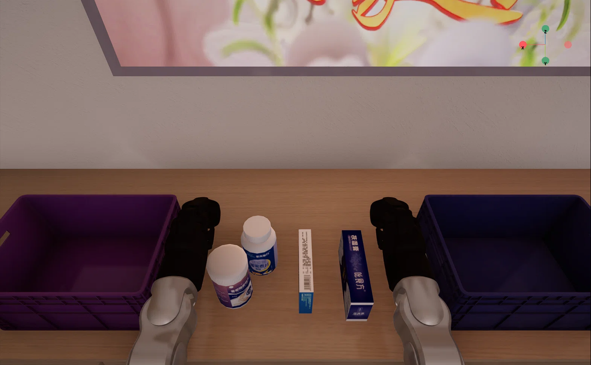
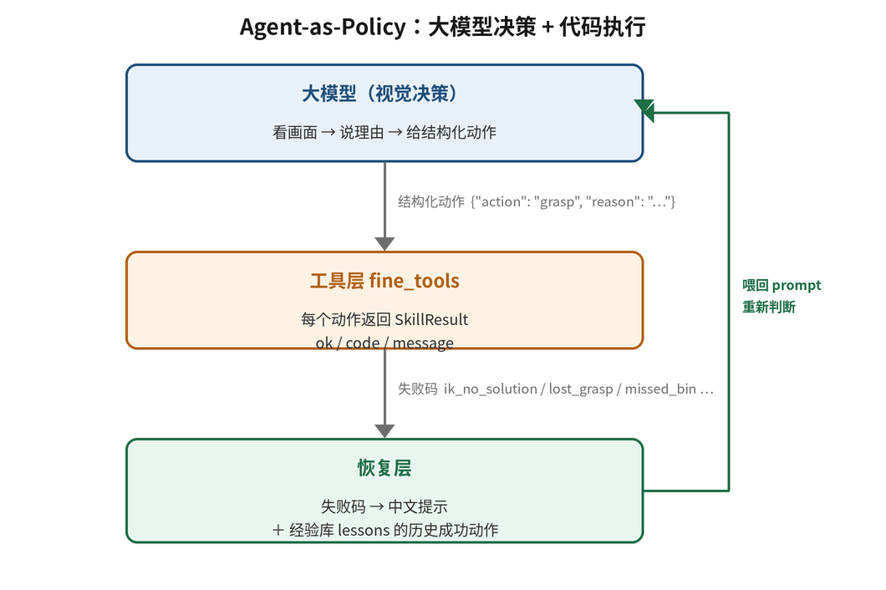

# 药品分拣 · Agent-as-Policy 技术报告v1.0

> 状态：仿真环境 4/4 跑通，真机未验证。
> 代码：`handoff/medication-sorting` 分支，`examples/euler/medication_sorting/`（11 个模块，约 4100 行）。
> 本文档随代码迭代，数字均来自本仓库实测，来源见各节标注。

---

## 1 概述

### 1.1 任务

Unitree G1 双臂机器人在 OrcaLab 的 `nursinghome` 场景里做药品分拣：
左臂把两只药瓶放进左侧紫色筐，右臂把两个药盒放进右侧蓝色筐。



| 物体 | 外形（实测包围盒） | 目标筐 | 手臂 | 握法 |
|---|---|---|---|---|
| calcium | 药瓶 ⌀6.3 × 11.1 cm | 左侧紫色筐 | 左 | 侧握 |
| melatonin | 药瓶 ⌀6.3 × 11.1 cm | 左侧紫色筐 | 左 | 侧握 |
| pharyngitis | 药盒 2.8 × 15.0 × 9.9 cm | 右侧蓝色筐 | 右 | 顶握 |
| herbbox | 药盒 4.2 × 16.2 × 8.3 cm | 右侧蓝色筐 | 右 | 顶握 |

筐地板尺寸实测 16.0 × 25.2 cm。只要求入筐，不要求摆放姿态。

### 1.2 方法

不训练策略网络，也不写死坐标，而是把**语义决策**交给视觉大模型、把**可执行性**交给代码：

- 模型给出：物体在图上的像素点、下一步语义动作（往前 / 夹 / 下放 / 对齐）、以及一句理由；
- 代码给出：像素→桌面坐标的换算、抓取点与放置点、逆运动学与路径、碰撞检查、结果校验；
- 每次工具调用返回结构化结果（`ok / code / message`），失败码被翻译成中文回注给模型，让它换策略。

### 1.3 关键数字

| 指标 | 数值 | 来源 |
|---|---|---|
| 视觉标定残差 | ≈ 7.5 mm（RANSAC） | `grounding.fit_homography_ransac` 注释 |
| IK 位置/角度容差 | 5 mm / 2° | `planning.solve_ik` |
| 到位判定容差 | 15 mm / 0.15 rad（含二次保持） | `execution.Executor.move` |
| 结构化失败码 | 13 种（11 具体 + `ok` + `unknown`） | `skills.FAILURE_CODES` |
| 模型动作空间 | 8 个词，无连续量 | `tools.parse_action` 调用处 |
| 模型裁剪后 | qpos 121→99，执行器 45→30，碰撞体 273→242 | 本仓库 `prepared*.xml` 实测 |
| 物理步进 | 0.473 → 0.171 ms（约 2.8×） | 同上，离线 `mj_step` 基准 |

---

## 2 系统架构

### 2.1 四层

| 层 | 内容 | 换任务/换平台时是否改动 |
|---|---|---|
| 任务配置 | 物体列表、外形描述、目标筐、手臂分配 | 改配置 |
| 执行框架（harness） | 主循环、工具层、几何、运动规划、失败恢复、经验库 | 不动 |
| 决策策略 | 视觉大模型（Anthropic Messages / OpenAI 兼容） | 可换供应商 |
| 底层驱动 | OrcaLab 仿真、相机、夹爪指令 | 可换平台 |

任务配置由 `tasks/*.yaml` 提供、`task.TaskSpec` 解析；`agent` 与 `tools`
不含物体名常量，几何计算只使用包围盒与位姿。

### 2.2 决策闭环



### 2.3 一次执行的阶段

| 阶段 | 主要动作 | 判据 / 说明 |
|---|---|---|
| 定位 | `locate` | 模型报像素 → 单应矩阵换算；最多 3 次重试 |
| 接近 | `approach_xy` → `approach` → `descend` | 先水平对齐 XY，再垂直下探，避免斜向扫碰 |
| 抓取 | `align_grasp` 循环 → `grasp_preset` → `test_lift` | 模型逐轮给方向；闭合后接触确认；抬 3 cm 验证夹稳 |
| 搬运 | `plan_placement` → `lift_safe` → `carry` | 模型决定筐内落点；抬到释放点上方 8 cm 再水平移动 |
| 入框 | `align_place` → `release` → 落底等待 → 校验 | 几何放行；释放后等 200 帧（约 4 s）再判定 |
| 复位 | `home` | 被挡时先抬高再回 |

---

## 3 关键设计

### 3.1 为什么不让模型直接给坐标

模型能可靠判断"夹爪还在瓶子上方""该往左挪一点"，但它给出的坐标没有毫米级可信度：

- 单应标定的几何精度约 **7.5 mm**，但标定过程中出现过"1~2 个离群点把普通最小二乘解拉到 12 cm 残差"的情况；
- 最小的物体（药瓶）直径只有 **6.3 cm**，10 cm 级误差就是抓空。

因此接口被切成两半：**模型报"在哪"（像素）**，**代码换算成坐标**；动作只给语义，不给数值。
剩下的小偏差由后续的靠近与微调闭环吸收。

### 3.2 抓取点如何计算

全部由物体包围盒推导，不含产品先验（`geometry.grasp_target`）：

```text
bounds      = 物体碰撞几何的世界顶点
height      = bounds.z 的跨度
jaw         = 物体局部 X 轴的水平投影        # 夹爪闭合方向
rotation    = 由 jaw 与竖直轴构造（侧握 Rx(-90°)，顶握 Rx(0°)）
grip_center = 物体中心 + 局部坐标系下 [0, 0.01(仅左臂), height × fraction]
grasp       = grip_center − rotation · [0, 0, 0.18]     # 0.18 m = 手腕到夹爪中心
approach    = grasp + [0, 0, 0.08]                       # 前臂避让余量
```

- `0.18` 与 `0.08` 是机械臂常数，对所有物体一致；
- `fraction` 表示抓取高度占物体高度的比例：侧握取中段（0.51），顶握取上部（0.70~0.73）；
- 早期版本的预备点只高 6.5 cm，实测前臂会扫到瓶身导致 IK 无解，抬到 8 cm 后稳定。

### 3.3 放置点与入筐判据

放置点同样由几何推导（`geometry.placement_targets`）：

```text
projected = 物体顶点 → (手旋转 · 抓持旋转)ᵀ → 筐坐标系
安全区间   = 筐地板范围 ∓ 8 mm − 物体投影范围
落点       = 模型给的偏好偏移，裁剪到安全区间
释放高度   = 筐地板 + 底部余量（2 cm）
搬运高度   = 释放点 + 8 cm（避免物体底部擦筐沿）
```

入筐判定有两道几何检查，口径不同、用途不同：

| 判据 | 作用 | 口径 |
|---|---|---|
| `release_ready` | 释放前是否允许放 | 全 footprint 在筐地板内（留 3 mm），底部在筐沿下方 2 mm 到上方 12 cm 之间 |
| `placement_satisfied` | 落地后是否算成功 | 质心在筐地板内，底部相对地板在 −1 ~ +8 cm |

释放后若物体还没落到底（几何会判成"仍在筐口上方"），程序会先推进 200 帧再判。

### 3.4 失败恢复

**失败码**（13 种，节选关键 6 种）：

| 码 | 含义 | 模型常见应对 |
|---|---|---|
| `ik_no_solution` | 目标位姿无可行解 | 改判直接闭合，或换方向 |
| `plan_collision` | 路径与障碍相交 | 绕行 / 抬高 |
| `lost_grasp` | 夹住但抬升滑落 | 加深夹持后重抓 |
| `missed_bin` | 释放后不在筐口范围 | 调整落点 |
| `tracking_error` | 伺服未跟上 | 延长保持后复测 |
| `target_mismatch` | 视觉点位与任务物体不符 | 重新定位 |

**预算**（避免死循环，全部有界）：

| 环节 | 次数上限 |
|---|---|
| 单件定位 `locate` | 3 |
| 抓取对齐（每轮重抓） | 6 |
| 重抓轮数 | 3 |
| 搬运绕行尝试 | 6 |
| 放置对齐 | 6 |

**经验库**（`lessons.py`）：把「失败码 → 恢复动作 → 是否奏效」按频次累积到
`agent_out/lessons.json`，同类失败再次出现时把历史成功动作注入提示词。不训练、不改权重。

**不终止原则**：模型输出无法解析、微调失败、搬运被挡、夹持失败，都反馈给模型重新规划，
而不是让任务停下。

### 3.5 运动规划

| 环节 | 实现 |
|---|---|
| 逆运动学 | mink 差分 IK（位置权重 1.0，朝向权重 5.0），每种子 80 次迭代，`attempts=150` 随机重启 |
| 多解选择 | 收集最多 6 个可行解，取距当前位形最近的一个（手臂动作最小） |
| 路径规划 | 双向 RRT-Connect；直线可达则直连；成功后做 100 次随机短路 |
| 指令采样 | 五次多项式限速限加速度（搬运时 0.12 m/s，空载 0.3 m/s） |
| 安全校验 | 碰撞检查 + 关节限位 + 静态伺服余量（`qpos + qfrc_bias/gain` 是否落在控制范围内） |

### 3.6 模型裁剪

OrcaLab 导出的完整模型有 121 个 qpos、45 个执行器；分拣时机器人站立不动，腿和腰只会带来
下沉、自碰撞与额外计算量。因此运行时裁掉 **16 个关节**（浮动底座 1 + 腿 12 + 腰 3），
即 22 个 qpos、15 个执行器：

| | 完整模型 | 裁剪后 |
|---|---|---|
| qpos | 121 | 99 |
| 执行器 | 45 | 30 |
| 参与碰撞的几何体 | 273 | 242 |
| 物理步进 | 0.473 ms | 0.171 ms |

裁剪后的 99 维里只有 30 维属于机器人（手臂 14 + 夹爪 16，夹爪每指为四连杆），
其余是场景物体与道具。渲染时用 `QposBridge.pad` 补回 121 维，对上层透明。

---

### 3.7 任务定义与两种模式

任务写在 YAML 里，由 `task.TaskSpec` 解析成对象。两种模式共用同一条抓取→搬运→入框管线：

**固定清单模式**——逐件处理已知物体：

```yaml
objects:
  - key: calcium
    desc: 圆柱形药瓶（离机器人更近、靠前的那个）
    dest: left_bin
    arm: left
bins:
  left_bin: 左侧紫色筐
```

处理顺序由模型建议，但必须过两道校验才采纳：合法排列（不重不漏）、且同一条手臂上先近后远。
第二条来自实测：让远处物体先抓时，近处物体仍挡在路径上，IK 只能找到碰撞解，
报 `ik_no_solution ... best position error 0.000000`（位置可达但解被拒）。
因此手臂内的顺序由几何兜底，模型只决定左右手的先后；不满足则回退 YAML 顺序。

---

### 3.8 视觉接地的精度上限

单应矩阵把像素映射到桌面坐标，其精度决定「模型指的那个点」有多可信。实测结论：

| 环节 | 实测 | 说明 |
|---|---|---|
| 模型报像素的重复性 | ±10 px | 同一帧问 5 次的标准差 |
| 相机斜视时的深度信号 | 3~4 px/cm | 沿相机光轴方向移动 20 cm 仅变 70 px |
| 标定残差（药品场景） | ≈ 7 mm | 视角较陡 + 高精度模型 |
| 标定残差（斜视场景） | 20~30 mm | 多采样后仍受限于像素噪声 |

因此像素只用于**判断是哪个物体**（物体间距通常 > 10 cm），不做毫米级定位；
物体身份确定后，抓取点使用仿真里的真实位姿。

> 实现上做过三项修正：提示词显式声明图像尺寸（否则模型按自己假设的分辨率报数）、
> 取帧按 `simulate_index` 对齐（否则拿到上一步的旧帧）、DLT 前做 Hartley 归一化
> （否则世界坐标 30 量级时矩阵病态）。

---

## 4 实现

### 4.1 模块职责

| 文件 | 职责 |
|---|---|
| `main.py` | 入口：模型后端、相机取帧、环境自检、`main()` |
| `agent.py` | 主循环：逐物体抓取→搬运→入框，失败恢复与预算控制 |
| `tools.py` | 工具层：`observe / point / move_to / micro_adjust / grasp_preset / release / decide_*` 等 |
| `failures.py` | `SkillResult`、失败码表、`classify()`（异常 → 失败码） |
| `lessons.py` | 经验库：失败码 → 恢复动作的频次统计 |
| `scene.py` | 场景绑定与模型预处理（mesh 路径、指尖 condim、四连杆接触排除） |
| `geometry.py` | 抓取点 / 放置点几何、入筐判据 |
| `planning.py` | IK、RRT-Connect、限速采样、伺服余量检查、抓持重投影 |
| `execution.py` | 仿真推进、夹爪标定与指令、到位校验、运动执行 |
| `grounding.py` | 单应矩阵拟合/标定与像素↔桌面坐标换算（Hartley 归一化 + RANSAC） |
| `task.py` | 任务定义：读 `tasks/*.yaml`（物体 / 筐 / 手臂） |
| `model_trim.py` | 生成只含双臂的模型并封装 qpos 补齐 |
| `xml_strip.py` | 关节裁剪的 XML 层实现（删关节、烘焙位姿、关碰撞） |

### 4.2 数据流

```text
相机三帧 ──► 模型（多图问答）──► 语义动作 / 像素点
                                     │
                  单应矩阵 ──────────┴──► 桌面坐标 (x, y)
                                     │
                  bbox + 位姿 ────────┴──► 抓取点 / 放置点
                                     │
              IK + RRT + 限速 ────────┴──► 关节指令序列
                                     │
                  OrcaLab 仿真 ───────┴──► 实际位姿 ──► 到位校验
                                     │
              到位误差 / 接触 / 几何 ─┴──► SkillResult(ok, code)
                                     │
                         失败码 → 中文提示 → 回注 prompt
```

### 4.3 运行输出

每次运行生成 `agent_out/<UTC 时间戳>_<随机串>/`：

| 文件 | 内容 |
|---|---|
| `episode_result.json` | 每个阶段的事件（stage / ok / code / message / 坐标） |
| `plans.json` | 每次运动的关节路径与速度参数 |
| `motion_context.json` | 最近一次运动的目标、约束、抓持关系 |
| `prepared.xml` / `prepared_armonly.xml` | 原始模型与裁剪后模型 |

成功判据：`episode_result.json` 中 `status` 为 `complete`。

---

## 5 当前评测状态

### 5.1 已确认

| 项 | 结果 |
|---|---|
| 端到端完成 4 件 | 一次完整运行 `status: complete`（223 条事件） |
| 失败恢复生效 | 日志中可见「IK 无解 → 反馈 → 改判直接闭合」「搬运被挡 → 抬高/横移 → 通过」 |
| 视觉标定可用 | 标定残差 ≈ 7.5 mm，`locate` 坐标与真值同量级 |
| 后端可切换 | Anthropic / DeepSeek（Anthropic 兼容端点）/ OpenAI 兼容三选一，`--backend` 切换 |
| 任务配置可外置 | `tasks/*.yaml` + `TaskSpec`，harness 不含物体名常量 |

### 5.2 待补（评测协议）

| 指标 | 采集方式 | 目标 |
|---|---|---|
| 成功率 | 固定布局连续跑 5~10 次，读 `status` | 给出 `n/N` |
| 单次耗时 | 运行起止时间戳 | 给出中位数与范围 |
| 失败分布 | 统计 `episode_result.json` 里的 `code` | 前 3 类失败占比 |
| 恢复有效率 | 失败后下一阶段是否成功 | 例如 `n/N` 次恢复成功 |

**说明**：目前只有单次演示，没有统计意义上的成功率，因此本文档不宣称可靠性指标。

---

## 6 局限与后续计划

### 6.1 局限

1. **仅仿真验证**：真机的伺服误差、手眼标定误差均大于仿真，成功率会下降。
2. **部分几何参数按物体写死**：抓取高度比例 `fraction`、筐内偏好落点 `DROP_SLOTS`
   目前按物体名配置；虽然抓取点由包围盒推导，但换物体仍需调这两个参数。
3. **单应矩阵精度受限**：VLM 像素噪声 ±10 px，斜视时深度方向信号弱，
   标定残差 20~30 mm；因此像素只够判断"是哪个物体"，不足以做毫米级定位。
4. **单 agent**：所有上下文集中在一个提示词中，长任务下上下文体积会持续增长。
5. **无学习**：经验库只是频次统计，不构成策略学习。

### 6.2 后续计划

| 优先级 | 事项 | 产出 |
|---|---|---|
| P0 | 固定布局跑 5~10 次，统计成功率与失败分布 | 评测表（补进第 5 节） |
| P1 | 换 DeepSeek 后端在同一场景跑通并录像 | 已完成后端接入，待补跑分 |
| P2 | 真机复现 | 手眼标定 + 伺服残差补偿 |

已完成：任务配置外置（`tasks/*.yaml`）、模型自定处理顺序、多后端切换、场景标定工具。

---

## 7 参考

| 工作 | 借鉴点 |
|---|---|
| SayCan | 大模型在**可执行技能集合**上做选择，不直接输出底层控制 |
| ReAct | 推理与行动交替：`[推理] → [执行] → [工具] → 观察` |
| Code as Policies | 每个能力是**带返回值的函数**，模型只挑函数与参数 |
| Voyager | 失败经验跨轮复用（对应本项目 `lessons.py`） |
| RobotUse | backend 承担几何与运动、视觉**点目标**接地、持久化经验、`place ≠ release` |
| OpenPI / π0.5 | 端到端 VLA 路线，本项目作为对照未采用 |
| mink | 差分逆运动学（实际依赖） |

与 RobotUse 的差异：它用「主 agent + 子 agent」做上下文隔离；本项目为单 agent + 几何兜底，
实现更简单，代价是上下文体积更大。

---

## 附录 A 失败码全表

| 码 | 含义 |
|---|---|
| `ok` | 成功 |
| `ik_no_solution` | 无满足碰撞/限位的 IK 解 |
| `plan_collision` | 路径与障碍相交，或起点/终点在碰撞中 |
| `lost_grasp` | 抬升或搬运中物体滑落 |
| `missed_bin` | 释放后物体未进入目标筐 |
| `disturbed` | 放置后物体被扰动 |
| `tracking_error` | 末端未跟上规划轨迹 |
| `servo_range` | 伺服目标超出控制范围 |
| `nonfinite_state` | 仿真状态发散 |
| `no_object` | 物体已不在场景中 |
| `target_mismatch` | 视觉点位与任务绑定物体不一致 |
| `grasp_geometry` | 指端与物体不满足夹取几何条件 |
| `unknown` | 未分类错误 |

## 附录 B 动作空间

| 阶段 | 可选动作 | 附带字段 |
|---|---|---|
| 抓取 | `grasp` / `left` / `right` / `forward` / `backward` / `retreat` / `skip` | `dist_cm`、`seen`、`reason` |
| 放置 | `aligned` / `left` / `right` / `forward` / `backward` | `dist_cm`、`seen` |

语义按握法区分：侧握 `forward` 为水平前伸，顶握 `forward` 为竖直下压。

## 附录 C 运行参数

| 参数 | 说明 |
|---|---|
| `--selfcheck` | 依赖 / 端口 / 相机 / 模型连通性检查 |
| `--backend anthropic\|openai` | 模型后端 |
| `--output <dir>` | 输出根目录（默认 `./agent_out`） |
| `--no-capture` | 关闭相机（视觉工具将失效，仅调试） |
| `--full-body` | 使用完整机器人模型（默认只用双臂） |
| `--arm-only` | 默认开启，可显式指定 |

环境变量：`FABLE_API_KEY`、`FABLE_MODEL`、`FABLE_BASE_URL`（或 `OPENAI_*` 一组）。
