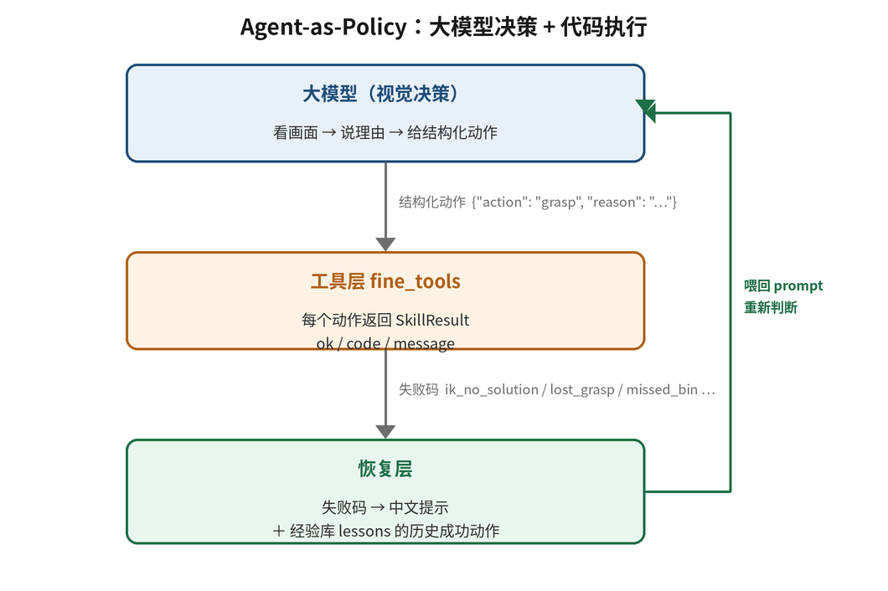
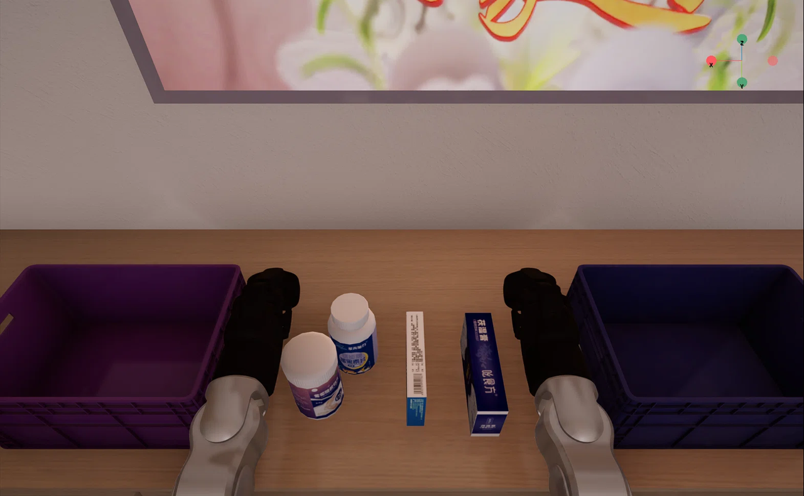

# 药品分拣 · Agent-as-Policy

Unitree G1 双臂机器人在 OrcaLab 里把药瓶放进紫色筐、药盒放进蓝色筐。

**一句话**：大模型只看画面做判断，代码负责算坐标、解逆运动学、执行和校验。

---

## Agent-as-Policy 是什么

视觉动作模型需要大量示教数据，换个物体就得重采，失败时也说不清原因；纯脚本把坐标写死，
物体一偏或抓滑一次，整条流程就停。所以我们走的路线：**模型只做判断，代码负责把判断变成动作**。

具体做法：

- **位置由模型报，坐标由标定换算。** 模型在俯视图上指出"物体中心在这个像素"，程序用事先标定好的
  单应矩阵把它换成桌面坐标（残差约 7.5 mm）。抓取和放置只给语义动作——往前一点、可以夹了、可以下放——不带坐标。
- **动作只有八种。** grasp / forward / backward / left / right / retreat / aligned / skip，
  没有连续参数，所以即使判断偏一点，也只是多走一小步，不会把机械臂送进碰撞。
- **失败会被告知。** 每个动作返回结果和失败原因（IK 无解、路径被挡、没夹住、没进筐……），
  翻译成中文交回模型换做法；同类失败下哪种处理奏效过会被记下来复用（`lessons.py`）。
- **几何做最后确认。** 物体是否真的进了筐由几何判定，模型偶尔看错左右时按几何纠偏。



---

## 1. 任务

对桌面上的药品进行分拣：两只药瓶放进左侧紫色筐，两个药盒放进右侧蓝色筐。

左臂负责药瓶（侧握，水平前伸去夹），右臂负责药盒（顶握，从上方竖直下压）；
只要求放进对应的筐，不要求摆放姿态。



---

## 2. 环境准备

### 2.1 需要什么

| 项 | 要求 |
|---|---|
| OrcaLab | ORCA Lab 开发者版（免费），需要登录后订阅 **4 个资产包**（见 2.2 ②） |
| Python | 3.12|
| GPU | 按松应官网的系统要求配置（见下方链接），主要供 OrcaLab 渲染；本项目的物理仿真跑 CPU，模型走 API |

官方入口：

- 下载安装包：<https://www.orca3d.cn/download/>
- 开发文档（含系统要求、资产订阅）：<https://docs.orca3d.cn/>
- OrcaGym 说明：<https://github.com/openverse-orca/OrcaGym>

### 2.2 安装步骤

**① 装 OrcaLab**

到 <https://www.orca3d.cn/download/> 下载 ORCA Lab 安装包并安装（Windows / Linux 都有），
按官网系统要求确认显卡与显存。装完后打开一次，确认能加载场景。

**② 订阅资产（共 4 个包，缺一个都加载不完整）**

在 OrcaLab 里登录账号，按下面的名称逐个订阅并下载：

| 资产包 | 提供什么 |
|---|---|
| NursingHome | 房间、桌子、床、窗帘、轮椅、试管架等场景物件 |
| unitree_g1_gripper | 机器人本体 `unitree_g1_1`（含夹爪） |
| AutoProductionLine_Warehouse | 紫色筐 `Box_Purple`、蓝色筐 `Box_Blue` |
| Medical | 4 件药品：`Medical_32 / 31 / 23 / 12` |

仓库里的 [`drag_classfication.json`](../../../docs/assets/medication_sorting/drag_classfication.json)
就是本项目的布局（自己配置的，引用了上面 4 个包）。在 OrcaLab 里导入这个布局，
即可得到与本 README 截图一致的场景：机器人站在桌前、左右两个筐、四件药品。

**③ 建 conda 环境**

```bash
conda create -n orcalab python=3.12 -y
conda activate orcalab
```

**④ 装 Python 依赖**

```bash
cd ~/SY/OrcaPlayground-medication-sorting
pip install -r examples/euler/medication_sorting/requirements.txt
```

`requirements.txt` 内容：

```
mujoco==3.12.0
numpy==2.2.6
scipy==1.16.2
grpcio==1.66.1
protobuf==5.29.6
av==19.0.2
Pillow==12.0.0
mink==1.4.0          
```

**⑤ 自检**

```bash
python examples/euler/medication_sorting/main.py --selfcheck
```

### 2.3 启动 OrcaLab 并确认端口

在 OrcaLab 里打开场景、确认机器人就位后，终端检查 4 个端口：

```bash
ss -tln | grep -E '50051|7070|7072|7074'
# 50051 = gRPC 控制   7070 = 头部相机   7074 = 左腕相机   7072 = 右腕相机
```

场景需要重置时：`pkill -f orcalab.main` 后重新打开。

---

## 3. 配置模型 API

模型密钥**不写进代码**，放在仓库根目录的 `.env` 里（已在 `.gitignore` 中，不会被提交）。

### 第一步：申请 API key

| 供应商 | 申请地址 | 说明 |
|---|---|---|
| Anthropic（默认） | <https://console.anthropic.com> → API Keys → Create Key | 需要能调用视觉模型 |
| DeepSeek（可选） | <https://platform.deepseek.com> → API Keys | 模型名用 `deepseek-flash`（支持图片输入） |

拿到形如 `sk-ant-...` 或 `sk-...` 的字符串。

### 第二步：新建 `.env` 并填入

在**仓库根目录**（和 `README.md` 同级）新建 `.env`：

```bash
cd ~/SY/OrcaPlayground-medication-sorting
cat > .env <<'EOF'
FABLE_API_KEY=sk-ant-xxxxxxxx
FABLE_MODEL=claude-fable-5-2
FABLE_BASE_URL=https://api.anthropic.com
EOF
chmod 600 .env
```

把 `FABLE_API_KEY` 换成你申请到的 key。

程序启动时会自动向上查找并加载 `.env`（`main._load_dotenv`），已存在的环境变量不会被覆盖。

### 换模型供应商

**DeepSeek（最省事）**：`.env` 里写 `DEEPSEEK_*` 三个变量，然后加 `--backend deepseek` 即可：

```bash
cat >> .env <<'EOF'
DEEPSEEK_API_KEY=sk-xxxxxxxx
DEEPSEEK_MODEL=deepseek-flash
EOF
python examples/euler/medication_sorting/main.py --backend deepseek
```

也可以不写 `DEEPSEEK_*`，直接复用 `FABLE_*` 三个变量指向 DeepSeek 的 Anthropic 兼容端点：

```bash
FABLE_BASE_URL=https://api.deepseek.com/anthropic
FABLE_API_KEY=<DeepSeek 的 key>
FABLE_MODEL=deepseek-flash
```

> ⚠️ 必须选**带视觉**的模型（`deepseek-flash`）。`deepseek-v4-pro` 不处理图片，
> 所有看图判断会退化成纯文本，任务一定失败。

也可以用 OpenAI 兼容端点（DeepSeek / Qwen-VL / GPT-4o）：

```bash
python examples/euler/medication_sorting/main.py --backend openai
# 读取 OPENAI_BASE_URL / OPENAI_API_KEY / OPENAI_MODEL
```

---

## 4. 运行

```bash
cd ~/SY/OrcaPlayground-medication-sorting
conda activate orcalab

# ① 环境自检：依赖 / 端口 / 相机 / 模型连通性
python examples/euler/medication_sorting/main.py --selfcheck

# ② 跑完整任务（4 件）
python examples/euler/medication_sorting/main.py
```

参数：

| 参数 | 说明 |
|---|---|
| `--selfcheck` | 不动机器人，只检查环境 |
| `--task <file>` | 任务 YAML（默认 `tasks/medication_sorting.yaml`） |
| `--homography <file>` | 单应矩阵（默认 `layouts/homography.json`；每个场景一份） |
| `--list-bodies` | 列出场景里可移动的 body（名字 / 位置 / 尺寸） |
| `--calibrate` | 为当前场景标定单应矩阵，写到 `--homography` |
| `--ref-body <name>` | 标定用的参考物体 body 名 |
| `--ref-desc <text>` | 参考物体的视觉描述（模型看图用） |
| `--output <dir>` | 输出根目录（默认 `./agent_out`） |
| `--backend anthropic\|deepseek\|openai` | 模型后端 |
| `--no-capture` | 关闭相机（调试用，视觉工具会全部失效） |
| `--full-body` | 用完整机器人模型（调试用，默认只用双臂） |

### 输出在哪里

每次运行新建一个目录，不会覆盖历史：

```
agent_out/20261118T101500Z_ab12cd34/
├── episode_result.json      每个阶段的记录（status / events / 失败码）
├── plans.json               每次运动的关节路径
├── motion_context.json      最近一次运动的目标与约束
├── prepared.xml             OrcaLab 导出的原始模型
└── prepared_armonly.xml     裁剪后的双臂模型
```

成功判据：`episode_result.json` 里 `"status": "complete"`。

事件里保留了每个阶段的**世界坐标**（`xy`、`object_position`、`hand_position`、`delta` 等），
控制台不打印这些数值——排查问题时看 JSON，不要靠翻终端。

---

## 5. 换场景 / 重新标定

单应矩阵把头部相机的像素映射成桌面坐标，**每个场景一份**。换场景、换机器人或挪动桌子后必须重标，
否则 `locate` 会把像素映射到错误位置。**只挪动物体位置不需要重标。**

```bash
# ① 看场景里有哪些可移动物体（名字 / 位置 / 尺寸）
python examples/euler/medication_sorting/main.py --list-bodies

# ② 标定这个场景（参考物要选"大、无遮挡、独一无二"的）
python examples/euler/medication_sorting/main.py --calibrate \
  --ref-body "<body 名>" --ref-desc "<它的外观描述>" \
  --homography layouts/<场景名>.json --backend anthropic

# ③ 用这份标定跑任务
python examples/euler/medication_sorting/main.py \
  --homography layouts/<场景名>.json
```

做法：把参考物体沿桌面 4×4 网格移动，每个点让模型报一次像素（默认采样 5 次取中位数），
再用 **RANSAC + Hartley 归一化**拟合 3×3 矩阵，结束自动把物体放回原位。

| 指标 | 含义 |
|---|---|
| 内点比例 | 越高越好，< 70% 说明参考物难认，换一个 |
| 内点平均残差 | 药品场景约 7 mm；< 30 mm 可用于抓取 |

---

## 6. 一次执行长什么样

控制台只讲"发生了什么"，**不打印坐标**：

```
🔭 观察场景 → 决定任务
  [推理] 桌上有两个圆柱形药瓶、两个长方形药盒
  [执行] 按模型建议排序：calcium → melatonin → herbbox → pharyngitis

🎯 圆柱形药瓶（离机器人更近、靠前的那个） → 左侧紫色筐（left臂侧握）
  [工具] 视觉定位完成
  [推理] 侧握（水平前伸），抓取点取正后方 9cm，预备点比抓取点再高 8cm
  [推理] 中                              ← 模型描述：物体相对夹爪的位置
  [执行] grasp — 对齐                    ← 模型选的动作 + 理由
  [执行] 夹持确认通过 → 切换入框状态
  [工具] 视觉定位完成
  [推理] 放左侧
  [执行] 几何检查通过（物体已在筐口范围）→ 可以下放
  [执行] 释放前几何检查：通过
```

**所有坐标、时间、失败码都写进 `episode_result.json`**，需要排查时看那份文件，
控制台留给"读得懂的过程"。

失败时不会停：失败码 → 中文提示 → 喂回模型 → 重新判断（重抓最多 3 轮、搬运绕行最多 6 次、微调失败改判）。

### 处理顺序由模型决定

开局那次观察除了描述场景，还会给出**建议的处理顺序**（如 `calcium → herbbox → …`）。
主循环要过两道校验才采纳：

1. 必须是合法排列（不重不漏）
2. **同一条手臂上必须先近后远**

第 2 条是实测教训：让远处的瓶子先抓，近处那瓶还挡在路径上，IK 只能找到碰撞解，
表现为 `ik_no_solution ... best position error 0.000000`（位置够得到，但解被拒）。
这条规则比"模型看图判断"可靠，所以由几何兜底；不满足就回退 YAML 顺序。

模型仍然可以决定**左右手的先后**（比如先左后右、或交替），只是手臂内的顺序由几何说了算。

---

## 7. 代码结构

| 文件 | 职责 |
|---|---|
| `main.py` | 入口：模型后端（Anthropic / OpenAI 兼容）、相机取帧、`main()` |
| `agent.py` | 主循环：逐物体「抓取 → 搬运 → 入框」+ 失败恢复 |
| `tools.py` | 工具层：模型能调的每个动作，全部返回 `SkillResult` |
| `failures.py` | 结构化失败码、`CODE_HINT`、`classify()` |
| `task.py` | 任务定义：读 `tasks/*.yaml`（物体 / 筐 / 手臂），harness 不硬编码物体 |
| `lessons.py` | 经验库：失败码 → 成功恢复动作（跨轮累积） |
| `scene.py` | 场景绑定、模型预处理（mesh 路径、指尖 condim、四连杆接触排除） |
| `geometry.py` | 抓取点 / 放置点几何、入筐判据 |
| `planning.py` | mink 逆运动学、RRT-Connect 路径规划、限速采样 |
| `execution.py` | 仿真推进、夹爪控制、到位校验 |
| `grounding.py` | 单应矩阵视觉接地（像素 → 桌面坐标） |
| `model_trim.py` | 裁模型：只保留双臂 + 夹爪（XML 手术 + 环境封装 + qpos 补齐） |

---

## 8. 从零复现

1. 取代码：`git clone https://github.com/JasonZhw/OrcaPlayground.git`，切到 `handoff/medication-sorting`
2. 装 OrcaLab，按第 2.2 节 ② 订阅 4 个资产包，并导入 `drag_classfication.json` 布局
3. 任务在 [`tasks/medication_sorting.yaml`](../../../tasks/medication_sorting.yaml) 里定义（物体 / 筐 / 手臂），换任务改这份即可
4. 建 `orcalab` 环境、装依赖（第 2.2 节 ③④）
5. 配模型密钥（第 3 节）
6. 打开该布局，确认机器人站在桌前、两个筐和四件药品就位
7. `--selfcheck` 通过后运行（第 4 节）

`layouts/homography.json` 已随仓库提供。换场景、换机器人或挪动桌子后必须重新标定，
否则 `locate` 会把像素映射到错误位置。

## 9. 常见问题

| 现象 | 处理 |
|---|---|
| `--selfcheck` 报端口未监听 | OrcaLab 没起 / 场景没打开 |
| 自检报"没抓到任何帧" | 相机流没开，重启 OrcaLab；或 `--no-capture` 下视觉工具必然失效 |
| `locate` 连续 3 次失败 | 检查 `layouts/homography.json` 是否匹配当前场景；或模型没返回像素 |
| 反复 `ik_no_solution` | 物体太远/太偏；可调 `geometry.grasp_target` 里的抓取高度与偏移 |
| `[执行] 输出无法解析（unknown）` | 模型输出格式跑偏，程序会自动重问；连续 6 次才失败 |
| 任务跑完但某件没进筐 | 看 `episode_result.json` 的 `status` 与最后几条事件 |

---

完整的技术设计、实现细节、评测协议与局限，见
[技术报告](../../../docs/medication_sorting_technical_report.md)（同目录下有 `.docx` 版本）。

---

## 10. 参考框架


| 参考 | 借鉴了什么 |
|---|---|
| [SayCan](https://say-can.github.io/) | 大模型输出**语义动作**，底层由可执行 skill 完成；模型不碰底层控制 |
| [ReAct](https://arxiv.org/abs/2210.03629) | 推理与行动交替：`[推理] → [执行] → [工具] → 观察结果` |
| [Code as Policies](https://code-as-policies.github.io/) | 每个能力是**带返回值的函数**，模型只负责挑函数和参数 |
| [Voyager](https://voyager.minedojo.org/) | 把失败经验沉淀下来跨轮复用（对应本项目的 `lessons.py`） |
| [RobotUse](https://arxiv.org/abs/2610.04929) | backend 承担几何与运动、视觉**点目标**接地、持久化经验、`place ≠ release` |


## 11. 能力边界

harness 复用的目标已达成：任务定义在 YAML，抓取/放置几何由包围盒推导，模型后端可切换。
以下暂作为**已知边界**，不影响现有任务，换新场景/新物体时再迭代：

- **抓取高度 `fraction`、筐内落点 `DROP_SLOTS`**：目前按物体名写在 `geometry.py`，换物体需手调。
- **场景绑定 `BODY_SUFFIXES`**：物体/筐的 MuJoCo body 名靠这张表映射，换场景时需要改（或先用 `--list-bodies` 看名字）。
- **单臂**：当前是 G1 双臂；任务只用一条臂时，把 YAML 里所有 `arm` 设成同一侧即可，另一条臂闲置。
- **单应矩阵的精度上限**：VLM 报像素有 ±10 px 噪声，相机斜视时"深度"方向信号弱，
  标定残差通常在 1~3 cm 量级。因此像素只能用来**判断是哪个物体**，不能当作毫米级定位；
  物体身份确定后，抓取点用仿真里的真实位姿。

一句话：**换任务 / 换模型已解耦；换场景需要一次标定 + 改 `BODY_SUFFIXES`，抓取高度与落点仍是手调参数。**
