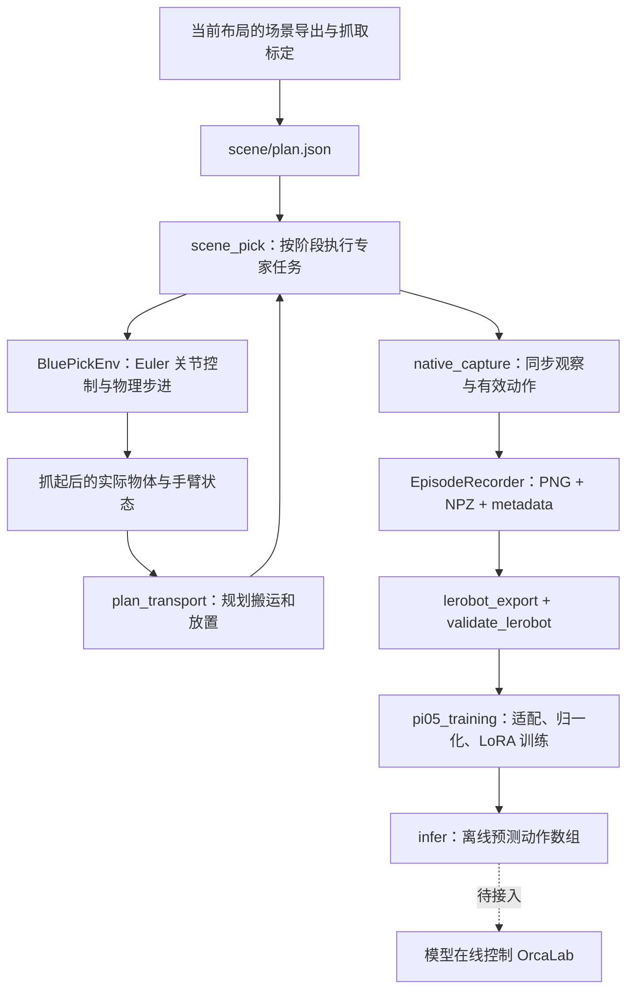

# G1：浅蓝色盒子抓取、示范采集与 π0.5 训练

当前任务：**把桌面上浅蓝色且最小的盒子放进左侧木托盘。** 使用右臂和右夹爪，固定底盘，左臂先放下；记录头部与右腕两路相机。开发分支为 `feature/Synthetic_Data`，仿真使用 `orcalab_9_1` 环境。

截至 2026-10-28：8 条已验收示范、26,617 帧已转换成 LeRobot v2.1，训练适配和本地数据回读检查已完成。云端 GPU 训练、微调模型的预测和 OrcaLab 闭环推理尚待验证。当前专家使用 IK 路点，未接入 cuRobo。

## 从哪里开始

| 想做什么 | 入口 / 说明 |
| --- | --- |
| 理解代码与数据如何串联 | 本页下方的流程和模块表 |
| 执行当前布局、录一条示范 | [采集说明与启动命令](CAPTURE.md) |
| 转换、验证 LeRobot 数据 | [数据转换说明](LEROBOT.md) |
| 在云端训练、做离线预测 | [π0.5 训练包](pi05_training/README.md) |
| 查看初期实验与参数来源 | [历史开发记录](HISTORY.md) |
| 查看盒子抓取与搬运的调试过程 | [包装盒验证记录](NEW_LAYOUT_PICK_REPORT.md) |

## 整体流程



这条流程包含三个不同角色：专家负责产生示范，记录器保存示范，π0.5 学习从观察预测动作。任务文本在专家采集时是标签，不参与专家选物；专家目标由 `plan.json` 的 `target_body` 指定。训练后模型才需要根据图像和文本决定动作。

## 代码如何分工

源码保留现有模块路径，原来的 `python -m ...` 启动命令继续可用。按职责阅读即可，无需先看整个仓库。

| 层次 | 文件 | 职责 |
| --- | --- | --- |
| 执行入口 | [scene_pick.py](scene_pick.py) | 解析参数、核验场景和计划，执行抓取/搬运/回位阶段，组织录制并保存结果 |
| 物理与控制 | [blue_env.py](blue_env.py) | `BluePickEnv` 继承 `OrcaGymEulerEnv`；通过公开 API 读取状态、固定底盘、发送伺服目标和推进仿真 |
| 夹爪控制 | [gripper_control.py](gripper_control.py) | 关节顺序、初始开合指令、搬运期间保持八路夹爪目标，释放时解除保持 |
| 搬运规划 | [plan_tray_transfer.py](plan_tray_transfer.py) | 在独立 MuJoCo 模型中做 FK/IK 和碰撞采样；依据实际持物姿态规划抬高、转腕、横移、下放与退手 |
| 空手回位 | [return_home.py](return_home.py) | 放置通过后规划右臂回布局初始位置，保持夹爪张开 |
| 采集协调 | [native_capture.py](native_capture.py) | 获取相同仿真索引的头部/右腕画面，记录执行前状态和有效动作，再调用 `env.step()` |
| 原始存储 | [episode_recording.py](episode_recording.py) | 三种英文任务表述、9 维动作编码/展开、PNG/NPZ/metadata 写入与同步检查；自身不推进仿真 |
| 数据转换 | [lerobot_export.py](lerobot_export.py)、[validate_lerobot.py](validate_lerobot.py) | 按显式清单转换，再通过真实 LeRobot 读取器核验数值、文本、视频时间轴和动作块 |
| 模型接口 | [pi05_training/adapter.py](pi05_training/adapter.py) | 相机与状态映射到 OpenPI 输入，输出恢复为 9 维动作 |
| 训练配置 | [pi05_training/config.py](pi05_training/config.py) | π0.5 LoRA、数据位置、动作长度、学习率等配置 |
| 训练入口 | [pi05_training/run.py](pi05_training/run.py) | `data-smoke`、`norm`、`train`、`infer` 四个子命令 |

其余文件按用途查阅：

- `geometry.py`、`grasp_alignment.py`：碰撞体边界、坐标变换、接触对齐分析。
- `placement_sample.py`：从执行状态构造放置检查所需的测量值。
- `placement_result.py`、`scene_transfer_result.py`：放置与完整搬运的判定；任务完成和严格质量诊断分别保留。
- `inspect_scene.py`、`task.py`、`task.json`：只读场景查询及早期双物体几何预检。默认配置仍指向灰件/蓝件，不是当前包装盒的抓取配置。
- `blue_pick.py`、`transport_result.py`、`blue_pick_plan.json`：早期蓝件验证。`scene_pick` 仍复用 `blue_pick` 中的模型准备、文件哈希和抓持评估函数，不能直接删除它。
- `left_arm_down_pose.json`：已验证的左臂待机路径参考；当前执行以传入 `plan.json` 的左臂路点为准。
- `TASK_DESIGN.md`：早期任务设计参考；当前接口以本页、[CAPTURE](CAPTURE.md) 和 [LEROBOT](LEROBOT.md) 为准。

### 专家如何完成一条任务

`scene_pick.main()` 的启动参数与计划读取独立在 `parse_args()` 中，执行顺序为：

1. 校验场景 XML、资产、计划和初始关节；在线执行还检查当前 OrcaLab 场景是否匹配。
2. 固定 pelvis，按计划放下左臂，等待物体稳定。准备阶段结束后开始录制。
3. 执行计划中的接近、夹取、对齐、加紧和抬升路点；加紧后保持全部八路夹爪目标。
4. 抓起后读取实际物体相对手臂的姿态，调用 `plan_transport()` 生成后续搬运阶段。计算期间不推进物理时间。
5. 逐步执行横移、下放；松爪前检查物体在托盘内且接近底板，再解除夹爪保持、松开和退手。
6. 放置检查通过后调用 `plan_home_return()`，让右臂回到布局默认位置，最后保存任务结果、诊断和 episode。

控制周期为 0.02 秒仿真时间，即 50 Hz；每个控制步包含 10 个 0.002 秒物理子步。相机等待和规划会拉长墙钟时间，不改变数据的仿真采样间隔。

`BluePickEnv` 虽沿用早期蓝件名称，当前包装盒也使用它。实际物体由物理接触夹持；规划器只在自己拥有的静态模型中保持物体与手臂的相对姿态进行预测，不会把实际物体焊在夹爪上。

### 一帧训练数据从哪里来

```text
读取实测关节状态和仿真时间
    → 计算夹爪保持逻辑生效后的动作
    → 获取两路相同 simulate_index 的画面
    → 检查拍摄期间状态未变化
    → 写入 observation_t / action_t
    → 执行动作，核对实际指令与记录一致
```

| 内容 | 固定约定 |
| --- | --- |
| `observation.state` | 15 维：实测右臂 7 维＋实测夹爪内部关节 8 维 |
| `action` | 9 维：右臂 7 个绝对目标＋连续夹爪参数 `a,d` |
| 夹爪展开 | `[0,0,a,d,0,0,-a,d]`，按记录的关节名称顺序 |
| 图像 | `head_cam → head`、`camera_right → right_wrist`；保持宽高比缩放补黑边到 224×224 RGB |
| 文本 | `TASK_TEXTS` 的三种英文同义表述；`--task-index 0/1/2` 为整条 episode 选一句 |
| 对齐 | 执行前的观察对应即将执行的动作，无额外一帧偏移 |
| 时间 | 50 Hz 仿真时间；LeRobot 时间戳为帧号除以 50 |

训练使用夹爪保持逻辑生效后的名义动作，不使用保持前的 `requested_action`，也不使用底层补偿后的 `servo` 输入。夹爪 `a,d` 不是牛顿单位的力，也不是两个二值开关。

## 数据和代码分别在哪里

```text
~/SY/OrcaPlayground/examples/euler/tray_transfer/   可维护的源码、配置与说明
~/SY/OrcaPlayground/tests/test_tray*.py 等          CPU 回归检查
~/SY/datasets/tray_transfer/<批次>/
    scene/plan.json、场景 XML 与资产              该布局的运行输入
    tools/                                       该批标定/重规划工具（如有）
    diagnostics_*/                               接触、轨迹、计划、源码快照、结果
    episode_*/                                   原始 PNG、NPZ、metadata
~/SY/datasets/lerobot/local/g1_lightblue_box_tray_v1/   已转换数据
~/SY/exports/pi05_tray_pilot_v1/                   云端交付包
```

`pilot`、`layout` 等只是采集批次名称，不是不同训练数据格式。真正参与本轮转换的 8 条记录由 [lerobot_manifest_v1.json](lerobot_manifest_v1.json) 明确列出。源码整理不会改写过去的 `diagnostics/code` 快照、原始 episode 或已导出的训练包。

## 当前边界与后续接口

- **换布局需要重新生成抓取计划。** 当前 `scene_pick` 读取已生成的 `scene/plan.json`；初始抓取标定/重规划脚本还保存在各批次的 `tools/` 中，包含特定布局和参考路径。`inspect_scene` 不会自动生成当前盒子的抓取计划，`plan_transport` 负责的是抓起后的搬运。
- **成功记录与质量诊断分开。** 本轮包含 8 条用户验收记录，其中 7 条含回位，另 1 条保留未回位和严格夹持诊断未通过的标记。它们全部用于本轮试训，尚无独立验证集，不能据此报告泛化成功率。
- **训练适配已准备，在线模型控制未实现。** `infer` 从数据集取一帧，加载 checkpoint，输出 `(50,9)` 动作数组；不会连接 OrcaLab。后续控制客户端需要读取实时双相机和状态、执行动作块的一部分，再更新观察。
- **模型控制时要适配夹爪保持。** 专家按阶段解除闭合保持；模型运行时应允许预测的 `a,d` 在放置阶段控制张开，不能用专家的永久保持覆盖它。
- **场景资源不随源码发布。** 新克隆需要对应场景导出和资产。修改源码后实现哈希会变化，旧离线证据不能直接冒充当前代码的验证记录。

## 开发检查

下面的检查不启动 OrcaLab、不推进场景、不下载模型权重：

```bash
conda activate orcalab_9_1
cd ~/SY/OrcaPlayground
python -m unittest discover -s tests -p 'test_tray*.py'
python -m unittest discover -s tests -p 'test_blue*.py'
python -m unittest discover -s tests -p 'test_scene*.py'
python -m unittest tests.test_grasp_alignment
python -m unittest discover -s examples/euler/tray_transfer/pi05_training -p test_adapter.py
python -m ruff check examples/euler/tray_transfer tests/test_tray*.py tests/test_blue*.py tests/test_scene*.py tests/test_grasp_alignment.py
```

LeRobot 写入/回读集成检查需要独立转换环境，命令见 [LEROBOT](LEROBOT.md)。CPU 检查验证代码约定，实际抓持、视觉效果和模型成功率仍需相应的仿真执行。
