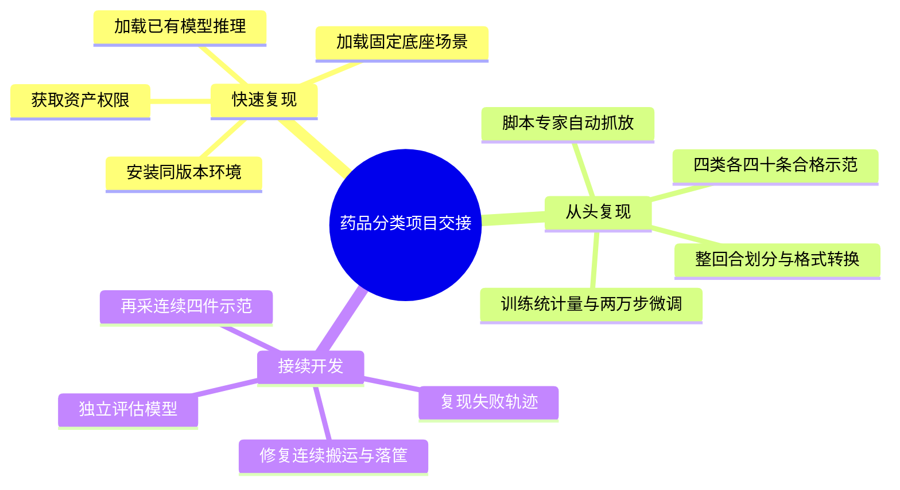

# 药品分类项目开发记录与复现手册

更新日期：2026年10月17日。适用对象：在自己的电脑上接手项目的开发者。

**阅读顺序：先看第1章和第3章。复用已有模型：第4至第6章；自己采集并训练：第4、5章 → 第7章启动采集 → 第8章训练 → 第9章推理评估，不必先执行第6章。**

本文基于当前代码和落盘记录整理，不是最初训练营26.7.1版教程。原机已经跑过采集、训练和仿真推理；尚未在接收方电脑上完成跨机验收。

## 1. 项目做什么，目前做到哪里

目标：在OrcaLab中，让固定底座G1使用右臂夹爪，把两种药盒放入紫色筐、两种药瓶放入蓝色筐。先用自动专家脚本产生示范，再微调π0.5，由模型根据图像、机器人状态和任务文本输出动作。

| 物品 | 代码中的Actor名称 | 目标筐 |
| --- | --- | --- |
| 咽炎片盒 | `pharyngitis_tablets_box_1` | 紫色 |
| 饮品盒 | `fu_shi_gao_herb_drink_packaging_box_1` | 紫色 |
| 褪黑素瓶 | `melatonin_tablet_bottle_1` | 蓝色 |
| 葡萄糖酸钙片瓶 | `calcium_gluconate_tablets_bottle_1` | 蓝色 |

### 1.1 已完成的成果

- 自动采集160条合格单物品示范，每种40条，来自295次实际尝试。
- 按完整回合划分128条训练、32条验证；训练12,439帧，验证3,148帧。
- 完成π0.5 LoRA微调20,000个优化器步，最终检查点目录为`19999`。
- 已跑通模型服务到真实MuJoCo物理抓放的仿真推理，不使用专家动作回退。

### 1.2 结果必须分开看

| 实验 | 结果 | 说明 |
| --- | --- | --- |
| 20,000步模型首次单物品评估 | 10/40，25% | 四种各10次，每回合重新初始化 |
| 后续动作执行长度对照中的chunk=4 | 16/40，40% | 复用了首次40组物品/seed，不能替代新的独立验收 |
| 夜间连续专家筛选 | 0/75整轮 | 25组参数共用3组初态做配对对照 |
| 选中专家参数的新初态复核 | 0/10整轮 | 不是VLA推理结果 |

**当前没有完成“四件连续分类成功”的验收，也没有采集新一批严格连续四件RGB示范或据此重新训练。**

首次10/40同样使用chunk=4，所以不能把后来的16/40全部归因于改变chunk。两次均加载19999模型，后一次属于复用测试初态的调参对照。

当前场景的两个药瓶为原尺寸70%，紫筐相对原始场景放大20%。随机摆放仅覆盖目标初始位置每轴±2厘米、偏航±15度、保持直立，不是整张桌面任意摆放，更不代表真实机器人部署效果。

## 2. 开发过程与关键决策

| 阶段 | 做了什么 | 为什么这样做 |
| --- | --- | --- |
| 10月12日：场景检查 | 检查药品、篮筐、G1资产和通信入口，处理本机代理干扰 | 先确认场景和接口可用 |
| 10月13日：单药盒基线 | 固定G1根关节、调整工作位置，建立IK专家、双RGB采集和π0.5适配 | 暂不解决人形站立平衡，先跑通右臂抓放 |
| 10月13日：训练闭环 | 从1,500步、6,000步到12,000步进行小规模验证；修复检查点保存内存峰值 | 证实数据能训练、模型能部署，而不只看loss |
| 10月14日：扩展四种物品 | 为每种物品建立目标标签、提示词和抓放参数；药瓶缩为70% | 原尺寸瓶与夹爪开口余量不足，先建立受控实验 |
| 10月14日至16日：正式160条 | 每类40条，失败保留、合格补采；饮品盒落点增加筐局部Y方向2.5厘米补偿 | 修复实际越界问题，保持其他物品参数不变 |
| 10月16日：20,000步与推理 | 完成四类数据训练、检查点保存、40次单物品评估和动作块长度对照 | 测量模型真实抓放能力 |
| 10月16日：尺寸与路径诊断 | 测量碰撞尺寸，比较底座、夹持方向、搬运和释放路径 | 判断失败是否来自开口、可达性、干涉或滑移 |
| 10月16日晚：连续专家对照 | 共85轮，复核0/10；22:32完成预定批次后停止 | 专家尚不稳定，不继续生成连续示范或训练 |

当前自动专家是**数值IK、分阶段抓放和实际物理反馈**，没有接入CuRobo规划，也不需要PICO。CuRobo的安装记录不等于本任务已经使用它生成轨迹。

### 2.1 实际的数据与控制链路

```text
采集：场景真值 → IK专家 → 执行器目标 → MuJoCo物理步进
                                       ↓
                           双RGB + state + action + 验收证据
                                       ↓
                     合格完整回合 → LeRobot → π0.5 LoRA

推理：双RGB + 机器人state + 任务prompt
                    ↓
              π0.5策略服务
                    ↓
           8维动作 → 限位与速率限制
                    ↓
          OrcaGymLocal物理步进 → OrcaLab渲染
```

实现使用`OrcaGymLocal`：经gRPC从OrcaLab取得模型、建立本地MuJoCo物理步进，并把状态同步到OrcaLab渲染；不是每个物理子步都由远端OrcaLab执行。MCP用于场景加载和原生视图截图。

## 3. 交接文件与目录

原机项目根目录是`/home/pc/ZXJ/SY`。朋友可以放到自己的目录，下文以`$HOME/medication-sorting`为例。

```text
medication-sorting/
├── tools/medication_sorting/       采集、训练、推理、诊断与对应测试
├── tools/orca/                    原机启动辅助脚本，部分含固定路径
├── tests/                         项目级测试
├── pytest.ini
├── environment/medication_sorting/
│   └── requirements-base-reference.txt
├── docs/medication_sorting/        本文和专题说明
├── docs/plans/                    历史决策与后续方案
├── docs/reports/                  尺寸、底座、连续路径诊断
├── software/
│   ├── OrcaPlayground/            官方代码，固定commit
│   └── openpi/                    官方代码，固定commit，保留.git
├── runtime/cache/openpi/big_vision/
│   └── paligemma_tokenizer.model  约4.1MB，训练和推理均需要
└── data/medication_sorting/
    ├── scenes/                    原场景和实验场景
    ├── lerobot/local/             转换后的训练集和验证集
    ├── openpi_assets/             自己数据的norm_stats
    ├── checkpoints/               微调模型与续训状态
    ├── pretrained/pi05_base/      从官方基座重新训练时使用
    ├── multi_object/              原始示范、划分和首次评估
    ├── policy_evaluations/        后续模型评估与对照
    ├── geometry_audits/           物理诊断证据
    └── overnight/20261016/        最新连续专家实验
```

### 3.1 最小交接与完整交接

| 内容 | 用途 | 原机占用 |
| --- | --- | --- |
| `tools/`、`tests/`、文档、依赖参考、`scenes/` | 所有路线都需要 | 较小 |
| 最新`19999/`完整目录 | 加载已有模型；含`params/`、`assets/`、`train_state/`、提交元数据 | 约8.9GB |
| 两份四药品LeRobot数据集 | 复用已有数据训练、保留独立验证 | 约990MB + 251MB |
| tokenizer及现有任务norm_stats | 避免额外下载，保证使用正确统计量 | 较小 |
| 正式`production/raw/` | 审计原始回合、重建跨机划分、分析失败 | 约34GB，含失败尝试 |
| 官方`pi05_base/`及其下载manifest | 从官方基座开始新实验 | 约12GB，可重新下载 |
| `overnight/`、`geometry_audits/`、相关推理报告 | 接续优化 | 按需传输 |

已有模型推理不需要重新下载官方基座，也不需要读取训练集；但必须有完整推理参数、对应统计量和tokenizer。为便于后续续训，建议直接交接完整`19999/`。

本交接副本位于 `JasonZhw/OrcaPlayground` 的 `projects/medication_sorting/`，使用 `handoff/medication-sorting` 分支。模型与数据通过独立渠道交接，不包含在GitHub代码中；详见[发布范围与迁移说明](../发布范围与迁移说明.md)。

不交接`.venv/`、账号密码、Token和整个运行缓存。商业/受限资产不应擅自重新发布。**场景JSON只保存资产引用，朋友需要自己的资产访问权限。**

## 4. 在新电脑准备环境

### 4.1 已验证的原机配置

| 项目 | 原机配置 |
| --- | --- |
| 系统 | Ubuntu 24.04.4 LTS，Linux x86_64 |
| GPU | NVIDIA GeForce RTX 5090，约32GB显存 |
| NVIDIA驱动 | 580.159.03 |
| 主机内存 | 约30GiB可见物理内存，8GiB swap |
| Python | 3.12.14 |
| OrcaLab / OrcaGym | 26.9.1 / 26.9.1 |
| MuJoCo / 仿真NumPy | 3.12.0 / 2.2.6 |
| PyTorch | 2.14.1+cu130，CUDA 13.0构建 |
| 训练层JAX / jaxlib | 0.5.3 / 0.5.3，CUDA12插件 |
| 训练层NumPy | 1.26.4 |
| Transformers / Orbax | 4.53.2 / 0.11.13 |
| LeRobot | 固定Git revision的0.1.0旧API |

这是经过项目适配的混合环境，不是直接执行OpenPI官方`uv sync`得到的完整官方环境。训练走**JAX LoRA**，不是PyTorch训练器。

朋友的显卡和系统尚未核对。建议先使用原生Ubuntu和NVIDIA GPU；小显存设备是否能运行需要独立验证。原生Windows不能直接照抄本文全部脚本，其中使用了Linux路径和`fcntl`。重新采集并训练建议预留至少100GiB可用空间，还要额外考虑OrcaLab资产下载；原始历史目录与多个旧检查点不必全部复制。

### 4.2 项目路径与Python

在Ubuntu图形桌面终端操作。先准备系统基础依赖：

```bash
sudo apt update
sudo apt install git python3.12-venv libxcb-cursor0 libxkbcommon-x11-0 libegl1
```

如果从GitHub取得代码，先进入本项目目录，再创建自己的Python环境。以下假设外层仓库在 `~/OrcaPlayground`；独立代码包解压到其他目录时替换第一行路径：

```bash
export SY_ROOT="$HOME/OrcaPlayground/projects/medication_sorting"
cd "$SY_ROOT"
unset PYTHONPATH PYTHONHOME LD_PRELOAD
python3.12 -m venv .venv
.venv/bin/python -m pip install --upgrade pip
```

上述系统包针对Ubuntu24.04，不代表所有电脑的图形驱动问题都能通过这几个包解决。不要复制原机`.venv`，也不需要创建名为`ZXJ_VIP`的环境。

**以后每开一个新终端，先执行下面这一段。** 后文各终端都使用同一套项目路径和Python：

```bash
export SY_ROOT="$HOME/OrcaPlayground/projects/medication_sorting"
cd "$SY_ROOT"
export PATH="$SY_ROOT/.venv/bin:$PATH"
unset PYTHONPATH PYTHONHOME LD_PRELOAD
export HF_LEROBOT_HOME="$SY_ROOT/data/medication_sorting/lerobot"
export OPENPI_DATA_HOME="$SY_ROOT/runtime/cache/openpi"
export NO_PROXY="localhost,127.0.0.1,::1"
export no_proxy="$NO_PROXY"
```

### 4.3 安装仿真侧依赖

```bash
.venv/bin/python -m pip install torch==2.14.1 --index-url https://download.pytorch.org/whl/cu130
.venv/bin/python -m pip install -r environment/medication_sorting/requirements-base-reference.txt
```

随附requirements是原机核心版本参考，不是全量传递依赖锁。2026年10月17日核查时，PyTorch官方cu130索引存在对应Python3.12/Linux x86_64的2.14.1 wheel；新机器仍需匹配驱动和硬件。CuRobo、PICO、ROS和完整CUDA Toolkit不是当前IK采集路线的必需安装项。

### 4.4 固定官方仓库版本

如果交接包没有`software/`源码，执行下列命令；若已有目录，只核对commit，不再重复clone：

```bash
mkdir -p software
git clone https://github.com/openverse-orca/OrcaPlayground.git software/OrcaPlayground
git -C software/OrcaPlayground checkout a774fae0f0850780a14d1cca0c3018931d22e71d
git clone https://github.com/Physical-Intelligence/openpi.git software/openpi
git -C software/openpi checkout 215abfb217dbac7d5f1273282331b9b1866c0479
```

| 仓库 | 锁定版本 |
| --- | --- |
| OrcaPlayground | `release/26.9.1`对应commit `a774fae0f0850780a14d1cca0c3018931d22e71d` |
| OpenPI | `215abfb217dbac7d5f1273282331b9b1866c0479` |
| LeRobot | `0cf864870cf29f4738d3ade893e6fd13fbd7cdb5`，由训练层安装器获取 |

OpenPI目录必须保留`.git`，安装器会核对commit；不要直接改上游OpenPI代码。本项目的适配都放在`tools/medication_sorting/`。

### 4.5 新电脑的路径与桌面会话

交接副本已将 `rendered_rgb.py` 中的原机截图路径改为当前用户的 `~/.orcalab`，无需再次编辑代码。特殊安装可以设置 `ORCALAB_CAPTURE_DIR` 指向OrcaLab实际输出目录。OrcaLab与采集进程必须由同一用户启动、保持相同HOME；先实测两路截图，再做批量采集。

本副本的环境辅助脚本自动定位项目目录，长任务启动器继承当前 `DISPLAY`、`WAYLAND_DISPLAY` 和 `XAUTHORITY`，不再写死原服务器会话。在Ubuntu图形桌面的终端启动；纯SSH或无桌面时需要自己配置有效图形会话，脚本不会猜测会话编号。Qt依赖优先使用第4.2节安装的系统库。

## 5. 资产、底座固定与场景恢复

### 5.1 登录并同步资产

在终端1执行：

```bash
cd "$SY_ROOT/software/OrcaPlayground"
"$SY_ROOT/.venv/bin/orcalab"
```

首次启动按官方流程完成界面组件初始化，使用朋友自己的账号登录。若出现“选择仿真程序”窗口，选择“无仿真程序（手动启动）”，由后续脚本控制。中文可以在“编辑 → 配置”切换。

当前Layout声明以下资产包，需对其中实际引用的资产有访问权限并同步：

| 资产包声明名称 | 用途 |
| --- | --- |
| `NursingHome` | 场景环境 |
| `unitree_g1_gripper` | 带夹爪的G1，技术名`g1_pick_with_gripper` |
| `AutoProductionLine_Warehouse` | 篮筐等物体 |
| `Medical` | 药品 |

其中G1引用了特定发布者的资产，不能默认所有新账号都有权限。如果资产中心找不到，应联系资产所有者或平台开通访问，而不是用一个结构不同的G1替换后继续运行。只有机器人外观相同、关节和夹爪结构不同，也无法直接复用这套控制器。

### 5.2 为什么固定底座

当前只学习右臂抓取，不处理行走和平衡。G1的根关节在实验Layout中设为`fixed`，不是在每个控制步强写机器人位置；右臂和夹爪仍通过执行器、接触和MuJoCo物理运动。

控制器还包含重力补偿、位置伺服和夹爪四连杆标定；只豁免同一机械连杆链内部相交网格的自碰撞，保留手指之间以及手指与药品、桌面的接触。不要只替换为一个普通Gym环境后期待得到同样效果。

| 场景文件，均位于`data/medication_sorting/scenes/` | 定位 |
| --- | --- |
| `drag_classfication.json` | 原始场景，保留不覆盖 |
| `drag_classfication_fixed_base.json` | 早期固定根关节副本 |
| `drag_classfication_capture.json` | 正式采集基础场景：固定底座、G1相对原场景平移`[0.14,-0.18,0]`米、紫筐放大20% |
| `drag_classfication_bottles70.json` | 当前正式场景，在capture基础上只将两个药瓶比例乘0.7 |

快速复现直接加载已交付的`drag_classfication_bottles70.json`，不用重新修改场景。机器人顶层Actor位置与pelvis刚体位置并不相同，不要把两者的坐标直接互换。当前相机位姿、手臂home位置和专家航点高度都基于这个场景的世界坐标，不能先把场景整体搬到原点再照抄命令。

如需研究生成过程，可另存新副本，绝不覆盖正式文件：

```bash
.venv/bin/python -m tools.medication_sorting.fixed_layout \
  --source data/medication_sorting/scenes/drag_classfication.json \
  --output data/medication_sorting/scenes/friend_fixed_example.json \
  --robot-offset 0.14 -0.18 0 --basket-scale-factor 1.2
```

该命令说明固定根关节和位置调整方法，不保证重新序列化的文件与历史capture文件逐字相同。当前专家配置会严格核对70%场景，做基线时仍以交接的正式文件为准。

### 5.3 加载当前场景

保持OrcaLab已打开，在终端2初始化第4.2节环境后执行：

```bash
.venv/bin/python tools/medication_sorting/prepare_scene.py \
  --layout data/medication_sorting/scenes/drag_classfication_bottles70.json \
  --record-seconds 0
```

此入口先检查资产、备份当前编辑场景，再加载Layout并以手动外部控制模式启动仿真。保持OrcaLab窗口和图形会话可用，暂不运行空循环、官方G1运控或其他控制程序。

端口开放只能说明有服务监听，不能证明抓取成功。`prepare_scene.py`默认加载原始场景，所以本文所有正式命令均显式提供`--layout`。

## 6. 最快路线：用已有模型做一次推理

### 6.1 安装训练与策略服务依赖层

完成OrcaLab首次初始化后，在项目根目录执行：

```bash
.venv/bin/python tools/medication_sorting/setup_pi05.py --dry-run
.venv/bin/python tools/medication_sorting/setup_pi05.py install --execute
bash tools/medication_sorting/pi05_python.sh --cpu \
  -m tools.medication_sorting.setup_pi05 verify
```

安装器只向`.venv/pi05-deps`写入JAX/LeRobot等依赖，仿真侧继续使用原NumPy2.2.6。训练、转换和策略服务通过`pi05_python.sh`启用NumPy1.26.4与固定JAX依赖。**不要将两套依赖直接混装，也不要对基环境执行OpenPI的全量依赖同步。**

安装中断时，同一环境可以执行`install --execute --retry`恢复；已完整安装的依赖层不重复执行安装。新电脑重新生成自己的安装manifest，不复制原机依赖层。

CPU verify检查数据写读和动作变换，不会加载真实模型或证明GPU训练成功。GPU首次使用前可做小运算验证，先确认没有本项目的训练或策略服务占用GPU：

```bash
XLA_PYTHON_CLIENT_MEM_FRACTION=0.05 \
bash tools/medication_sorting/pi05_python.sh \
  -m tools.medication_sorting.setup_pi05 verify --gpu
```

### 6.2 恢复模型与tokenizer

将完整`19999/`放到下列位置，保留内部文件名和目录：

```text
data/medication_sorting/checkpoints/pi05_g1_medication_sorting_lora/
└── g1_four_medication_160_20261014_20k/19999/
    ├── _CHECKPOINT_METADATA
    ├── params/
    ├── assets/local/g1_four_medication_160_20261014_train/norm_stats.json
    └── train_state/
```

同时交接`runtime/cache/openpi/big_vision/paligemma_tokenizer.model`。缺少缓存时，OpenPI会尝试从官方`gs://big_vision/paligemma_tokenizer.model`下载，需要网络可达；不要随便换成另一个tokenizer。

### 6.3 启动模型服务

终端3先初始化第4.2节环境，再执行：

```bash
export MODEL_REPO=local/g1_four_medication_160_20261014_train
export CHECKPOINT="$SY_ROOT/data/medication_sorting/checkpoints/pi05_g1_medication_sorting_lora/g1_four_medication_160_20261014_20k/19999"
XLA_PYTHON_CLIENT_MEM_FRACTION=0.65 \
bash tools/medication_sorting/pi05_python.sh \
  -m tools.medication_sorting.pi05_adapter \
  --repo-id "$MODEL_REPO" --action-horizon 10 \
  serve -- --policy.dir="$CHECKPOINT" --port=8000
```

等待模型加载与首次编译。`--policy.dir`指向数字步号`19999`目录，不能指向`params/`或实验父目录。`repo-id`必须与该检查点中的统计量路径一致。

### 6.4 执行一次单药盒推理

终端2保持当前正式场景已加载，执行：

```bash
export CHECKPOINT="$SY_ROOT/data/medication_sorting/checkpoints/pi05_g1_medication_sorting_lora/g1_four_medication_160_20261014_20k/19999"
.venv/bin/python -m tools.medication_sorting.evaluate_policy \
  --checkpoint-reference "$CHECKPOINT" \
  --target pharyngitis_tablets_box_1 \
  --profile randomized_tabletop_70 \
  --layout data/medication_sorting/scenes/drag_classfication_bottles70.json \
  --randomization-profile tabletop_v1 \
  --episodes 1 --seed-start 4200000000 \
  --steps 150 --execute-chunk 4 --control-hz 5 \
  --output "data/medication_sorting/policy_evaluations/friend-smoke-$(date +%Y%m%d-%H%M%S)"
```

该命令由模型自己控制动作，保存`summary.json`、每回合`report.json`、图像和轨迹。退出码1可能表示真实任务失败，不一定是安装错误，先看报告中的`error`。

此快速路线未提供旧的`--training-manifest`，因此不会声称已经在朋友电脑重新审计训练集分离。原划分含绝对软链接，直接带到新机器会失效；正式新评估的来源审计见第9章。

**快速复现的第一目标：模型真实加载、收到双RGB、输出8维动作、机器人执行并生成完整报告。抓放是否成功按报告如实记录，不能承诺任意一次摆放必定成功。**

## 7. 自动采集：没有PICO也能做示范

### 7.1 专家如何工作

```text
初始化目标随机位置和偏航角
          ↓
接近 → 下探 → 闭爪 → 抬升 → 搬运 → 放低 → 松爪 → 撤离 → 稳定检查
          ↓
记录动作前观测、实际动作、物理轨迹和验收证据
```

专家可读取物体位置和接触真值来生成示范，这是仿真监督来源；VLA推理不能把这些真值作为动作输入。运行中不瞬移药品、不加吸附或焊接。随机摆放只发生在回合初始化。

### 7.2 底层控制与数据约定

| 项目 | 当前约定 |
| --- | --- |
| 机器人 | 固定底座G1，仅右臂与右夹爪参与任务 |
| state/action | float32，8维；前7维为固定顺序的右臂关节位置，单位rad；第8维夹爪闭合比例 |
| 夹爪语义 | 0=张开，1=闭合 |
| 数据侧动作 | 绝对关节位置目标，不是末端XYZ或速度 |
| 控制频率 | 5Hz，物理步长0.001秒，每动作推进200子步 |
| 双视角 | 固定俯视`base_rgb`，虚拟手端跟随`wrist_rgb` |
| 图像 | uint8 RGB，224×224；固定gamma=0.45 |
| 同步 | 暂停物理后取两张图，取图之间不步进，再执行动作 |

手端视图来自原生视口渲染，不是物理腕部相机。原生`head_cam/camera_right`路径有黑图问题，当前统一使用`viewport`后端；采集和推理必须保持一致。5Hz是仿真时间频率，不代表墙钟每秒一定采五帧。

### 7.3 启动顺序：先开OrcaLab，再运行采集脚本

首次使用先完成第4章的环境安装和第5章的资产授权。**自动采集不需要先训练π0.5，也不需要启动模型服务。** 如果前面正在推理，先停止推理程序和模型服务，避免争用机器人或显存。

下面用两个终端操作。朋友电脑沿用第4.2节的 `$HOME/OrcaPlayground/projects/medication_sorting`；如果克隆在其他目录，替换为实际项目目录。在原服务器运行时，把两个终端中的 `SY_ROOT` 都改为 `/home/pc/ZXJ/SY`。已打开OrcaLab时，不再启动第二个窗口。

**终端1：打开OrcaLab，保持窗口运行。**

```bash
export SY_ROOT="$HOME/OrcaPlayground/projects/medication_sorting"
cd "$SY_ROOT/software/OrcaPlayground"
"$SY_ROOT/.venv/bin/orcalab"
```

如果弹出“选择仿真程序”，选择“无仿真程序（手动启动）”。

**终端2：初始化第4.2节的终端环境，然后加载采集场景。**

```bash
.venv/bin/python tools/medication_sorting/prepare_scene.py \
  --layout data/medication_sorting/scenes/drag_classfication_bottles70.json \
  --record-seconds 0
```

该脚本会加载场景并启动仿真。加载成功后，继续在终端2执行下面的采集命令。采集中保留OrcaLab和图形会话，不手动移动机器人或药品，也不运行其他控制程序。

### 7.4 先试采一条药盒示范

先采咽炎片盒，输出到独立的试采目录：

```bash
export SMOKE="data/medication_sorting/friend-smoke-$(date +%Y%m%d-%H%M%S)"
.venv/bin/python -m tools.medication_sorting.collect_episodes \
  --target pharyngitis_tablets_box_1 \
  --profile randomized_tabletop_70 \
  --layout data/medication_sorting/scenes/drag_classfication_bottles70.json \
  --randomize --randomization-profile tabletop_v1 \
  --seed 2026101800 --episodes 1 --control-hz 5 \
  --camera-backend viewport \
  --output "$SMOKE"
```

启动后无需按WASD。脚本会重置目标摆放，自动执行抓取、搬运、放筐并保存图像和动作；终端会输出 `采集帧`。一条示范是一次完整抓放过程，不是一帧图像。

结束后验收这条示范：

```bash
.venv/bin/python -m tools.medication_sorting.verify_episodes \
  --input "$SMOKE" --completed-only --summary
```

看到 `accepted_count: 1`、`rejected_count: 0` 才算试采通过。单条示范的 `actual_split_ready: false` 正常，它还不足以划分训练和验证集。只看抓取动作或 `collection.json` 中的 `success`，不能替代图像和物理证据验收。

试采其他物品时，只替换 `--target`，可选名称见第1章的四物品表；每次重新设置 `SMOKE` 以使用新目录。`--episodes 5` 表示尝试5次，不保证得到5条合格示范。

典型回合文件保存在 `$SMOKE/episode_0000/`：

```text
episode_0000/
├── episode.npz        state/action/base_rgb/wrist_rgb/sim_time/phase
├── metadata.json      目标、种子、频率、版本、相机和场景/代码哈希
├── report.json        实际执行结果与失败原因
├── trace.jsonl        逐步物理观察
└── frames/            原生图、224像素图和相机变换
```

可打开 `frames/000000/base_rgb_224.png` 和 `wrist_rgb_224.png`，查看保存的双视角画面。试采只用于检查链路，不自动加入下面的正式配额。

### 7.5 批量采集：四种药品各40条

试采通过后，在终端2创建本次实验名。记下输出的 `RUN_NAME`，后续补采、数据转换和训练使用同一实验：

```bash
export RUN_NAME="friend_$(date +%Y%m%d_%H%M%S)"
export SESSION="$SY_ROOT/data/medication_sorting/reproduction/$RUN_NAME"
export RAW="$SESSION/raw"
export SPLIT="$SESSION/split"
export TRAIN_REPO="local/${RUN_NAME}_train"
export VALID_REPO="local/${RUN_NAME}_validation"
export EXP_NAME="${RUN_NAME}_20k"
printf 'RUN_NAME=%s\nTRAIN_REPO=%s\nVALID_REPO=%s\n' "$RUN_NAME" "$TRAIN_REPO" "$VALID_REPO"
```

启动正式采集：

```bash
.venv/bin/python -m tools.medication_sorting.collect_balanced \
  --layout data/medication_sorting/scenes/drag_classfication_bottles70.json \
  --profile randomized_tabletop_70 --randomization-profile tabletop_v1 \
  --per-target 40 --max-attempts 200 --seed-start 2026101800 \
  --output "$RAW"
```

脚本自动轮流抓取四种物品，不用手动切换 `--target`。每次尝试都换一个seed，并将当前目标相对初始位置随机平移每轴±2厘米、旋转±15度，保持直立；不是整张桌面任意摆放。每回合重置后只分拣一个目标，**不是一回合连续收完四件**。

| 参数 | 怎么使用 |
| --- | --- |
| `--per-target 40` | 每种物品收满40条合格示范，合计160条；失败不占配额 |
| `--max-attempts 200` | 每种物品最多尝试200次，不是四种合计200次；达到上限仍可能未满配额 |
| `--seed-start 2026101800` | 批次起始种子；同一批次补采保持不变 |
| `--output "$RAW"` | 保存本次原始数据；补采仍用这个目录 |
| `--max-new-attempts 4` | 可选：本次最多新增4次尝试后退出，下次继续补采 |

采集中终端会输出 `批量进度`。全部物品达到配额后，脚本自动结束并输出 `complete: true`；**不会自动转换数据或开始训练**，下一步按第8章操作。

### 7.6 查看进度、停止和中断后继续

在另一个终端初始化第4.2节环境，再把 `RAW` 设为本批次的真实目录，即可查看简要统计。下面的命令读取已完成回合的统计，不控制机器人：

```bash
.venv/bin/python - "$RAW/progress.json" <<'PY'
import json
import sys
from pathlib import Path

path = Path(sys.argv[1])
if not path.exists():
    print("还没有进度文件；请查看采集终端的启动或历史复核日志。")
else:
    progress = json.loads(path.read_text())
    print(f"合格 {progress['accepted']} 条，已尝试 {progress['attempts']} 次，完成：{progress['complete']}")
    for target, counts in progress['by_object'].items():
        print(f"{target}：合格 {counts['accepted']}/{counts['required']}，尝试 {counts['attempts']}")
PY
```

`progress.json` 在一回合尝试结束后更新，不是逐帧更新。重新启动时会先复核旧数据，此时查看 `raw/review_status.json` 中的 `reviewed_attempts`；历史回合多时，复核需要等待。

**需要停止：** 在采集终端按 `Ctrl+C`。中断可能留下未完成回合，不能把它当作合格数据。更适合主动分批运行的方式，是在批量命令末尾增加 `--max-new-attempts 4`，让脚本完成最多4次新尝试后自行退出。

**需要继续：** 恢复OrcaLab和场景，在终端初始化第4.2节环境，再执行第7.5节变量块；其中 `RUN_NAME` 要填写记下的旧值，不能重新用日期生成。然后重新执行原批量命令，保持场景、profile、配额、尝试上限、种子及输出目录不变。脚本会复核历史、保留失败证据并只补缺额，不覆盖旧回合。只有批量脚本支持这样续采，单物品试采要另建目录。

长时间运行仍可能出现渲染黑图。原机正式长任务每4次尝试重启自己管理的OrcaLab。新电脑可先采用上述4次一批的方式，批间正常关闭、重开并重新加载场景，再续跑同一批次。配额未满时返回退出码1是脚本的约定，既可能是分批限额，也可能是达到尝试上限；需结合日志和 `progress.json` 判断，不能一律视为成功或报错。

原机全流程入口 `run_randomized_experiment.py` 已包含四次一批、受控启动退出和三次无进展停止。交接副本已继承当前桌面会话，但仍保留历史数据集名和实验名。**新电脑初次复现使用本文分步命令；调整这些配置前，不直接运行它覆盖历史数据或启动整条长任务。**

### 7.7 采完后验收数据

```bash
.venv/bin/python -m tools.medication_sorting.verify_episodes \
  --input "$RAW" --summary
```

保留所有失败，只有物理抓放和图像/同步质量均通过的完整回合才能训练。偶发黑图会在不步进、不换相机位姿的情况下有限重绘；持续黑图拒收，不能拿上一帧补齐。总览包含失败时，验收工具返回非零不代表没有合格数据；按逐条`accepted`筛选，后面的划分器也会执行验收。

单物品成功的核心证据是实际双指接触抬升、松爪、完整碰撞边界入正确筐和稳定，不是仅看机器人做了一个动作。严格连续任务的额外验收规则见第10章，不把两个层级混用。

原始正式配额如下；合格率是物理执行与图像质量的联合结果，不是VLA成功率：

| 物品 | 合格示范 | 尝试次数 |
| --- | --- | --- |
| 钙片瓶 | 40 | 40 |
| 褪黑素瓶 | 40 | 54 |
| 饮品盒 | 40 | 154 |
| 咽炎片盒 | 40 | 47 |
| 合计 | 160 | 295 |

## 8. 数据转换与π0.5训练

### 8.1 完整回合划分128/32

```bash
.venv/bin/python -m tools.medication_sorting.split_episodes \
  --input "$RAW" --output "$SPLIT" \
  --per-object-train 32 --per-object-validation 8 \
  --train-repo-id "$TRAIN_REPO" --validation-repo-id "$VALID_REPO"
```

要求每种恰好40条合格、独立内容与seed的回合。按完整episode划分，不能把相邻帧拆成训练和验证。`$SPLIT`须位于`$RAW`之外且不能已存在。

输出的`train/`和`validation/`是指向原回合的绝对软链接。跨机迁移应带上raw，在新位置重新执行划分；不能只复制旧split。通过完整raw重建后，保留新`split_manifest.json`用于评估来源审计，不改写原始回合内容。

### 8.2 转换LeRobot

```bash
bash tools/medication_sorting/pi05_python.sh --cpu \
  -m tools.medication_sorting.convert_episodes \
  --input "$SPLIT/train" \
  --output "$HF_LEROBOT_HOME/$TRAIN_REPO" \
  --repo-id "$TRAIN_REPO" --fps 5 --terminal-phase settle_final

bash tools/medication_sorting/pi05_python.sh --cpu \
  -m tools.medication_sorting.convert_episodes \
  --input "$SPLIT/validation" \
  --output "$HF_LEROBOT_HOME/$VALID_REPO" \
  --repo-id "$VALID_REPO" --fps 5 --terminal-phase settle_final
```

训练输入只使用train。validation单独保存，当前训练命令并不自动生成完整验证集指标。已有转换数据可以直接交接使用；要从这些数据重训，只需把变量设为实际已有repo-id，不再重复转换。

### 8.3 只用训练集计算统计量

```bash
bash tools/medication_sorting/pi05_python.sh --cpu \
  -m tools.medication_sorting.pi05_adapter \
  --repo-id "$TRAIN_REPO" --action-horizon 10 norm-stats
```

输出位于`data/medication_sorting/openpi_assets/pi05_g1_medication_sorting_lora/<repo-id>/norm_stats.json`。不能借用DROID、其他机器人或验证集统计量。

适配器训练时将前7维绝对关节动作转为相对当前state的增量，夹爪不做delta；模型内部填充到32维，推理反变换回8维绝对目标。不要把NPZ里的8维动作直接解释成OpenPI原始32维输出。

### 8.4 获取官方基座

从头微调使用官方π0.5基座，放在`data/medication_sorting/pretrained/pi05_base/`。本交接代码已附带 `data/medication_sorting/reports/pi05-download-manifest.json`，其中只有公开的文件名、大小与校验和等元数据，没有模型权重。

```bash
bash tools/medication_sorting/pi05_python.sh --cpu \
  -m tools.medication_sorting.download_pi05
```

下载器依赖上述manifest，**不会自动生成它**。已收到完整基座时，用`--verify-only`离线复验文件长度与MD5/CRC32C。仅部署已有微调模型可跳过这一节。

### 8.5 先做一步训练冒烟

先正常关闭本项目OrcaLab和模型服务释放显存，保留数据；不要结束朋友电脑的其他项目进程。GPU小运算验证通过、数据和基座准备完成后执行：

```bash
export SMOKE_EXP="${RUN_NAME}_smoke"
XLA_PYTHON_CLIENT_MEM_FRACTION=0.80 \
bash tools/medication_sorting/pi05_python.sh \
  -m tools.medication_sorting.pi05_adapter \
  --repo-id "$TRAIN_REPO" --batch-size 1 --action-horizon 10 \
  train -- --exp-name="$SMOKE_EXP" \
  --weight-loader.params-path="$SY_ROOT/data/medication_sorting/pretrained/pi05_base/params" \
  --num-train-steps=1 --save-interval=1 --log-interval=1
```

检查步号`0/`是否完整提交。一步成功只说明当前环境能加载权重、反向传播并保存，不代表已经学会抓取。

### 8.6 正式20,000步

```bash
XLA_PYTHON_CLIENT_MEM_FRACTION=0.80 \
bash tools/medication_sorting/pi05_python.sh \
  -m tools.medication_sorting.pi05_adapter \
  --repo-id "$TRAIN_REPO" --batch-size 1 --action-horizon 10 \
  train -- --exp-name="$EXP_NAME" \
  --weight-loader.params-path="$SY_ROOT/data/medication_sorting/pretrained/pi05_base/params" \
  --num-train-steps=20000 --save-interval=2000 --log-interval=200 \
  --lr-schedule.warmup-steps=500 --lr-schedule.peak-lr=2e-5 \
  --lr-schedule.decay-steps=20000 --lr-schedule.decay-lr=2e-6
```

这是20,000个优化器step，不是20,000个epoch。batch size=1，action horizon=10，5Hz下预测约2秒动作。LoRA不代表检查点只保存很小的增量文件，当前完整保存仍占数GB。

最终目录：`data/medication_sorting/checkpoints/pi05_g1_medication_sorting_lora/$EXP_NAME/19999/`。从0开始编号，因此末目录是19999。完成必须看到提交元数据以及`params/`、`assets/`、`train_state/`，不能使用`.orbax-checkpoint-tmp`残留目录。

原机曾在最终保存时因主机内存峰值被OOM终止；现有适配器已实现逐数组写盘，仍需留足内存。已有完整检查点续训应使用相同实验配置和`--resume`，先核对模型、优化器状态和数据统计量，不使用`--overwrite`重新覆盖历史成果。

## 9. 部署自己训练的模型并评估

重开OrcaLab并按第5.3节恢复正式场景。终端3恢复第4.2节环境及相同`TRAIN_REPO`、`EXP_NAME`，启动新模型：

```bash
export CHECKPOINT="$SY_ROOT/data/medication_sorting/checkpoints/pi05_g1_medication_sorting_lora/$EXP_NAME/19999"
XLA_PYTHON_CLIENT_MEM_FRACTION=0.65 \
bash tools/medication_sorting/pi05_python.sh \
  -m tools.medication_sorting.pi05_adapter \
  --repo-id "$TRAIN_REPO" --action-horizon 10 \
  serve -- --policy.dir="$CHECKPOINT" --port=8000
```

终端2恢复`SESSION`、`SPLIT`和`CHECKPOINT`等变量，分别为四种目标评估。下面为咽炎片盒的10次独立单物品回合：

```bash
.venv/bin/python -m tools.medication_sorting.evaluate_policy \
  --checkpoint-reference "$CHECKPOINT" \
  --training-manifest "$SPLIT/split_manifest.json" \
  --target pharyngitis_tablets_box_1 \
  --profile randomized_tabletop_70 \
  --layout data/medication_sorting/scenes/drag_classfication_bottles70.json \
  --randomization-profile tabletop_v1 \
  --episodes 10 --seed-start 4200030000 \
  --steps 150 --execute-chunk 4 --control-hz 5 \
  --output "$SESSION/evaluation/pharyngitis_tablets_box_1"
```

其余三种按同一模板替换`--target`、`--seed-start`和输出末级目录：

| target | seed-start |
| --- | --- |
| `calcium_gluconate_tablets_bottle_1` | `4200000000` |
| `melatonin_tablet_bottle_1` | `4200010000` |
| `fu_shi_gao_herb_drink_packaging_box_1` | `4200020000` |

这些seed与本手册采集示例起始值不同，审计工具仍会核查是否与实际划分重叠。输出目录必须新建；每件的全部10次都要计入分母。

`execute-chunk=4`表示每次预测10步、只执行前4步再观察重规划，不是4Hz。推理代码还对关节限位和单步变化限幅。评估期间只运行一个控制客户端。

成功要求：双指接触且抬高超过6厘米连续至少3个控制步；松爪后完整碰撞边界处于正确筐内，线速度低于0.02米/秒并连续稳定20个5Hz控制步。服务启动、动作返回、loss下降均不能替代这个结果。

`--training-manifest`提供的审计只证明与所给划分的seed分离等来源证据，不单独证明远端模型一定由该数据训练，也不能把相同seed的后续调参测试当作新的独立验收。摆放seed相同也不单独锁定模型的随机采样和全部物理/渲染差异，跨机不保证逐次成绩完全相同。

## 10. 四物品连续任务：当前接续开发重点

四件各自独立成功，不等于同一场景连续整理成功。严格整轮规则为：

- 一轮开始时只重置一次，同时随机四件初态，物品之间不再reset。
- 每件都要有实际双指接触和抬升证据；最多150控制步，整轮最多600步。
- 末尾连续20个5Hz控制步，四件同时满足正确筐内、已释放和稳定。
- 不放宽碰撞、速度和抬升阈值，不使用瞬移、吸附或专家替代模型动作。

当前严格入口是`continuous_expert.py`，**只做专家物理试验，不采训练RGB、不调用VLA、不自动训练**。

已手动加载第5章场景并停止其他控制客户端后，可复现选中候选的新种子试验；不加`--launch`，避免继承原机的桌面启动配置：

```bash
.venv/bin/python -m tools.medication_sorting.continuous_expert \
  --rounds 10 --seed 92000 \
  --park-left-arm --herb-y-correction 0 \
  --melatonin-extra-tilt -10 --herb-extra-tilt -10 \
  --output "data/medication_sorting/continuous_expert/friend-review-$(date +%Y%m%d-%H%M%S)"
```

参数含义：左臂只在轮首设为避让初态，两个指定物品额外调整抓取倾角；保留饮品盒原有Y方向2.5厘米落点补偿，不增加搬运扶正阶段。该候选仅是筛选中的阶段进展较好，**不是已验证成功方案**。

上一轮10次复核：咽炎片盒8/10阶段成功，饮品盒6/8；褪黑素瓶0/6，钙片瓶未执行到。前一件失败就停止，因此后续物品的分母较小，不能把未尝试计成单物品失败。褪黑素6次失败中4次耗尽动作预算，另有不可达和放置不合格。

尺寸诊断发现：全开指尖保守净空约71.68毫米，70%钙片瓶直径63毫米，褪黑素瓶56毫米；两个药盒和70%药瓶均曾独立抓放成功。底座小幅移动可改善离散IK端点，却没有解决完整路径；现有证据不支持把全部失败归结为“手太小”或“药品太大”。

接续顺序：先定位夹持丢失、IK分支、手臂干涉、筐边碰撞和释放撤离的实际失败，再建立稳定连续专家。此前方案设置的继续门槛是新初态10轮至少8轮成功；达到后才补连续RGB示范，按整轮划分，再微调和做新初态VLA整轮验收。

**严格连续VLA评估驱动、与其配套的连续四件RGB数据管线尚未完成。** 现有单物品`evaluate_policy.py`不能用一个参数直接变成严格四件连续验收。旧`run_four_objects.py --continuous`也不能代替新入口的末尾共同20步规则。

## 11. 接手常见问题

| 现象 | 先检查什么 |
| --- | --- |
| OrcaLab无窗口或Qt报错 | 在图形桌面终端启动；检查驱动、xcb库；不复制原机DISPLAY/XAUTHORITY |
| `ConnectionRefusedError`，50051不通 | OrcaLab及目标场景是否已经启动仿真；是否另有控制程序 |
| MCP连接受`socks://`代理影响 | 当前场景/截图客户端已设`trust_env=False`；本机策略连接保留NO_PROXY，确认正在使用新代码 |
| `缺少资产`或加载失败 | 登录账号、资产权限及同步状态；尤其核对特定发布者的G1夹爪资产 |
| `G1基座尚未固定` | 是否误加载原始Layout；显式传bottles70场景 |
| 有画面但找不到新截图 | 检查`rendered_rgb.py`路径、HOME是否一致、原生文件更新时间 |
| 全黑图或原生相机空白 | 使用viewport后端；保留拒收图；持续失败时重启本项目渲染，不用旧帧补数据 |
| `目标不可达`、抬升后滑落 | 查物体姿态、接触与IK失败阶段，不直接放宽容差或删除碰撞 |
| `target body不唯一` | 场景重复放入了匹配资产，或替换了不同结构的模型 |
| JAX/NumPy冲突 | 训练、转换、服务是否走`pi05_python.sh`，是否误修改基环境 |
| checkpoint缺少统计量 | `repo-id`是否与checkpoint的`assets`一致，是否误指向params子目录 |
| split或来源审计找不到文件 | 旧绝对软链接跨机失效；带raw重建新split，不只改清单里的一个路径 |
| 训练最后被Killed或仅有tmp目录 | 检查主机OOM与提交元数据；保留临时证据，从完整checkpoint恢复 |
| evaluate退出1 | 读逐回合报告区分物理失败、服务错误或验收不合格，不自动改成成功 |

## 12. 关键代码与证据索引

以下均为相对项目根目录的路径，交接时保留目录结构。

| 文件 | 作用 |
| --- | --- |
| `tools/medication_sorting/prepare_scene.py` | 检查资产、备份、加载并启动场景 |
| `tools/medication_sorting/fixed_layout.py` | 固定根关节及生成实验位置副本 |
| `tools/medication_sorting/scaled_layout.py` | 两瓶缩放副本与来源校验 |
| `tools/medication_sorting/robot_control.py` | 本地物理步进、执行器、夹爪标定、IK |
| `tools/medication_sorting/task_specs.py` | 物品标签、任务提示词和专家配置 |
| `tools/medication_sorting/rendered_rgb.py` | 同步双视角原生渲染 |
| `tools/medication_sorting/collect_episodes.py`、`collect_balanced.py` | 单回合录制、按物品补采 |
| `tools/medication_sorting/verify_episodes.py`、`split_episodes.py` | 质量验收和整回合划分 |
| `tools/medication_sorting/convert_episodes.py` | 转换旧API版LeRobot数据 |
| `tools/medication_sorting/setup_pi05.py`、`pi05_python.sh` | 固定训练依赖层和运行入口 |
| `tools/medication_sorting/pi05_adapter.py` | LoRA配置、8/32维变换、统计量、保存和服务适配 |
| `tools/medication_sorting/infer_policy.py`、`evaluate_policy.py` | 纯模型单物品推理与评估 |
| `tools/medication_sorting/continuous_expert.py`、`physics_diagnostics.py` | 严格连续专家与物理失败记录 |

| 证据 | 路径 |
| --- | --- |
| 正式采集逐条记录 | `data/medication_sorting/multi_object/randomized160-20261014/production/raw/progress.json` |
| 128/32划分 | 上述`production/split/split_manifest.json` |
| 首次40次模型推理 | 上述`production/inference_results.json` |
| 训练与首次服务日志 | 上述`production/pipeline_logs/` |
| 后续动作块对照 | `data/medication_sorting/policy_evaluations/chunk-comparison-20261016-v2/` |
| 尺寸与底座诊断 | `docs/reports/2026-10-16-药品抓取尺寸与底座诊断报告.md`及`data/medication_sorting/geometry_audits/` |
| 最新连续专家结果 | `data/medication_sorting/overnight/20261016/summary.json`、`结果汇总.md` |
| 继续开发方案 | `docs/plans/2026-10-16-四药品连续分类成功率提升策划书.md` |

随附`environment/medication_sorting/交接版本快照-2026-10-17.json`记录本次核对的版本、代码/场景哈希和结果摘要；它是原机审计快照，不是安装器或数据下载清单。朋友按第4.5节修改截图路径后，代码哈希发生变化是预期现象，应在新实验中另行记录。

旧README和早期计划保留了当时的“正在采集”、旧21/5划分及5999/11999模型等描述。了解历史可以参考，但当前复现以本文的26.9.1、四药品160条、19999检查点和实际JSON证据为准。

### 12.1 接手后的验收

- [ ] 朋友的Ubuntu、GPU、驱动和Python环境已核对，依赖层CPU验证通过。
- [ ] 账号能加载全部资产，正式70%药瓶固定底座场景可启动。
- [ ] 已有19999模型服务能够加载，真实执行一次单物品推理并保存报告。
- [ ] 新采集的一条示范包含有效双RGB、8维状态动作及完整物理证据。
- [ ] 如需重训，128/32按整回合独立划分，完成一步训练保存后再开始长训练。
- [ ] 单物品和四件连续任务分开统计，成功和失败全部留档。

原机于2026年10月17日本次整理时重新运行：

```bash
env -u PYTHONPATH PYTHONNOUSERSITE=1 PYTEST_DISABLE_PLUGIN_AUTOLOAD=1 \
  .venv/bin/python -m pytest -q tests tools/medication_sorting/tests
```

结果为569项通过；依赖层CPU verify同时通过NumPy/Torch互操作、LeRobot四帧写读和动作变换恢复。本次没有重新采160条、重新训练20,000步或在朋友电脑重跑仿真，不能把这些离线检查当作新的抓取成功率。

### 12.2 官方参考

- ORCA文档：https://docs.orca3d.cn/
- OrcaPlayground：https://github.com/openverse-orca/OrcaPlayground
- OpenPI：https://github.com/Physical-Intelligence/openpi
- PyTorch安装入口：https://pytorch.org/get-started/locally/

**交接后的首要目标不是立即重训，而是在新电脑恢复同一场景、同一观测和动作约定、同一模型的单物品推理。基线恢复后，再针对真实失败改进连续抓放。**
