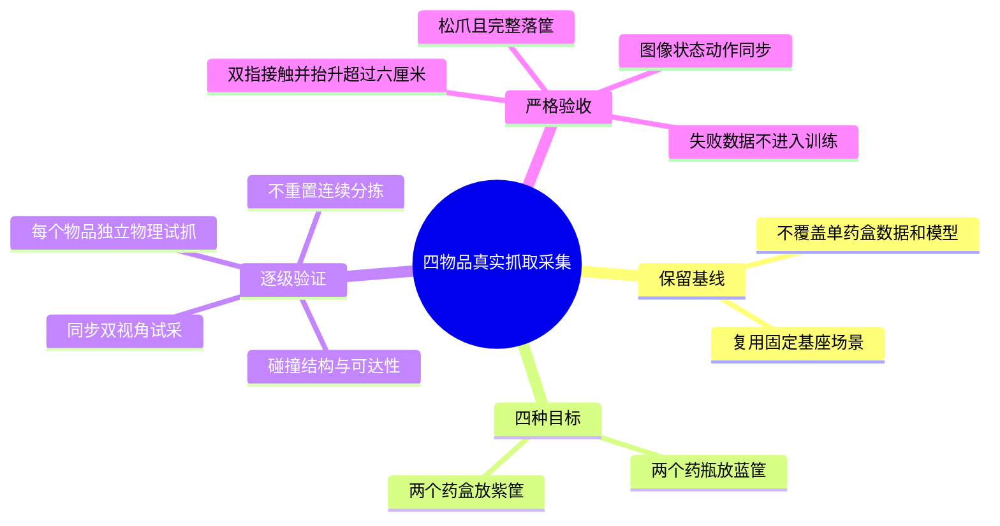

# 四物品抓取与采集实施

目标：先证明四种物品各自可抓、可放、可采集，再尝试一次不重置的连续整理；不将单物品成功等同于四物品连续成功。

环境：项目 `.venv`，OrcaLab/OrcaGym 26.9.1，固定基座 G1 右臂七关节和夹爪，共八维动作。旧训练、数据和模型不覆盖。

## 实施步骤

- [x] 检查现有场景和脚本：四物品存在；原专家只绑定 Medical_12 和紫筐。
- [x] 连接仿真，检查四物品真实碰撞体、初始尺寸和目标筐容量。
- [x] 先添加失败测试，再扩展目标映射、通用碰撞边界和任务标签；保留原默认单药盒行为。
- [x] 分别对四物品运行不含 RGB 的真实物理试抓，保存报告和轨迹；两个药盒成功，两个药瓶失败。
- [x] 四物品各录制一条同步双 RGB 试验回合，独立输出到 `data/medication_sorting/multi_object`；两个成功回合接收，两个失败回合拒收。
- [x] 尝试同一物理状态连续分拣，期间不 reset、不瞬移；第一个药盒入筐，第二个搬运逆解超限，按失败终止。
- [x] 执行320项回归测试和独立离线数据验收，更新结果。
- [ ] 四种物品各有合格成功示范：尚缺两个药瓶。
- [ ] 四物品不重置连续整理成功：尚未通过。
- [ ] 成功示范扩量、独立划分及 π0.5 多任务训练：本轮未启动。

## 失败处理与验收边界

物品不可达、夹爪不适配或筐容量不足时记录失败原因。若需更改场景，生成独立副本并记录变更，不修改原始 Layout。每条数据保存物品、目标筐、指令、场景路径及哈希、物理报告与逐帧证据。逐物品成功率和连续四物品成功率分开报告。试采不等于已获得足够训练数据，也不代表旧单药盒模型能整理四物品。

测试命令：

```bash
PYTEST_DISABLE_PLUGIN_AUTOLOAD=1 .venv/bin/python -m pytest -q tests tools/medication_sorting/tests
```

## 2026-10-14 实测结果

| 目标 | 目标筐 | 录制帧数 | 质量合格的成功回合 |
| --- | --- | --- | --- |
| `pharyngitis_tablets_box_1` | 紫筐 | 96 | 1 |
| `fu_shi_gao_herb_drink_packaging_box_1` | 紫筐 | 103 | 1 |
| `melatonin_tablet_bottle_1` | 蓝筐 | 43 | 0，抬升失败 |
| `calcium_gluconate_tablets_bottle_1` | 蓝筐 | 40 | 0，抬升失败 |

共282帧同步双RGB及8维状态/动作，199帧为两个独立成功示范，83帧仅用于失败诊断。不是足量训练集，不代表四物品任务完成。只在回合开始重置，执行期间不瞬移、不吸附；没有改变药瓶尺寸、质量或夹爪力限位。对照试验曾调整夹爪位置增益、接触求解配置，均失败且未作为正式采集配置。

正式采集目录：`data/medication_sorting/multi_object/four-object-rgb-pilot-20261014`。
当前代码独立复核报告：该目录的 `reviewed_summary.json`。
连续失败报告：`data/medication_sorting/multi_object/four-object-continuous-reachable-drops-20261014/summary.json`。

已知阻塞：夹爪全开碰撞面间距约7.2cm，大药瓶瓶身直径约9cm，小药瓶瓶身直径约8cm；瓶盖较窄但竖直夹法仍碰到瓶身、滑脱。需重新验证夹持姿态/适配更宽夹爪，不能靠训练消除机械不匹配。连续模式还需在不改变物体状态的前提下改进机械臂过渡轨迹和逆解支路。

## 后续独立缩小实验

用户随后授权尝试缩小药瓶，已另建70%尺寸副本。四种物品独立抓取落筐均成功，并获得四条合格双RGB示范，共392帧；另有41帧渲染失败记录被拒收。原尺寸药瓶仍未通过，本页原始记录及数据不修改。详见 `docs/plans/2026-10-14-缩小药瓶抓取试验.md` 和 `data/medication_sorting/multi_object/bottles70-reviewed-20261014.json`。尚未完成连续整理、示范扩量或四物品π0.5训练。
