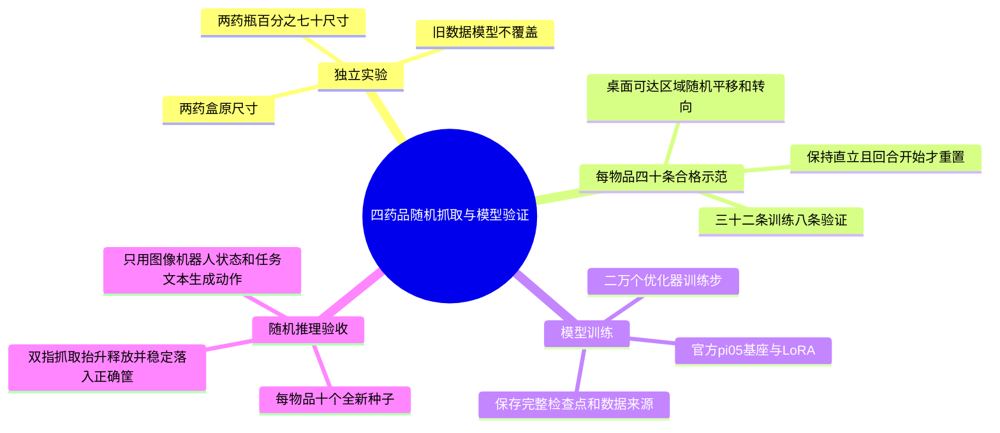

# 四药品160条示范与π0.5两万步实验

用户已确认：四种药品各40条合格回合，每种32条训练、8条独立验证；20,000个优化器步；每种10个新随机摆放推理回合。瓶子继续70%尺寸。随机范围先通过物理预试确定，不承诺任意位置、任意倾倒姿态可抓。

环境固定为项目`.venv`，不更改`ZXJ_VIP`；现有343项回归已通过。项目根目录无Git仓库，在现有工具目录原位增量修改，数据、场景、检查点采用全新目录。

## 实施清单

- [x] 预检查环境、基座、磁盘、既有采集和推理契约。
- [x] 新增共享随机摆放配置，记录真实采样范围；旧毫米级采样默认行为保持不变。
- [x] 扩展推理为四目标和相应筐，目标位置只用于回合初始化与验收，不生成策略动作。
- [x] 增加按物品分层的整回合划分，内容哈希和seed不得跨训练验证泄漏。
- [x] 完成两组各12次物理预试，分别7/12、8/12；冻结为每轴正负2cm和转向正负15度，保持直立。新配置下饮品盒初始张开夹爪，搬运时回正；小批RGB试采保留，失败仍拒收，不计入正式160条。
- [x] 自动流程及回归共463项测试通过，正式入口加入逐阶段数量、来源和配置一致性检查。
- [x] 2026-10-14 20:28启动正式后台服务；首条大药瓶数据97帧通过独立复核，无错误或警告。其余继续采集，不能把此记录视为已完成160条。
- [x] 2026-10-15针对饮品盒同侧卡筐修复落点补偿，12个新seed物理预试5次成功，501项回归通过；17:45恢复正式服务。原126条合格数据不覆盖，具体恢复记录见`2026-10-15-饮品盒采集恢复.md`。
- [x] 2026-10-15 18:13完成恢复后首批四次正式尝试，新增1条96帧合格示范且独立复核零错误、零警告，累计127/160，饮品盒7/40；批次结束重启服务加载最后的启动超时修复，继续按原配置补采。不将脚本采集合格率当作模型推理成功率。
- [x] 2026-10-15 20:10在129/160、饮品盒9/40处恢复补采；修复启动器退出后同组子进程残留、备份异常跳过端口等待的问题，补充已退出启动器及PID复用保护，506项回归和独立审查通过。新增两条正式示范独立复核无错误警告；训练与推理仍未开始。
- [ ] 有限重试采到每种40条合格独立回合，保留所有失败尝试并记录实际成功率。
- [ ] 建立128条训练和32条验证回合，转换LeRobot，统计量只使用训练集。
- [ ] 从官方π0.5基座微调20,000步，独立实验名，检查点完整提交后才部署。
- [ ] 每种10个未用于采集的新种子执行纯策略闭环，保存40回合全部结果和分物品成功率。

## 文件与验证

1. `tools/medication_sorting/randomization.py`和测试：固定seed重现、边界检查、旧模式兼容、不同种子真实改变位置与转向。
2. `collect_episodes.py`和`run_expert.py`：传递并保存随机配置，目标变换仅发生在回合初始化。盒子转向时夹持方向需跟随实际朝向，物理预试不放宽验收标准。
3. `infer_policy.py`和测试：目标映射、初始夹爪、任务文本、目标筐、随机配置与采集相同；保留服务检查点来源。
4. `split_episodes.py`和测试：每物品32/8，拒绝缺类、重复内容和重复seed；旧单物品默认接口兼容。
5. 批量入口先小规模验证再采40条；遇到持续黑图、不可达或物理失败按原因拒收，不复制图像、不修补轨迹、不将失败放入训练。
6. `run_randomized_experiment.py`按四次尝试一批管理自己启动的OrcaLab，批次结束先备份编辑场景再关闭，释放资源后才训练；策略服务必须是本批次20,000步的真实检查点。连续三批无新增合格数据时停止并保存错误，不无限重试。

正式输出位于`data/medication_sorting/multi_object/randomized160-20261014/production`，不混入预试目录。长任务使用`sy-medication-160-20k.service`并设置`Restart=no`；只有采集支持断点续跑，后续阶段中断后需先核对已有文件再分别恢复。

回归命令：

```bash
PYTEST_DISABLE_PLUGIN_AUTOLOAD=1 .venv/bin/python -m pytest -q tests tools/medication_sorting/tests
```

结果必须分开报告：脚本示范采集合格率、单目标VLA成功率、连续四目标任务成功率。本实验40回合推理是独立重置的单目标任务；未测试连续四物品时不得宣称已通过。
