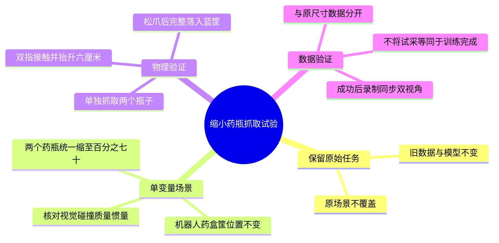

# 缩小药瓶抓取试验

目标：验证夹爪开口不足是否为两药瓶抓取失败的主要阻塞。用户已要求尝试缩小瓶子；本次只建立实验副本，不改变原尺寸任务的验收含义。

方案：从 `drag_classfication_capture.json` 深复制，仅将两个药瓶 Actor 的当前缩放乘以0.7，同时同步根级 `uniformScale` 覆盖项。两个药盒、两筐、机器人及所有位置保持不变。预计瓶身直径9cm→6.3cm、8cm→5.6cm；实际尺寸、质量和惯量以导出的物理模型为准。

环境：`/home/pc/ZXJ/SY/.venv`，OrcaLab/OrcaGym 26.9.1。没有Git仓库，不创建提交。

## 执行顺序

- [x] 先添加缩放测试：不改变输入、只改变两个瓶子、正确同步根级覆盖项、拒绝非法比例或缺失/重名目标。
- [x] 实现场景生成及独立 `scaled_bottles_70` 抓取参数；报告和采集元数据记录所用配置，旧默认行为不变。
- [x] 运行343项回归，生成独立场景及源/输出SHA256清单。
- [x] 启动并加载实验场景，核对实际碰撞外形、质量和惯量。
- [x] 对两个瓶子分别执行真实物理抓取，保留失败轨迹，不修改成功阈值。
- [x] 对四种物品采集双RGB并离线验收；报告真实帧数和成功数，暂不启动四物品训练。

## 验收

执行中不瞬移物品、不吸附，不修改夹爪力限位。必须双指接触、实际抬升超过6cm、松爪后全部碰撞边界落入蓝筐且速度低于0.02m/s。独立成功不代表连续四物品成功，也不代表原尺寸瓶子成功。

测试命令：`PYTEST_DISABLE_PLUGIN_AUTOLOAD=1 .venv/bin/python -m pytest -q tests tools/medication_sorting/tests`。

## 物理试验进展

两个药瓶碰撞体直径实测为6.3cm、5.6cm，质量分别为0.343278kg、0.255939kg，惯量也按实际缩放改变；因此不是只改变画面。

首轮大瓶成功抬升，但送往蓝筐时5.10m搬运高度逆解超限；小瓶垂直接近姿态逆解超限。离线可达性检查后，缩小配置使用5.04m搬运高度，小瓶保留负10度绕X倾斜，原尺寸配置不改。

第二轮两瓶均能抬升并搬运；小瓶成功，大瓶高处释放穿过薄筐底，严格验收拒收。诊断记录显示瓶底在松爪约0.2秒内从筐底上方降至底板下方，并顶动筐。只降低大瓶释放位置至4.91m，其他物理参数不改。

第三轮两个瓶子独立抓取、松爪和落筐均成功，抬升分别约0.1655m、0.1685m；速度低于0.02m/s，完整碰撞边界在蓝筐底板内。报告：`data/medication_sorting/multi_object/bottles70-low-release-physics-20261014`。该入口因仅选择两目标而退出1，防止误报四物品全部完成；两个目标的物理结果均为真。

## 最终小批结果

四种物品分别重置后，在同一70%药瓶场景中均完成物理抓取落筐：`multi_object/bottles70-all-four-physics-20261014/summary.json`。

| 物品 | 目标筐 | 合格示范 | 合格帧数 |
| --- | --- | --- | --- |
| 葡萄糖酸钙片瓶 | 蓝筐 | 1 | 98 |
| 褪黑素片瓶 | 蓝筐 | 1 | 95 |
| 药饮包装盒 | 紫筐 | 1 | 103 |
| 咽炎片药盒 | 紫筐 | 1 | 96 |

共录制5次：4次合格，共392帧；1次大药瓶因连续3次空白渲染中断，41帧仅作诊断，禁止训练。未改成功阈值或修补失败数据。静止状态下的截图对照也出现间歇全黑，显存未耗尽，底层渲染原因尚未完全定位。保存后重启OrcaLab，保持相同场景和专家参数补采大瓶，98帧合格，期间2次重绘保留原始拒绝图像。长批次渲染稳定性仍须处理。

三个成功示范及失败记录在 `multi_object/bottles70-all-four-rgb-20261014`；大瓶补采在 `multi_object/bottles70-large-rgb-retry-20261014`。两个会话使用相同Layout及SHA256。汇总：`data/medication_sorting/multi_object/bottles70-reviewed-20261014.json`，对所有5次记录使用最新只读验收工具复核，并按目标统计。

源场景SHA256仍为 `e0b178c18ac53e833c571fae6b831d5855e1817545e2029545ec3e0d96d65b79`。缩小场景SHA256为 `db322ff25011f20f2208c025a30261e9b30db5d9c909a5a0b8309e9bfb3c63b1`。界面两瓶世界缩放均为0.7；忽略引擎重载随机命名及输出顺序后，导出模型中两瓶之外的物理结构与原尺寸模型一致。

代码复核发现并修复“缩小配置遗漏场景参数时记录成原场景”的问题：必须显式提供匹配场景，执行前核对实际两瓶碰撞直径，元信息和物理报告配置须一致。第二轮只读复核无新增发现，最终343项测试通过。

结论：70%尺寸药瓶可以真实夹取并采集成功示范。不是原尺寸药瓶成功，不是连续四物品完成，也不是足量训练集。旧单药盒数据和模型不覆盖；本次没有启动π0.5训练或新的策略推理。

实验结束已保存编辑场景、停止仿真并关闭窗口，12345、50051、8000均无监听。OrcaLab在关闭时仍于清理视口阶段返回退出码11，不能称为正常退出；该问题未在本次修复，发生在数据保存和验收完成之后。
