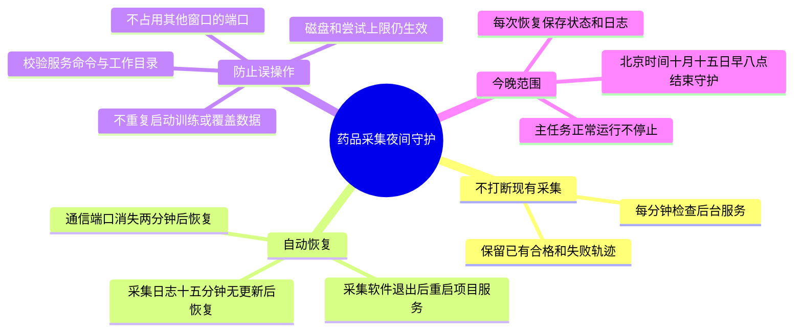

# 药品任务夜间守护实施计划

**目标：** 根据用户要求，今晚持续采集，OrcaLab异常退出后自动恢复；不将后台守护误称为模型训练完成。

**方案：** 选择独立的用户级systemd定时守护，不直接开启整条流水线的无条件`Restart=always`。原因是当前仅采集支持断点续跑；训练、转换和评估中断时重复整条入口会遇到已有输出，不能自动覆盖。守护每60秒检查固定项目服务，到2026-10-15 08:00北京时间停止自身定时器，不停止主任务。

## 实施清单

- [x] 先写离线测试：正常采集、异常退出、训练无窗口、端口短暂消失、卡住、完成、外部端口占用、磁盘不足、尝试耗尽、非本项目服务与到期行为。
- [x] 新增`tools/medication_sorting/night_watchdog.py`：只检查并恢复`sy-medication-160-20k.service`，原子保存`night_watchdog.json`和追加式事件记录，用文件锁避免重叠检查。
- [x] 为`run_randomized_experiment.py`补充日志序号续接及历史状态留档测试和实现，重启不覆盖旧日志；不改变采集姿态分布和物理验收。
- [x] 运行全部离线测试，核对实际生产服务归属，部署一分钟定时器并验证首次实际检查。
- [x] 使用一次性独立测试服务验证异常退出后`systemctl restart`恢复，测试后清理自身测试服务，不操作生产仿真；另外发现并补测临时服务定义消失后的按固定命令重建。
- [x] 验证生产服务、定时器、下次触发时间和守护记录，更新实验说明与实际数据数量。2026-10-14 22:13首次部署后核验为正常采集，14/160合格；最终全套489项测试通过。

运行命令：`PYTEST_DISABLE_PLUGIN_AUTOLOAD=1 .venv/bin/python -m pytest -q tests tools/medication_sorting/tests`。

保护边界：磁盘剩余不足100GiB、任一目标200次仍不足40条、数据标签或场景配置不一致时保留失败证据，不用降低质量来维持运行。训练阶段无窗口属于正常现象。未开始下游阶段时才能恢复采集。

定时器使用`OnUnitInactiveSec=60s`，即每次检查结束后一分钟再检查，避免一次恢复耗时较长导致后续触发丢失。主服务保持`Restart=no`，重启决策由守护判断阶段后执行。正常采集或训练不会被中断；到早八点只结束守护。服务器重启、用户图形会话退出或机器断电不在临时systemd服务的恢复范围内。
