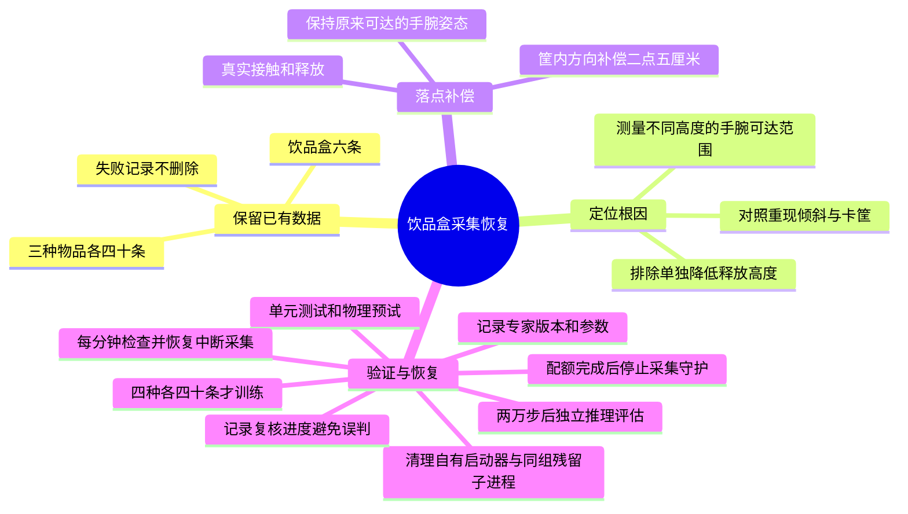

# 饮品盒采集恢复

原实验在126条合格、216次尝试时因连续三批无进展停止。饮品盒75次尝试仅6条合格；42次放置失败、26次位姿求解失败、1次抬升失败。数据和验收标准保持不变，不加入平躺或侧立初始姿态。

## 已有证据

- [x] 对照重现第74、59、51号初始摆放，结果位于`data/medication_sorting/multi_object/herb-recovery-20261015`，不计入正式160条。
- [x] 单独降低释放高度至4.90米未解决卡筐；直接在高位扶正导致路径位姿不可达。
- [x] 对同一真实模型检查24组位姿：筐上5.10米的30度纠偏不可达，4.99米可达。不能仅凭终点可达就断言整条轨迹可执行。
- [x] 分阶段扶正在完整轨迹上仍不可达，未启用，已移除试验代码。42次旧放置失败全部越过筐的局部负Y边，改为使用已有落点偏移接口补偿。
- [x] 正Y补偿2.5厘米，六个旧摆放对照3次成功，12个全新预试seed成功5次；后者5/12是物理预试成功率，不是正式数据或VLA成功率。所有预试均独立保存。
- [x] 新专家只调整饮品盒，版本`herb_release_offset_v1`。新metadata保存实际补偿、专家参数及三个实现文件的SHA256，旧数据不重写；场景、随机分布、控制频率和训练动作定义不变。
- [x] 场景启动失败最多重试三次，每次只备份和清理本任务自己启动的窗口；不控制占用端口的外部窗口，不重新播放已开始的训练或评估。
- [x] 独立只读审查确认旧126条兼容、补偿只叠加一次、局部坐标转换正确；发现`TimeoutExpired`漏捕获后补测试复现并修正。完整回归501项通过。
- [x] 2026-10-15 17:45重新启动正式服务，先完整复核旧回合；此时正式合格数仍是126条，不把无RGB预试算入正式数据。
- [x] 2026-10-15 18:04首条新增正式RGB回合`episode_0075`通过独立只读复核：96帧、零错误、零警告，真实抬升约0.229米、释放后完整入紫筐、末速度约0.000933m/s。新专家参数和实际2.5厘米补偿一致；累计127条，饮品盒7条。该结果是脚本示范成功，不是VLA推理结果。
- [x] 本批次`episode_0075`至`episode_0078`四次尝试全部落盘：1次通过、1次放置失败、2次位姿求解失败。累计127条合格、220次尝试；饮品盒7/79。失败回合保留且不进入训练，不能由本批1/4推断VLA成功率。
- [x] 2026-10-15 18:13:43在批次结束后重启正式服务，加载最后的`TimeoutExpired`修复；18:13:54场景已重新加载并进入旧数据复核。新主进程2247113，采集进程2247964，日志`0228-collect_batch_000.log`；既有127条和全部失败证据保留，未影响其他项目GPU进程。
- [x] 随后四次尝试再新增2条，累计129条合格、224次尝试，饮品盒9/83；18:45场景启动超时后，启动器清理未确保同组窗口子进程退出，残留端口使重试中止。19:59检查时端口已释放，原数据完整保留，训练和推理未开始。
- [x] 用真实子进程监听端口复现：启动器接收SIGTERM后先退出，同组忽略SIGTERM的子进程仍监听；另两项测试复现备份失败/超时跳过端口等待，三项均先失败。修复只清理当前自有进程组并在备份异常时仍等待端口释放，16项专项和504项完整回归通过；测试同时确认外部进程组存活。
- [x] 独立只读复核`episode_0081`和`episode_0082`，分别102帧、96帧，均无错误和警告；种子分别为2026121581、2026121582，实际筐内补偿均为2.5厘米。
- [x] 独立审查发现“清理开始前launcher已退出”仍被跳过，补真实监听用例复现后关闭遗漏；另外补已回收PID被复用时拒绝发送信号的保护和测试。18项专项、506项完整回归通过，复审未发现新增阻塞问题；未改变专家、图像、轨迹或训练验收规则。
- [x] 2026-10-15 20:10:12恢复正式服务，20:10:23进入旧回合复核。主进程2424001、OrcaLab进程2424018、采集进程2424894；12345与50051端口均属于该OrcaLab。累计仍为129条合格、224次尝试，饮品盒9/40；当前日志`0235-collect_batch_000.log`。此记录只证明服务已恢复，不能据此宣称后续长期运行、训练或推理已完成。
- [x] 按用户新增指令恢复每60秒自动检查；历史复核写逐回合进度，避免耗时正常复核被十五分钟停滞规则误杀。异常退出时只续采已有任务，四种各40条后结束采集守护，不重启训练或评估。新增七项用例先失败后通过，完整513项回归通过。
- [x] 20:39:07在旧进程尚未开始新抓取时重启服务以加载复核心跳；新主进程2470317。20:39:33已复核三条历史回合，`raw/review_status.json`持续更新；已有129条合格、228次尝试保留，饮品盒9/40，未影响其他项目进程。
- [x] 20:39:52确认`sy-medication-night-watch.timer`首次实际检查成功：服务active、两个通信端口正常、决策wait，无时间截止；下一次20:40:52。恢复次数5为旧守护累计值，并非本次重新启动五次。四种各40条后停止守护，不停止主任务；磁盘、配置、尝试上限与下游阶段保护保持启用。
- [x] 独立审查发现两个完成判断边界：实验完成标记不得绕过采集配额校验；有效采集已完成时，即使主服务归属变化也应只停止自身守护。三项组合用例先失败后修复，完整516项回归通过。20:44:53新版守护实际检查仍为wait、双端口正常；历史已复核78/228次尝试，合格数仍129，未开始训练或推理。
- [ ] 补齐饮品盒剩余31条，仍要求双指接触、真实抬升超过6厘米、释放、完整入正确筐并静止。
- [ ] 凑齐四类各40条后按32/8分层划分，训练20,000步并执行40回合新种子纯策略评估。

## 方案边界

保持场景、70%药瓶、随机范围、5Hz采集和8维动作契约。新旧专家的成功示范可以共同用于行为克隆，但必须保留专家版本，不将预试重复seed或失败回合算入正式配额。若分阶段轨迹仍不可行，保留失败证据并重新评估姿态及路径，不放宽验收或无限重试。
