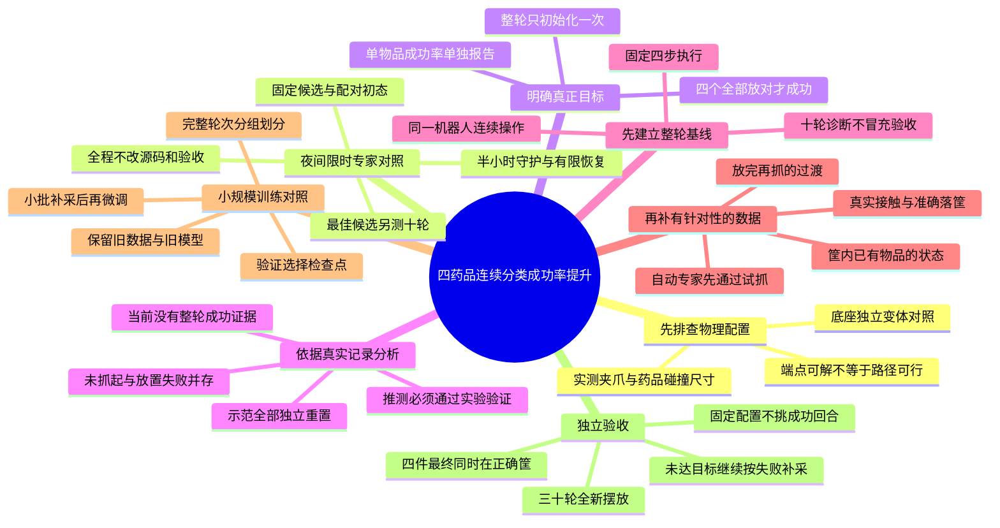

# 四药品连续分类成功率提升策划书

编制日期：2026年10月16日。状态：用户已同意执行，并要求当晚持续优化、次日查看。已完成首批18次独立专家物理个案及离线IK筛查；新增严格连续专家入口和4轮不同配置的工程冒烟，均未整轮通过。限时夜间参数对照及半小时守护已于21:56部署；22:02已完成首组3轮基线并进入下一候选。尚未开始新的连续RGB示范采集、VLA整轮基线或微调，后续阶段不标记完成。

执行进度：

- 已完成：尺寸与基座首批诊断、完整物理状态及接触力记录、IK候选选择回归修复。
- 已完成：连续专家唯一轮首初始化、四件同时随机化、150/600步预算、3步真实抬升及末尾20步联合验收、掉落停机保护。
- 进行中：专家路径优化。药盒出现夹持滑落、左臂接触、第二落点卡边；不能归因于单一尺寸问题。
- 待完成：纯VLA整轮基线、连续RGB示范采集、微调与独立模型验收。
- 当晚授权范围：执行固定参数的真实物理对照，异常有限恢复；不修改物体尺寸、摩擦、验收阈值，不覆盖旧数据或模型。

### 当晚对照安排（截至2026年10月17日09:00，Asia/Shanghai）

使用`/home/pc/ZXJ/SY/tools/medication_sorting/night_expert_search.py`。1个原配置基线加24个候选，共25组；每组使用同样3个整轮随机种子81000、81001、81002。候选只改变闲置左臂轮首避让、药盒落点补偿、到筐上方后的扶正动作、药盒额外抓取倾角；候选褪黑素瓶使用已通过困难角点个案的额外负10度倾角，基线不变。其余尺寸和物理参数不变。

筛选先比较完整成功轮数，平局时比较完成物品阶段数，仍平局时按预先固定的候选顺序选择。最优候选再运行91000至91009共10个未参与筛选的整轮初态。最多85轮，这些是专家开发及复核试验，不是VLA最终验收；即使通过8/10，也不能宣称模型推理成功。

每30分钟检查后台任务；只恢复本任务所属进程组，整体恢复最多2次，启动器自身每次最多3次启动尝试。运行中源码或原场景指纹改变、磁盘不足100GiB或重复基础设施故障时停止，不无限重启。服务异常中断的已开始轮次保留为失败，不覆盖后重跑。明早09:00停止发起新轮次；若预定实验提前完成，则提前释放资源。

结果位置：`/home/pc/ZXJ/SY/data/medication_sorting/overnight/20261016/`，查看`status.json`、`summary.json`及`结果汇总.md`。后台仅负责专家路径对照，未实现自动连续RGB补采和新模型训练，不会在只有物理轨迹时伪称正在训练。

## 一、结论与项目目标

目前最需要解决的不是继续缩短推理动作段，而是把现有的“单物品抓取”流程升级为“四物品连续分类”，并补充与连续操作一致的示范。

用户确认的任务成功口径：一轮中有两个药盒、两个药瓶，机器人连续操作，把药瓶放入蓝筐、药盒放入紫筐。四件全部完成真实抓取、释放，并最终在正确筐内稳定放置，才算一轮成功。任何一件未完成，整轮失败。

此前报告的40%是单物品测试的16/40，不是四物品整轮成功率。原先25%与本轮40%使用相同的4步执行配置，存在策略随机采样等波动，不能归因于已经完成了新的优化。

本策划书的目标是：建立可复现的整轮基线，定位失败阶段，补采连续操作示范，微调π0.5，再通过独立整轮测试验证改善。文中的采集数量和训练预算是建议，不是已经完成的结果或成功率保证。

## 二、现状与证据

### 2.1 已完成的工作

| 项目 | 核实结果 |
| --- | --- |
| 软件 | 当前环境的OrcaLab、OrcaGym均为26.9.1 |
| 机器人 | 固定基座G1，使用右臂和夹爪 |
| 物品 | 两种药盒保持尺寸，两种药瓶为原尺寸70% |
| 合格示范 | 四种各40条，共160条独立单物品回合 |
| 数据划分 | 每种32条训练、8条验证，共128/32条 |
| 训练帧数 | 12,439帧；验证集3,148帧；均为5Hz |
| 初始化 | 160条示范的`reset_at_start`全部为`true` |
| 摆放范围 | 目标相对原位每轴正负2厘米、偏航正负15度，保持直立 |
| 已有模型 | π0.5 LoRA，已完成20,000个优化器步；检查点目录为19999 |
| 最新对照 | 1、2、4步执行配置各40次，共120次单物品测试 |
| 整轮验收 | 尚未建立π0.5四物品连续任务的有效成功率 |

“随机摆放”目前不包括整张桌面任意位置、平躺或倾倒。后续保持相同范围先解决连续操作，不能把扩大摆放范围和改模型同时混在一次实验里。

### 2.2 动作段对照结果

| 连续执行动作数 | 抓起成功 | 完整入筐成功 | 未抓起 | 抓起后未完成入筐 |
| --- | --- | --- | --- | --- |
| 1步 | 1/40 | 0/40 | 39 | 1 |
| 2步 | 12/40 | 4/40 | 28 | 8 |
| 4步 | 27/40 | 16/40 | 13 | 11 |

120次均未在原始报告中记录执行异常。4步组的24次失败全部到达150步上限；11次抓起后失败中，末帧均已无夹爪接触，且均不在正确筐内，其中10次全过程未满足完整入筐条件。

4步组按物品拆分：

| 物品 | 抓起成功 | 完整入筐成功 | 优先排查 |
| --- | --- | --- | --- |
| 钙片瓶 | 10/10 | 5/10 | 搬运与落筐精度 |
| 褪黑素瓶 | 5/10 | 3/10 | 抓取对准、夹持和放置 |
| 饮品盒 | 7/10 | 5/10 | 接近与抓取，其次放置 |
| 咽炎片盒 | 5/10 | 3/10 | 抓取对准、夹持和放置 |

本轮40个摆放种子复用了之前的测试种子，属于配对调参集。不同动作段消耗策略随机数的次数不同，不能声称采样噪声逐步相同，也不能从这一次小样本比较推断普遍最优参数。

## 三、原因分析

### 3.1 已确认的问题

**问题一：评估单位与真实任务不同。** 当前推理入口每次只处理一个目标，并调用机器人重置。把四种单物品结果加在一起，并不能证明机器人可以在同一个场景中连续完成四件事。

**问题二：训练数据没有覆盖连续操作的起始状态。** 现有160条示范都从重置后的状态开始。连续任务的第二至第四件物品，却需要从上一次落筐后的手臂位置继续；画面中还可能出现已入筐的物品和变化后的遮挡。训练与实际任务存在明确的状态覆盖缺口，但这一缺口造成多大损失，还要通过整轮测试量化。

**问题三：抓取和放置都不够可靠，不能只优化一个环节。** 4步组仍有13次未抓起、11次抓起后失败。尤其钙片瓶已经10/10抓起，但只5/10放好，继续只采接近和夹紧动作不会解决全部问题。

**问题四：已有自动专家也没有完成连续四物品验证。** 历史独立试抓中，四种物品分别成功过；但已有连续试验未成功，出现过逆运动学目标不可达。因此，必须先让自动化示范生成器能可靠连续执行，再扩充连续任务数据，不能默认原单物品脚本直接串起来即可。

### 3.2 待验证的原因，不能当作定论

| 假设 | 当前证据边界 | 验证方式 |
| --- | --- | --- |
| 抓取中心、下降高度或闭合时机不准 | 只能确认未达到抓起条件，未对13次失败逐一定位 | 对齐RGB、末端位置、双指接触和物体抬升时刻，逐条分类 |
| 搬运途中滑落、提前松爪或落点偏移 | 抓起后失败不等于“没松爪”；最终无接触也可能来自掉落 | 重建最后接触位置、第一次脱离高度、筐内几何关系及物体轨迹 |
| 频繁重规划打断动作进展 | 1步差于4步是观察结果，不足以确定内部机制 | 审计预测序列首动作与实际进展，核对动作窗口和末端补齐方式 |
| 安全限幅明显改变模型输出 | 4步组5,151个动作中，872个执行动作与预测不同，约16.9%；限幅本身是安全功能 | 区分关节限位、速率限制与夹爪限制，检查差值及其与失败的关联；不直接取消限幅 |
| 数据量不足或已有模型过拟合 | 每种实际只有32条训练示范，但仅凭数量不能证明过拟合 | 比较独立验证表现、不同检查点和针对性补采前后的物理结果 |
| 画面、动作或时间对齐仍有局部问题 | 源码使用动作前观测、同一双视角前处理；不代表已穷尽排除所有局部错误 | 对成功/失败样本各抽查RGB、state、action、时间戳、归一化和关节顺序 |

当前证据不支持把原因直接归结为“显卡不够”“必须重装环境”或“再训练两万步就会好”。

## 四、方案选择

| 路线 | 优点与代价 | 本次选择 |
| --- | --- | --- |
| 继续调动作段或增加训练步数 | 改动少，但无法补齐连续任务状态，且缩短动作段已经无收益 | 暂不优先 |
| 连续任务调度、针对性补采、π0.5微调 | 保留VLA产生抓取动作，能针对真实失败验证；需要先建设连续评估与专家示范 | 推荐主线 |
| VLA识别目标，CuRobo或规则控制完成抓放 | 可作为工程部署的混合方案，但成功率来自整个混合系统，不再是纯π0.5动作策略结果 | 独立备选，不混入本轮验收 |

推荐架构：上层脚本固定目标顺序、切换任务文本、计时和记录验收；π0.5只接收双RGB、8维机器人状态和目标指令，产生右臂及夹爪动作。仿真真值用于初始化、诊断、判定阶段结束和最终验收，不用于生成或修正VLA抓取轨迹。

本阶段验证的是固定顺序、由仿真判定任务阶段的VLA动作策略，不等于模型已经能够自主选择目标或自主识别完成状态。真实机器人部署需要另外验证视觉完成检测与目标调度，不能直接依赖仿真真值。

自动化专家可以使用真实位姿和IK生成训练示范，但专家试抓成功率与VLA成功率必须分开。CuRobo并非本轮必须新增的软件；先复用现有控制和IK工具，确认需要路径规划时再单独验证接入。

## 五、实施阶段与继续条件

### 前置诊断：夹爪、底座与药品尺寸【已完成首批】

实测全开指尖保守净空71.68毫米，当前药瓶直径63/56毫米。四种物品原位分别通过专家真实抓放；饮品盒旋转15°后，固定夹持方向失败、对齐方向个案通过。基座Y负移15毫米使离散航点从34/36到36/36可解，但两个困难摆放仍在实际抬升路径失败。因此不把移动基座或再次缩小物品直接当成正式优化，不混入原场景的VLA成绩。

静态落点筛查发现饮品盒存在筐底余量风险，但取消现有偏置的物理对照反而失败；先检查夹持姿态、整段搬运和撤离路径。原场景、数据和模型不变。后续连续专家阶段需保留该诊断发现，并记录完整失败状态；详细证据、限制与复现命令见诊断报告。

### 阶段一：建立四物品连续评估，先测10轮基线

固定当前19999模型、5Hz、预测长度10、每次执行4步。目标顺序先固定为：咽炎片盒、饮品盒、褪黑素瓶、钙片瓶；暂不研究任意顺序。

每轮只创建一次机器人和物理会话，只在轮首初始化四个物品。四件在各自已核验的可达区域随机平移、旋转，记录实际初态，检查无穿插、无重叠。旧测试只随机当前目标，新的“四件同时随机”属于新的评估配置，结果单独报告。

单目标最多150个控制步，整轮最多600步，稳定性检查计入预算。达到目标验收条件后切换任务文本，从当前真实状态继续，不把手臂强制送回初始姿态。未完成目标或触及预算则整轮失败；后续未执行的目标记录为“未尝试”，不能拿来计算该目标的抓取成功率。

不能简单启动四次现有`infer_policy`：该入口会重置机器人，重新构建物理会话也会破坏连续性。需要让四次目标操作共享同一个`FixedBaseRobot`、相机实例及执行状态。

先做1轮工程冒烟，再进行10轮基线。冒烟不纳入正式10轮分母；10轮中的失败全部保留，不挑选成功录像。

继续条件：整轮初始化次数、阶段衔接、动作来源、时间预算与四物品最终验收均有记录，评估流程能区分策略失败与运行故障。不要求旧模型先达到某个成功率。

### 阶段二：完成失败归因与连续专家试抓

对4步组24次失败和阶段一新增失败逐条标注：接近偏差、闭合失败、抬升失败、搬运掉落、落点错误、碰撞或运行故障。证据不足的样本标记“原因未定”，不强行归类。

专家路径重点补齐两类能力：从上一次撤离位置接近下一个物品；向已有物品的筐中放置第二件。使用筐内不同落点避免重叠，先核验落点几何和整段路径可达，保持物体尺寸、摩擦、夹持约束和验收阈值不变。

先进行10轮真实物理专家试验。建议至少8/10完整成功，再进入批量示范采集；这是工程继续门槛，不是VLA验收结果。未达到时，先修正专家路径、落点或不可达问题，不启动大规模微调。

### 阶段三：首批补采20轮完整成功示范

首批目标为20轮合格连续示范，约80段目标操作。每轮从开始到结束保留连续RGB、状态、动作、接触与物体轨迹；完整轮次之间才允许重置。

重点覆盖：四个目标的抓取、已入筐物品变化、放完后的撤离与下一次接近、第二件放入同一筐。对前面发现的高频失败姿态增加成功示范，而不是仅重复容易成功的位置。

每轮保存`round_id`、seed、四件初态、目标顺序、任务文本、阶段边界、物理验收及实现指纹。失败轮保留真实标签和尝试数，不伪装成完整成功数据。首批用于训练的新增示范只取整轮通过的记录。

建议按完整轮次划分16轮训练、4轮验证，再拆成64/16段目标操作；同一轮的片段不能跨训练和验证。同一任务的动作预测窗口不能越过目标指令切换边界。拆段仅用于数据格式，不重新摆物或重置机器人。

保留原128条训练和32条验证数据；新增训练段与原训练数据混合，验证集只用于选择配置，不能加入训练。先用首批数据验证效果，不能预先假定20轮足够。

### 阶段四：小规模微调与物理验证

保留原检查点19999和全部旧数据，新建实验名称、数据清单与输出目录。从现有模型继续做一轮小规模LoRA微调，首轮预算建议5,000个优化器步；保留1,000、2,500、5,000步候选，按验证表现选择，不默认最后一步最好。

首轮继续保持5Hz、相同观测、8维动作语义、安全限幅和4步执行。为控制变量，先沿用原检查点的训练集统计量并保存其指纹，检查新增数据是否出现大量归一化截断。若需重算统计量，只使用合并后的训练集，并建立单独的数据与模型配置，不覆盖旧统计量或混报结果。

若在线验证显示抓取和放置都无改善，暂停继续加步数，回到失败样本检查。若独立抽查证实图像、动作对齐或标签存在错误，先修复和重建受影响数据，再训练；不能让模型替错误的数据链路兜底。

在独立于训练、验证数据的10轮开发摆放上，对比原模型与候选模型。可使用相同初态做配对开发评估，但这些摆放随后不能再冒充全新最终测试。固定并记录策略随机数设置，避免把一次随机波动当作确定收益。

继续条件：完整任务有真实成功回放，开发集整轮完成率及失败分段优于基线，且没有通过放宽规则获得收益。若仍为0/10或没有改善，先分析后续补采方向，不自动无限重训。

### 阶段五：30轮独立验收

冻结模型、执行参数、顺序、摆放范围、超时与验收规则，使用未参与训练、验证和调参的30个全新整轮摆放。逐轮保存成功或失败、四目标阶段结果、随机初态、模型指纹、RGB和动作轨迹。

核心指标为整轮成功数/30，并报告样本量和区间估计。辅助指标包括每个目标的尝试数、抓起率、入筐率、首个失败目标、失败类型和耗时。因前序失败而未执行的目标不计为单物品“尝试”，但整轮仍计失败。

建议项目目标为至少24/30轮成功，即观察成功率80%；这是待执行确认的目标，不是当前能力或达成保证。30轮属于首轮工程验收，小样本结果不能等同于稳定的生产可靠性。不得因看到结果不佳而临时删除样本、更换seed或延长超时后继续使用同一个分母。

## 六、统一验收与记录规则

| 验收项 | 规则 |
| --- | --- |
| 抓起 | 目标真实自由刚体，与两指接触，抬升超过6厘米；沿用当前连续3步抓起确认 |
| 释放 | 目标不再接触夹爪，不靠夹爪支撑留在筐内 |
| 入筐 | 目标完整碰撞边界进入正确筐的有效范围，不能只看中心点 |
| 稳定 | 线速度低于0.02米/秒，条件连续保持20个5Hz控制步 |
| 整轮终态 | 最后20步中四件都同时在各自正确筐内、已释放且稳定；此前各件都有真实抓起证据 |
| 物理连续 | 轮中不重置机器人、物品或物理会话，不瞬移、不吸附、不焊接物品 |
| 动作来源 | VLA验收时无专家动作接管；固定顺序调度不能替模型执行抓放 |
| 尝试分母 | 正式轮次开始执行后，超时、动作失败和运行故障都保留并计整轮失败，同时单列故障原因 |
| 中断恢复 | 服务中断保留现场，该次正式轮次不当作未发生；后续恢复另开记录，不覆盖失败 |

如果最后放入的物品把先前药品撞出筐，即使四个单目标阶段曾分别成功，整轮仍判失败。暂不增加额外重试次数；若以后引入重试，必须事先固定次数和总预算，并作为另一种配置报告。

## 七、工程落地范围

下表为总体改动边界。纯VLA整轮入口、连续RGB划分及补采仍待实施；本轮已单独新增`continuous_expert.py`和`night_expert_search.py`，并为原专家增加默认关闭的诊断、执行后采样、预算和姿态对照参数。

| 文件 | 计划职责 |
| --- | --- |
| `/home/pc/ZXJ/SY/tools/medication_sorting/infer_policy.py` | 保持现有单物品入口兼容；将可复用目标执行逻辑与初始化分离 |
| `/home/pc/ZXJ/SY/tools/medication_sorting/policy_rollout.py` | 拟新增，共享无重置的单目标策略执行，明确输入当前机器人、策略、相机和上一执行动作 |
| `/home/pc/ZXJ/SY/tools/medication_sorting/evaluate_sorting_rounds.py` | 拟新增，管理整轮唯一初始化、四目标顺序、600步预算、最终联合验收和失败记录 |
| `/home/pc/ZXJ/SY/tools/medication_sorting/run_four_objects.py` | 复用现有专家连续模式，补足轮首四物品随机化、连续稳定性证据和轮次清单 |
| `/home/pc/ZXJ/SY/tools/medication_sorting/run_expert.py` | 为新增连续采集配置补齐3步双指抬升确认和20步稳定证据；现有末段3秒等待不能直接视为满足5Hz下20步验收，原始数据保持不变 |
| `/home/pc/ZXJ/SY/tools/medication_sorting/split_sorting_rounds.py` | 拟新增，按父轮次划分后生成任务段清单，避免影响原单物品划分规则 |
| `/home/pc/ZXJ/SY/tools/medication_sorting/tests/test_sorting_rounds.py` | 拟新增，覆盖重置次数、任务顺序、阶段边界、总预算、最终四件同时验收、失败分母及进程清理 |
| `/home/pc/ZXJ/SY/tools/medication_sorting/tests/test_split_sorting_rounds.py` | 拟新增，覆盖同轮不跨分区、窗口不跨任务文本边界、失败轮不能伪造成功示范 |

实施前先写失败测试，再做最小实现；离线通过后才做真实冒烟。关键用例：前三件成功第四件失败时整轮必须失败；最后一件碰落第一件时必须失败；单件记录不能拼成整轮；轮中调用第二次reset必须被检测；运行异常要停止本任务自有控制进程并保留报告。

回归命令：

```bash
cd /home/pc/ZXJ/SY
PYTEST_DISABLE_PLUGIN_AUTOLOAD=1 /home/pc/ZXJ/SY/.venv/bin/python -m pytest -q /home/pc/ZXJ/SY/tests /home/pc/ZXJ/SY/tools/medication_sorting/tests
```

回归通过只代表程序测试通过，不代表物理抓取、20轮采集、训练或最终验收已完成。连续RGB采集入口尚未建设，因此本策划书不提供伪装为可直接运行的新采集命令。专家试验的独立入口和夜间运行方式见文件开头的进度说明。

## 八、资源、风险与交付

### 8.1 资源与保护边界

继续使用`/home/pc/ZXJ/SY/.venv`及现有`/home/pc/ZXJ/SY/tools/medication_sorting/pi05_python.sh`隔离入口，不修改`/home/pc/miniconda3/envs/ZXJ_VIP`，不批量升级PyTorch、JAX或CUDA依赖。

本次只读检查时磁盘可用约404GiB；120次动作段对照输出约14GiB，原160条采集目录含失败尝试约34GiB。新增连续数据、转换文件和检查点要分别估算，沿用低于100GiB空闲时停止新批次的保护，不删除旧数据腾空间而不告知。

本轮120次对照实际约耗时6小时45分，因此按“离线检查、1轮冒烟、10轮诊断、小批示范、微调、独立测试”逐段推进，不承诺一晚完成。真实采集成功率和截图开销会影响时间。

5Hz指仿真控制时间的采样频率，不代表带截图和模型推理的墙钟执行速度；不能直接用600/5秒估算整轮实际耗时。

控制进程不得并发操作同一仿真。仅启动、备份和清理本任务自己创建的OrcaLab与策略进程；不接管其他窗口，不结束其他项目GPU进程。长任务独立落盘，运行异常先查原因，不自动重播整个采集训练流程。

### 8.2 主要风险与处理

| 风险 | 处理 |
| --- | --- |
| 连续专家路径不可达 | 先小规模物理试抓，检查上一目标结束姿态到下一目标的路径，不能只验终点IK |
| 同筐第二件与第一件碰撞 | 检查可容纳空间和不同落点，补有占用状态的示范，保持最终四件联合验收 |
| 新示范仍少或不覆盖失败 | 依据失败类型定向补采，20轮只作首批预算；没有收益先复查，不机械增加训练步数 |
| 模型只适应固定顺序 | 当前结果只对固定顺序负责；随机顺序作为后续独立项目，不扩大本轮宣称范围 |
| 单目标指标掩盖整轮失败 | 主报告先列整轮指标，单目标数字只作诊断，不用单目标乘积估算真实整轮成功率 |
| 使用混合控制后误报纯VLA结果 | CuRobo或专家接管的实验另建标签、目录和分母，不能混入纯π0.5验收 |

### 8.3 执行清单

- [x] 只读复核当前数据清单、160条初始化标记、120次对照及4步组失败分段。
- [x] 核对现有推理重置行为、专家连续试验边界和当前软件版本。
- [x] 编制本策划书，区分事实、待验证原因和建议目标。
- [ ] 实现连续评估与离线回归，完成1轮真实冒烟。
- [ ] 完成10轮旧模型整轮基线，生成逐轮失败分析。
- [ ] 完成连续专家10轮试抓，达到建议继续门槛后开始补采。
- [ ] 首批采集20轮完整合格示范，完成按轮次划分和数据质量检查。
- [ ] 新建实验完成首轮微调及10轮开发对照，不覆盖旧模型。
- [ ] 冻结配置并完成30轮独立验收，报告真实成功率与失败记录。

每个阶段的交付包括配置清单、模型与场景指纹、全部尝试、成功/失败证据、日志及下一阶段是否继续的结论。不得只交成功录像。

## 九、证据索引

1. 动作段对照最终结果：[comparison.json](/home/pc/ZXJ/SY/data/medication_sorting/policy_evaluations/chunk-comparison-20261016-v2/comparison.json)。
2. 对照逐目标报告与轨迹：[对照目录](/home/pc/ZXJ/SY/data/medication_sorting/policy_evaluations/chunk-comparison-20261016-v2)。
3. 原始训练与验证来源：[split_manifest.json](/home/pc/ZXJ/SY/data/medication_sorting/multi_object/randomized160-20261014/production/split/split_manifest.json)。
4. 原始采集及失败尝试：[progress.json](/home/pc/ZXJ/SY/data/medication_sorting/multi_object/randomized160-20261014/production/raw/progress.json)。
5. 原独立40次测试：[inference_results.json](/home/pc/ZXJ/SY/data/medication_sorting/multi_object/randomized160-20261014/production/inference_results.json)。
6. 历史连续专家失败：[summary.json](/home/pc/ZXJ/SY/data/medication_sorting/multi_object/four-object-continuous-reachable-drops-20261014/summary.json)。
7. 当前模型：[19999](/home/pc/ZXJ/SY/data/medication_sorting/checkpoints/pi05_g1_medication_sorting_lora/g1_four_medication_160_20261014_20k/19999)。
8. 当前单目标重置入口：[infer_policy.py](/home/pc/ZXJ/SY/tools/medication_sorting/infer_policy.py:148)；采集初始化记录：[collect_episodes.py](/home/pc/ZXJ/SY/tools/medication_sorting/collect_episodes.py:139)；专家连续模式：[run_four_objects.py](/home/pc/ZXJ/SY/tools/medication_sorting/run_four_objects.py:29)。

**建议批准后的第一个执行项：建设连续评估并测10轮旧模型基线。此项完成前不启动新一轮大规模采集或训练。**
