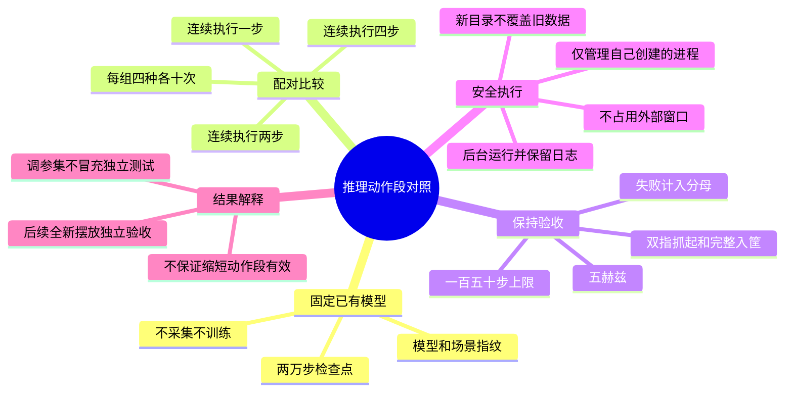

# 药品推理动作段对照实施计划

目标：按用户确认，先比较现有π0.5模型连续执行1、2、4步的效果，不更改模型、训练数据、相机或验收阈值。

## 固定实验

- 检查点：`/home/pc/ZXJ/SY/data/medication_sorting/checkpoints/pi05_g1_medication_sorting_lora/g1_four_medication_160_20261014_20k/19999`。
- 训练划分：`/home/pc/ZXJ/SY/data/medication_sorting/multi_object/randomized160-20261014/production/split/split_manifest.json`。
- 复用原40次测试种子，每种10次；三个动作段都重新运行，不能将历史4步结果直接拼入本轮。原测试由此用作诊断调参集。
- 三组均为5Hz、最多150步、模型预测长度10；初始化保持直立、每轴±2厘米、偏航±15度，药瓶70%尺寸。
- 每组重新启动策略服务，使策略随机数生成器具有相同默认起点；不同动作段后续调用次数不同，不声称所有采样噪声完全相同。
- 每种物品重新加载同一场景。顺序执行，不并发控制机器人，不调用专家生成动作。
- 成功仍要求双指接触并真实抬升超过6厘米，释放后完整落入正确筐，速度低于0.02米/秒，连续稳定20个5Hz动作步。
- 本轮共120次诊断回合；只报告本轮每种及总体成功数、抓起数、失败分段和动作段配置，不自动启动重训或补采。最高成功数相同时优先较大动作段以减少推理调用，不能声称显著提升。独立新摆放验收另行开展。

## 实施步骤

- [x] 新增`/home/pc/ZXJ/SY/tools/medication_sorting/tests/test_chunk_comparison.py`。先验证计划相同种子、固定模型和频率、不覆盖输出、缺回合不得完成、失败保留、外部端口不接管、只启动评估命令。
- [x] 运行`PYTEST_DISABLE_PLUGIN_AUTOLOAD=1 /home/pc/ZXJ/SY/.venv/bin/python -m pytest -q /home/pc/ZXJ/SY/tools/medication_sorting/tests/test_chunk_comparison.py`，确认新功能缺失导致12项失败；实现后通过。另补真实summary无顶层target的契约用例先失败后修正，并覆盖全12批调度与异常清理，15项专项通过。
- [x] 新增`/home/pc/ZXJ/SY/tools/medication_sorting/compare_action_chunks.py`，复用现有`Experiment`的自有进程生命周期，以及`evaluate_policy`的逐回合严格验收，不改两者源码。输出`configuration.json`、`status.json`、独立日志、各组summary及`comparison.json`。
- [x] 再运行专项与完整回归：`PYTEST_DISABLE_PLUGIN_AUTOLOAD=1 /home/pc/ZXJ/SY/.venv/bin/python -m pytest -q /home/pc/ZXJ/SY/tests /home/pc/ZXJ/SY/tools/medication_sorting/tests`。审查修正后19项专项、完整535项通过；四种各10条已有真实推理报告的模型/场景指纹与验收契约兼容验证通过，未把旧结果计入本轮。CPU依赖层真实读写与动作变换验证通过；保留既有非官方Torch版本，不更换环境。
- [x] 只读审查并修正三处边界：完整成功必须同时满足退出码、真实入筐和已验证抓起；每批结束及最终汇总前复查配置；补充随机摆放实现指纹。4项新增回归用例先失败再通过。异常只清理本任务进程，不把退出和清理阶段标记为成功。
- [x] 2026-10-16 11:46:35在新目录`/home/pc/ZXJ/SY/data/medication_sorting/policy_evaluations/chunk-comparison-20261016-v2`运行；已有目录则拒绝覆盖。以用户级`sy-medication-chunk-compare.service`管理，`Restart=no`、`KillMode=control-group`，不重启旧采集或训练入口。
- [x] 实际WebSocket元数据核验通过，检查点19999的提交时间、参数与归一化统计量指纹一致。11:47确认服务运行、场景加载，1步组首种药瓶seed 4000000000已有11个连续RGB时刻；逐回合报告与完整轨迹将在回合结束落盘，尚未产生正式成功率。不操作其他项目GPU进程。
- [ ] 完成全部120次诊断回合，复核`comparison.json`，选出后续全新seed独立验收的候选配置。

## 预启动记录

2026-10-16 11:41进行了预启动，真实策略元数据与两万步检查点一致，首回合生成了连续RGB。随后为修正审查发现的边界遗漏，停止了本任务服务；原目录`/home/pc/ZXJ/SY/data/medication_sorting/policy_evaluations/chunk-comparison-20261016`保留，不覆盖、不计入正式对照分母。正式实验改用上述`-v2`目录。

本项目根目录不是Git仓库，不创建仓库或worktree、不修改上游OpenPI和OrcaPlayground文件。不操作其他项目GPU进程和`ZXJ_VIP`环境。
