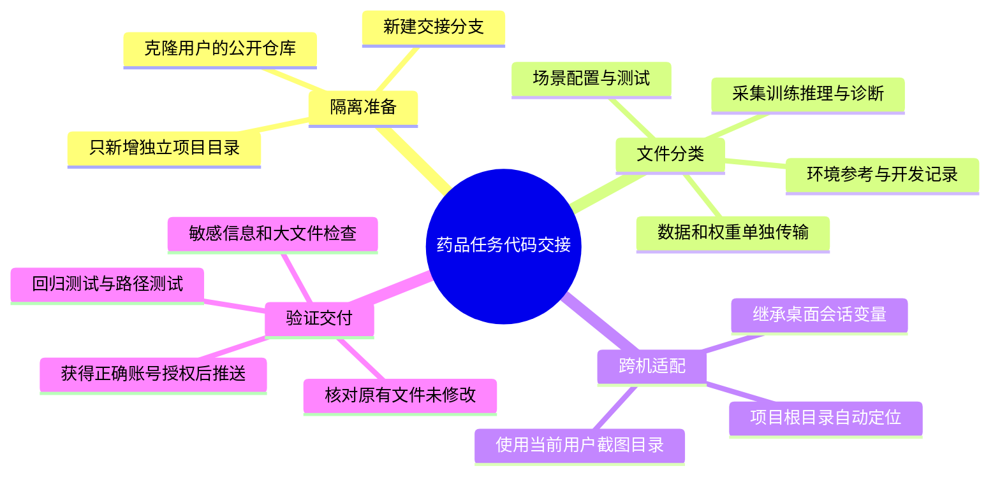

# 药品任务GitHub交接实施计划

用户已确认：只在 `JasonZhw/OrcaPlayground` 新增 `projects/medication_sorting/`，使用 `handoff/medication-sorting` 分支，不改 `main` 和原有示例。日期：2026-10-17。

## 交付边界

- 原始 `/home/pc/ZXJ/SY/tools/`、场景、模型、数据和环境不修改。
- 在 `runtime/exports/OrcaPlayground-handoff-20261017` 的独立克隆中工作。
- 使用 `projects/medication_sorting/` 作为独立项目根目录，保留现有 `tools.medication_sorting` 导入方式和数据路径契约，不迁移为新的Euler示例。
- 上传自主代码、场景引用、文档、环境参考和测试；不包含第三方源码、虚拟环境、实际资产、RGB数据、模型权重、tokenizer或凭据。
- 仅修复副本的本机路径与启动默认值，不改变专家动作、训练参数、验收阈值或历史结果。

## 实施步骤

- [x] 克隆仓库，记录main基准commit，建立交接分支并读取仓库约定。
- [x] 按白名单复制任务代码、相关测试、场景、依赖参考、计划和报告，排除缓存与无关26.7.1课程启动器。
- [x] 新增路径迁移测试，先验证固定HOME、项目根目录和桌面变量问题确实失败。
- [x] 在副本修复截图路径、环境根目录和桌面继承；补充入口README、文件清单和忽略规则。
- [x] 从独立项目根目录运行回归；检查新增文件内的秘密、大文件、软链接与不应发布的资产。
- [x] 核对所有改动都在独立目录下，提交本地分支，提供可下载代码包。
- [x] 确认登录账号获得目标仓库写权限后推送；未创建其他仓库，未覆盖已有分支。

## 发布状态

2026-10-17已通过获授权的协作者账号 `KangKang0615` 推送至 `JasonZhw/OrcaPlayground` 的 `handoff/medication-sorting` 分支，仅新增 `projects/medication_sorting/`。远端 `main` 仍为原基准 `c931a40447c64c11f0a69bbbab5e2649efbf5c57`，未合并交接分支。模型和数据未上传。

## 验证命令

在独立项目根目录运行：

```bash
PYTEST_DISABLE_PLUGIN_AUTOLOAD=1 /home/pc/ZXJ/SY/.venv/bin/python -m pytest -q tests tools/medication_sorting/tests
```

在独立仓库根目录核对：

```bash
git diff --cached --check
git diff --cached --name-status
git status --short
```

所有发布文件必须在 `projects/medication_sorting/`；不允许发布本地绝对路径软链接。物理仿真、GPU训练及朋友电脑的端到端运行不由离线测试替代。

## 当前交接事实

已有160条单物品合格示范和20,000步模型，未完成连续四药品任务。最新专家新初态复核为0/10；没有据此采集新连续RGB数据或重新训练。模型和数据另行交接，GitHub代码包本身不是完整的离线运行环境。
