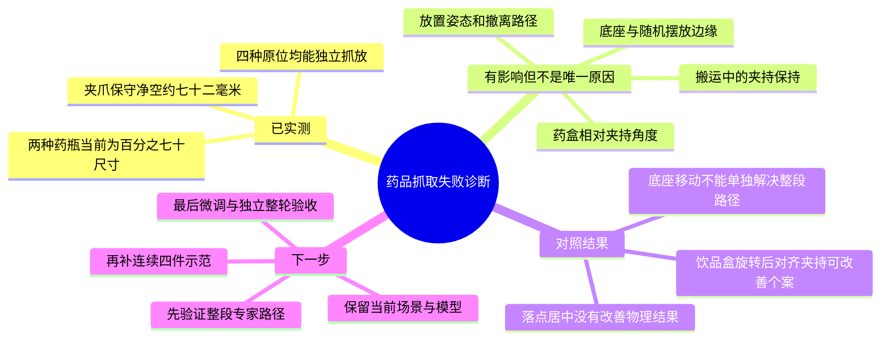

# 药品抓取：夹爪、底座与物品尺寸诊断报告

日期：2026年10月16日。状态：本轮尺寸核查、离线IK筛查及18次独立专家物理诊断已完成；未开始新训练，未修改原场景、旧数据和已有模型。

## 一、结论

**用户提出的物理配置因素确实值得排查，实测也发现操作余量有限；但证据不支持把当前失败统一归结为“机器人手太小”“底座摆错”或“药品太大”。**

1. 当前70%药瓶和两个原尺寸药盒，在原底座、原位各完成了一次真实抓放及连续4秒稳定入筐。当前配置不是四种物品完全无法操作。
2. 饮品盒有明显的方向敏感性。同样旋转15°，固定夹持方向的个案失败；只改为随盒子方向对齐后，个案通过。固定方向那次实际上也抓起来过，不能简化为“宽度超过开口就绝对抓不住”。
3. 底座影响可达余量，但只移动底座没有解决困难摆放。向世界Y负方向移动1.5厘米后，离散IK筛查改善，两个困难个案仍在实际抬升路径失败。
4. 放置不能只看平面尺寸。静态看似更居中的落点，在真实试抓中反而失败；物体倾斜、夹持偏移和撤离轨迹也必须一起检查。
5. 旧VLA结果还显示抓起后保持失败和错误搬运方向。这不是仅靠缩小物品可以解决的问题。

**本轮不是π0.5成功率测试。18次是不同条件的专家诊断，不计算混合成功率，也不算“四件连续分类成功”。此前16/40仍是单物品结果。**

## 二、测量对象与方法

当前任务：固定基座G1右臂，药瓶入蓝筐、药盒入紫筐。两个药瓶保留已有70%缩放，不再缩小。

- 基础场景：`data/medication_sorting/scenes/drag_classfication_bottles70.json`。
- 离线模型：`/home/pc/.orcagym/tmp/1C64360E_305E_4BCE_A579_DDCFBBC4A78B.xml`；来源与SHA256已写入JSON报告。
- 尺寸采用实际碰撞几何，不采用截图估计，不把纯视觉网格或资源名当作实际尺寸。
- 夹爪通过已有四连杆标定计算张开姿态，同时测量指尖碰撞网格的投影间隙和最近距离。
- 实际试抓使用现有`FixedBaseRobot`和`run_expert`，5Hz，真实接触、执行器与MuJoCo物理步进，无吸附、焊接或执行中瞬移。
- 每个个案独立重置，未记录训练RGB，也未交给VLA控制。物体初态重置只发生在个案开始。
- 抓起要求双指接触、抬升超过6厘米连续至少3步；结束后保持最后执行命令20步，检查完整碰撞边界在正确筐内、无夹爪接触、速度低于0.02米/秒。专家执行异常也保留为失败。

## 三、夹爪与药品尺寸

### 3.1 全开夹爪

| 测量项 | 结果 |
| --- | --- |
| 全开指尖沿关闭轴的保守净空 | 71.68毫米 |
| 两侧指尖碰撞网格最近距离 | 72.02毫米 |
| 半闭合目标的保守净空 | 23.26毫米 |

这里的“保守净空”是整个指尖沿关闭轴投影得到的安全间隙，不等于所有局部高度都只有这个宽度。物品超过该间隙也可能夹住局部、边缘或瓶盖；不能据此证明所有抓法都不可能。无载全闭目标会出现网格目标重叠，实际夹物时由接触约束挡住，不能把运动学目标当成实际穿透。

资源名称中的“2f85”不能代替当前导出模型的测量结果。

### 3.2 当前碰撞尺寸

| 物品 | 碰撞尺寸，毫米 | 质量，千克 | 正向宽度相对全开净空的余量 |
| --- | --- | --- | --- |
| 钙片瓶 | 直径63.0，高111.2 | 0.343 | 合计8.68毫米，理想居中时每侧约4.34毫米 |
| 褪黑素瓶 | 直径56.0，高107.8 | 0.256 | 合计15.68毫米 |
| 饮品盒 | 宽49.0，长190.0，高98.0 | 0.912 | 合计22.68毫米 |
| 咽炎片盒 | 宽31.0，长166.4，高110.0 | 0.567 | 合计40.68毫米 |

上述余量不是可保证的视觉定位误差容限：手指形状、物体倾斜、下探深度和动态接触都会改变可用空间。

现有70%瓶径对应原尺寸约90/80毫米。原尺寸圆柱主体比当前全开净空宽，确实更难从两侧完整包住；本轮没有重新测试原尺寸，也没有把尺寸和质量变化单独分离，不能声称“缩放已被证明是唯一有效原因”。

饮品盒质量约0.91千克也值得复核是否符合实际任务。当前没有做法向接触力和滑移极限测量，不能仅凭质量认定夹爪力不足；不能把驱动关节的力矩限位直接当成指尖夹持力。

### 3.3 药盒与夹爪方向不一致时

| 相对偏航角 | 饮品盒在关闭轴上的投影宽度 | 咽炎片盒在关闭轴上的投影宽度 |
| --- | --- | --- |
| 0° | 49.0毫米 | 31.0毫米 |
| 5° | 65.4毫米 | 45.4毫米 |
| 10° | 81.2毫米 | 59.4毫米 |
| 15° | 96.5毫米 | 73.0毫米 |

因此药盒“本身不宽”不意味着旋转后仍容易正向包夹。关键是**物体与实际夹爪的相对角度**，不是只看物体相对桌面的角度。

## 四、底座位置与可达性

原基座在导出模型中的pelvis位置约为`[0.633313, -3.332959, 4.790000]`米。

每个配置筛查36个位姿：4种物品各5个名义抓放航点，加各4个正负2厘米的抓取角点。采用相同8毫米位置、0.09弧度姿态容差，每个航点最多6个数值求解起点。

| 基座对照 | 求得满足容差的位姿 |
| --- | --- |
| 当前原底座 | 34/36 |
| 世界X正方向5厘米 | 28/36 |
| 世界X负方向5厘米 | 33/36 |
| 世界Y正方向5厘米 | 19/36 |
| 世界Y负方向5厘米 | 35/36 |
| 世界Z正方向5厘米 | 30/36 |
| 世界Z负方向5厘米 | 33/36 |
| 世界Y负方向1.5厘米 | 36/36 |
| 世界Y负方向2.5厘米 | 36/36 |

原底座未求解成功的两个抓取角点：褪黑素瓶偏移`[+2,-2]`厘米，饮品盒偏移`[-2,-2]`厘米。**数值IK未求解不等于数学证明不可达；端点可解也不意味着路径可走。**

进一步生成了仅移动G1顶层Actor的独立场景，验证实际pelvis为`[0.633313,-3.347959,4.790000]`米，物品、篮筐、尺寸与控制参数保持不变。

真实执行结果：两个角点在原底座均于下降阶段出现IK失败；移动1.5厘米后均能完成下降和闭合，但在抬升阶段出现IK失败。四种原位物品在两种底座下均分别通过一次。

**结论：小幅移动可以改善局部抓取姿态，但本次没有改善这两个完整抓放结果；不把该基座变体部署为正式优化配置。下一步必须检查整段路径和IK支路，而不是只筛查终点。**

## 五、18次物理个案对照

以下均为诊断样本，每一行每个条件仅运行一次，不用于估算稳定成功率。

| 条件 | 结果 | 观察 |
| --- | --- | --- |
| 原底座，四种物品分别在原位 | 4个全部通过 | 每件独立重置，不是连续四件 |
| 原底座，饮品盒旋转15°，固定夹持方向 | 失败 | 曾通过双指抬升，但搬运中出现IK失败，位置误差约71.5毫米 |
| 同一初态，只改为随盒子方向对齐夹持 | 通过 | 不改尺寸、质量、摩擦、底座或验收规则 |
| 原底座，饮品盒使用现有连续任务候选落点 | 通过 | 请求偏移`[18,0]`毫米，叠加现有偏置后为`[18,25]`毫米 |
| 同一初态，只取消Y方向25毫米偏置 | 失败 | 放下后倾斜，撤离IK失败，最终不完整入筐 |
| 原底座，两个困难角点 | 2个均失败 | 均在下降阶段失败 |
| 基座Y负移15毫米，四种物品原位 | 4个全部通过 | 未证明随机姿态和连续任务通过 |
| 同一基座变体，现有饮品盒落点 | 通过 | 保留原Y偏置 |
| 同一基座变体，只取消Y偏置 | 失败 | 搬运阶段IK失败 |
| 同一基座变体，两个困难角点 | 2个均失败 | 失败移到抬升阶段 |

对齐夹持方向的个案没有证明夹持过程已完全稳定：成功样本抬起后饮品盒仍倾斜约30°，最终释放后才落正。固定方向的失败个案在搬运中真实物体中心与手部位置发生偏离，专家的中心反馈推导出远处目标，随后无法求解；所以本对照证明的是“夹持方向会影响完整轨迹”，不是简单的尺寸硬阈值。

## 六、为什么不能只把落点改到筐中心

蓝筐底板有效平面约123.9×196.0毫米；紫筐约148.7×235.2毫米。

在直立、方向不变的理想条件下，饮品盒采用`[18,25]`毫米落点时，其长边会超出紫筐底板约2.4毫米。这是明确的静态几何风险，但**现有25毫米偏置包含对动态夹持偏移的补偿，不能据此直接删除**。

实际试抓中，保留偏置时药盒最终落正并完整入筐；取消偏置后却留下约31.5°倾斜，最终越界。说明必须控制物品的实际姿态、篮筐碰撞及撤离过程，再重新优化落点；只优化一个中心坐标可能适得其反。

本次单物品诊断也没有验证第二个药盒入筐时是否碰到第一个。两件同时放置必须通过后续连续任务检查。

## 七、与已有VLA失败记录的关系

复核`chunk-comparison-20261016-v2/chunk_4`的40份报告：16次完整入筐，13次未通过稳定抓起验证，11次抓起后失败。

- 饮品盒初始`|yaw|≤5°`的5次均成功，超过5°的5次均失败；其中2次仍抓起来过。这是旧调参样本内关联，平移与策略随机采样存在混杂，不是已验证的角度阈值。
- 钙片瓶10/10均通过抓起验证，仅5/10完成入筐。它的主要剩余问题不能归为“开口不够，完全抓不住”。
- 11次抓起后失败中，8次在闭合命令不低于0.95时出现完全脱离；支持继续检查滑移、接触保持和轨迹，而非一律归为模型提前开爪。命令闭合不等于已经测得足够夹持力。
- 7个抓起后失败的瓶，其最终碰撞包围盒高度接近瓶径，强烈支持最终横倒；但末态横倒不能证明初始失败原因。
- 一个褪黑素瓶失败样本被搬到X约1.16米，明显偏离蓝筐，不能只用夹爪尺寸解释。
- 旧推理trace没有记录物体四元数或实际末端姿态，不能精确恢复接触时物体与夹爪的相对角。后续推理应补这类诊断记录。

## 八、下一步执行顺序

1. **维持正式基线不变。** 保留70%药瓶、原基座和现有19999模型；不直接缩小所有物品，也不把基座变体与旧模型成绩混在一起。
2. **优先验证完整专家路径。** 在原底座下复现两个困难角点，记录失败时完整qpos、物体姿态、末端姿态和接触力；区分数值IK支路、真实关节边界、物理碰撞与滑移。增加起点尝试只能作为诊断，不能把超差解当作可执行动作。
3. **针对药盒相对方向和保持问题做小规模成对试验。** 当前15°对照是支持证据，还需多个相同初态的配对重复。保持其他条件一致，不能同时改变摩擦、重量和尺寸。
4. **先解决放置姿态，再优化筐内两个落点。** 保留当前偏置作为基线，检查倾斜物体、筐壁接触与撤离轨迹；不能仅按理想直立包围盒推算后直接部署。
5. **再执行已批准的连续任务计划。** 先建立原π0.5整轮基线和连续专家试验；专家达到计划门槛后再补20轮连续示范，按整轮分组，做小规模微调与独立验收。不能把本轮18次独立专家个案当成连续训练数据或VLA成绩。

本轮没有新增训练数据，没有重训，也没有宣称四件整轮成功率提高。原训练成果和全部失败证据均保留。

## 九、证据与复现

| 证据 | 项目内位置 |
| --- | --- |
| 九种底座条件、实际碰撞尺寸与324个离散IK记录 | `data/medication_sorting/geometry_audits/20261016-hardware-v2/geometry.json` |
| 原底座首批8次物理诊断 | `data/medication_sorting/geometry_audits/20261016-physics-v1/summary.json` |
| 原底座两个困难角点 | `data/medication_sorting/geometry_audits/20261016-base-original-corners/summary.json` |
| 基座负移1.5厘米的8次物理诊断 | `data/medication_sorting/geometry_audits/20261016-base-minus1_5cm/summary.json` |
| 独立基座变体及来源 | 上述基座目录的`diagnostic_layout.json`与`variant.json` |
| 逐步物理与最终稳定性证据 | 每个个案的`report.json`、`trace.jsonl`、`strict_verification.json`、`verification_trace.jsonl` |

可复现入口，输出必须使用不存在的新目录：

```bash
cd /home/pc/ZXJ/SY
.venv/bin/python -m tools.medication_sorting.geometry_audit \
  --xml /home/pc/.orcagym/tmp/1C64360E_305E_4BCE_A579_DDCFBBC4A78B.xml \
  --output data/medication_sorting/geometry_audits/new-hardware-audit --attempts 6

.venv/bin/python -m tools.medication_sorting.geometry_probes --launch \
  --cases herb_yaw15_fixed herb_yaw15_aligned \
  --output data/medication_sorting/geometry_audits/new-yaw-pair
```

物理诊断入口会检查端口，已有OrcaLab占用时拒绝接管；只清理自身启动的窗口与进程。未操作其他GPU任务。新增诊断测试和全量回归共546项通过。
